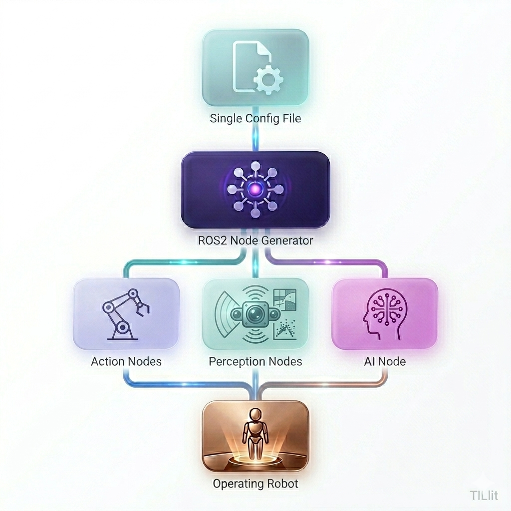

# AGENTS.md — instructions for coding agents

Joshua is a config-driven robotics framework: one protobuf config (e.g.
`config/config_preset/so100/teleoperate.pbtxt`) drives a ROS 2 stack built with
Bazel. This file is the repository entry point for AI navigation. Directory
`AGENTS.md` files combine purpose, architecture, rules, usage, and verification.
The [documentation index](docs/AGENTS.md) links cross-cutting guides. Launch
agents from the repository root so this file is picked up.

## Start each session with Joshua MCP

Check whether Joshua MCP is connected and call `list_supported_components`
before MCP-dependent configuration work. If unavailable, explain the missing
connection and prompt the user to run `./scripts/joshua_mcp.sh setup` from the
repository root, or reconnect their AI IDE if already configured. Independent
source and documentation work can continue while setup is pending.

Use the [guided integration skill](docs/skills/joshua-guided-integration/SKILL.md)
for existing-hardware configuration or component development. Read the
[setup guide](docs/MCP_SETUP.md) when diagnosing a connection. Setup verifies
inspection; it does not launch robot hardware or bypass client approvals.

## Hardware safety — read this first

Joshua drives physical robots. `bazel run //launcher:joshua_main -- --config
<preset>` can open real serial buses and move real motors.

**The filename does not tell you whether a preset is safe.** The launcher
branches on `general.operation_mode`, not the name — and a `MODE_SIMULATION`
preset may still declare real devices (`so100/sim_mirror.pbtxt` opens
`/dev/ttyACM1`), and a preset naming no `/dev` path at all may still drive real
hardware over the network (EtherCAT `interface_name` selects a real NIC). The
[robot layer](robot/AGENTS.md#architecture-contract) has no production mock
backend. A hardware-free run must be a pure MuJoCo/Isaac simulation with no
configured real-device endpoints.

- **Read the preset before running it.** Check `operation_mode` and every device
  path (`/dev/tty*`, `interface_name`, camera indices).
- **Do not run a preset that declares real hardware, and do not flash firmware,
  unless the user asks in the current turn and confirms the hardware is set
  up.** A past instruction to "verify the change" is not that confirmation.
- Prefer `bazel test //...` and config validation for verification — they touch
  no hardware.
- Firmware is never flashed automatically. Flashing is a deliberate,
  human-initiated operation — see [firmware/AGENTS.md](firmware/AGENTS.md).

## Development environment

Development is **Docker-first**. Native Ubuntu development is not a supported
entrypoint; ROS 2, Bazel, Python, and CUDA all live inside the images.

The host bootstrap installs Docker and NVIDIA container support and configures
PTP clock read access:

```bash
sudo ./scripts/setup.sh          # add --cpu on hosts without an NVIDIA GPU
```

Then open a dev shell:

```bash
docker compose build joshua-u22       # Ubuntu 22.04 / ROS 2 Humble
docker compose run --rm joshua-u22    # interactive shell
```

Ubuntu 24.04 / ROS 2 Jazzy is equally supported — CI tests both stacks on every
PR. Use `docker compose run --rm joshua-u24`; `run` enables the service's `u24`
profile for you, so `--profile u24` is only needed for a persistent
`docker compose up`. Development is supported on **Ubuntu Linux** only; macOS
is not. ARM64 and Isaac Sim variants are documented in
[docs/GETTING_STARTED.md](docs/GETTING_STARTED.md).

## Test

What CI runs on every PR is the Compose **task service**, not a bare `bazel`
invocation — it pins the Bazel configs and Python version. Reproduce CI exactly
from the host with:

```bash
docker compose run --rm test-u22   # or test-u24 for the Jazzy stack
```

Inside a dev shell, `bazel` works directly for iteration:

```bash
bazel test //ros2/utils:packet_parser_test   # the package you touched
```

Be aware that a bare `bazel test //...` omits the `--config=u22`
(or `--config=u24`), `--config=x86-base`, and `python_version` flags the task
service injects, so its results are not CI-representative — confirm with
`test-u22`/`test-u24` before claiming CI will pass.

CI tests and normal package builds do not require GPU hardware.

## Lint

Before pushing:

```bash
./hooks/lint_check.sh --fix   # auto-fix files changed since diverging from develop
```

Covers `clang-format` (C/C++/proto) and `black`/`isort`/`flake8` (Python). The
script needs `pre-commit` on the machine you run it from
(`python3 -m pip install --user pre-commit`); nothing installs a git pre-push
hook for you, so run it yourself before pushing.

`BUILD`/`BUILD.bazel` files are **not** covered by that script — run
`buildifier` on them yourself when you edit them.

## Conventions

- PRs target **`develop`** unless another target is explicitly specified.
- Branch naming: `<github-username>/<topic>` (e.g. `djkim/initialize-web-app`) —
  branches are named for the **operator**, not the agent, so ownership and
  review routing stay with a person.
- Agent-assisted commits carry a `Co-Authored-By:` trailer naming the model.
- The protobuf config is the single source of truth for a robot setup; don't
  duplicate configuration into code.

## Coding guidelines

All contributors, including AI agents, own the behavior and architecture they submit.
Read applicable directory instructions and trace implementations, factories, callers,
and tests before adding code. Define each rule once at its owning scope.

### Design principles

1. **Give each responsibility a clear owner.** Make resource ownership, state,
   initialization, recovery, and shutdown easy to locate. Keep one source of
   truth for each fact and one owner for each lifecycle. Tools and consumers
   should use the owning component's contract rather than duplicate its logic
   or independently manage its resources.

2. **Use the fewest layers needed.** Extend the responsible component first;
   share focused functions or internal helpers where useful. A new wrapper,
   manager, framework, or service must solve a concrete problem and make the
   overall design easier to understand. Forwarding calls or accommodating one
   tool alone does not justify another layer. Preserve boundaries that clarify
   ownership instead of combining unrelated responsibilities into one component.

3. **Keep core behavior easy to trace.** A reader should be able to follow
   configuration → owning component → execution and data flow. Keep
   sensor-specific behavior in its driver or ROS 2 node, and factories focused
   on selecting and constructing configured implementations. Share acquisition,
   health, or metadata helpers within those boundaries; do not replace meaningful
   sensor nodes with a generic node merely to reuse code. Keep dependencies and
   failure paths explicit.

4. **Build on ROS 2 for tools and data pipelines.** Joshua extends ROS 2. Reuse
   its topics, services, actions, QoS, introspection, diagnostics, logging, and
   rosbag2 recording where they meet the requirement. External tools should
   adapt established interfaces through thin adapters. Avoid parallel message
   buses, monitoring systems, lifecycle owners, and recording pipelines. When a
   custom path is necessary, explain the specific gap in existing capabilities
   and keep the addition limited to that gap.

5. **Scale through cohesive components and stable interfaces.** Build for
   demonstrated requirements and extend existing contracts where appropriate.
   Keep unrelated sensor, transport, and tool behavior independently changeable.
   Avoid speculative extension frameworks and scattered special cases.
   Protobuf configuration remains the source of truth for robot setup. Prefer
   changes that a future contributor can explain, debug, test, and remove
   without tracing unrelated subsystems.

### Implementation and review

Trace the affected subsystem's existing ownership and interfaces. When adding
or changing a component, layer, or pipeline, explain in the implementation or PR
summary:

- Which component owns the resources, state, and lifecycle?
- Why is this addition needed, and can an existing component or ROS 2 capability
  meet the requirement?
- How does the change preserve a direct, understandable execution and data path?
- How was the behavior verified, and what limitations remain?

Working code and passing tests are necessary; architectural clarity is also a
review requirement. Contributors must be able to explain the code they submit,
including code produced with AI.

### Compatibility and evidence

Preserve multiple configured devices, actuators, sensors, and topics. A refactor
must preserve public APIs, protobuf meaning, topic names/payloads, units, clock
domains, defaults, initialization, and shutdown. An intentional behavior change
must identify the baseline, migration, affected callers/presets, and tests.
Preserve protobuf field and enum identities; reserve removed names and numbers.

Use focused unit and contract tests for changed behavior, then integration tests
for actual node/topic/service interactions. Prefer controlled clocks, fake
transports, and PTYs over physical devices for repeatable failures. Exercise
failure handling, not only successful initialization. Report exact commands,
results, environment overrides, and uncovered behavior. Passing simulation or
protocol tests does not establish physical readiness, stopping, or timing.
Canonical test services and lint commands live in the root instructions and
[test instructions](AGENTS.md#test).

### Comments

Production code is **comment-free by default**. Do not add explanatory inline or
block comments, narrative docstrings, section banners, commented-out code, or
inline TODO/FIXME notes. Express intent through clear names, types, constants,
direct control flow, validation, and behavioral tests. Do not introduce extra
layers or abstractions merely to avoid a comment.

Put architecture, ownership, and operating guidance in the owning `AGENTS.md`;
put normative protocol details in the linked contract. Keep plans, workarounds,
and follow-up work in issues/PRs rather than source-code narratives.

The only exceptions are required license/generated notices, functional tool
directives, and essential API/schema, wire, safety, timing, unit, or concurrency
constraints that cannot be expressed adequately in code. Keep each exception
short, factual, and local to the constraint. Schema units, ranges, and omitted-
value semantics qualify; restating the implementation does not. PR authors must
justify added comments against these exceptions.

Apply this rule to new code. Migrate existing comments in focused cleanup PRs;
do not mix a repository-wide comment sweep into unrelated work. This rule is a
review requirement; automated comment-policy enforcement is not implemented.

### Make recurring corrections enforceable

When review finds a recurring failure, first improve the owning API or code
structure, then add a compiler/type/lint restriction or a behavioral regression
test where practical. Prose communicates intent; human review resolves design
judgments that those checks cannot decide. Every new checker needs a known-good
case and a deliberately invalid case that demonstrates rejection.

Current CI checks agent instruction links, skill metadata, CODEOWNERS coverage,
Docker entrypoint contracts, and Bazel tests in Humble and Jazzy. The existing
transport boundary target checks public compilation contexts for leaked concrete
transport headers. These checks do not establish compliance with every rule:
repository-wide static lint, a complete dependency guard with negative fixtures,
changed-comment checks, isolated test-service device mounts, and a representative
full-graph E2E smoke test are not all enforced today. PR authors must identify
relevant gaps instead of reporting an unimplemented check as passed. CODEOWNERS
coverage does not itself require owner approval or configure branch protection.

## Contribution workflow

[CONTRIBUTING.md](CONTRIBUTING.md) provides GitHub's discovery link to this
workflow; contribution and coding rules remain authoritative here.

1. Branch from `develop` unless another target is explicitly specified, using
   `<github-username>/<topic>`; keep ownership with the operator. Merge or rebase
   the current target branch when needed.
2. Keep changes focused, explain resource/state/lifecycle ownership, and reuse
   existing subsystem contracts. Update affected presets, callers, and guides
   for intentional compatibility changes.
3. Use clear imperative commit messages. Reference fixed issues in the PR body
   and include the model co-author trailer for agent-assisted commits.
4. Run relevant tests, the required lint command, and Buildifier for edited
   Bazel files. Report exact commands/results, environment overrides, coverage
   gaps, and hardware-run status in the [PR template](.github/pull_request_template.md).
5. Open the PR against `develop` unless another target is explicitly specified,
   and obtain at least one maintainer approval.
   Address feedback with new commits on the same branch. CI results and review
   must cover architecture, compatibility, behavior, and verification limits.

### Pull requests and review

[CODEOWNERS](.github/CODEOWNERS) is the source of truth for review routing;
do not copy its owner lists into another guide. Its last matching rule replaces
parent ownership and any listed owner can satisfy an owner-review requirement.
The coverage check proves directories have owners; required approvals/statuses
still depend on the repository's branch-protection configuration.

Report bugs with reproduction steps, environment details, and logs through
[GitHub issues](https://github.com/Joshua-AI-Robotics/Joshua/issues). Feature requests
should name the concrete problem and affected setup. Report vulnerabilities through
[SECURITY.md](SECURITY.md). Contributions use the repository's Apache 2.0 license
and follow the [Code of Conduct](CODE_OF_CONDUCT.md).

### Releases and versioning

[VERSION](VERSION) owns the release version. Keep [MODULE.bazel](MODULE.bazel)
and [ui/package.json](ui/package.json) in sync. Releases use `vX.Y.Z` tags on
`develop`; pre-1.0 minor releases can contain documented breaking changes.
Packet/schema changes require affected validation, conversion, preset, and
compatibility checks. Process-routing changes belong with NodeManager; the
removed node generator is not an extension point.

## Implementation direction

Before planning, changing, or reviewing code, open the shared
[coding guidelines](#coding-guidelines) and applicable
`AGENTS.md` files from the root down. Each directory file owns its local rules
and architecture contract. Re-read instructions for a new task or changed rules.
Use the [architecture map](docs/ARCHITECTURE.md#directory-contracts) to locate
ownership and allowed dependencies. Bridges contain routing only.

## Read before you edit

Links are not loaded automatically — actually open these files when the work
touches their area:

- **Any subsystem**: follow the directory navigation below and open each
  applicable `AGENTS.md` from the root down. Each file includes its local
  architecture, implementation rules, usage, and verification requirements.
- **Shared firmware/JoshuaWire**: read [firmware/common/AGENTS.md](firmware/common/AGENTS.md).
- **Build/packaging or release artifacts**: read
  [scripts/AGENTS.md](scripts/AGENTS.md) and the [test instructions](#test).
- **Cross-cutting or architectural changes**: read
  [docs/ARCHITECTURE.md](docs/ARCHITECTURE.md).
- **Environment/setup variants** (ARM64, Isaac Sim, hardware runs): read
  [docs/GETTING_STARTED.md](docs/GETTING_STARTED.md).
- **Recurring tasks with a repo skill**: some tasks have a `joshua-*` skill that
  encodes the steps — see [docs/skills/](docs/skills/AGENTS.md).
- **Hardware compatibility or model discovery**: read the
  [hardware catalog](docs/hardware_catalog/AGENTS.md) and its contribution contract,
  [implemented components](docs/SUPPORTED_COMPONENTS.md) and
  [supported hardware](docs/SUPPORTED_HARDWARE.md). MCP's
  `list_supported_components` describes software implementations;
  `list_supported_hardware` returns curated model information;
  `list_hardware_test_records` returns separate [historical runs](docs/TESTED_HARDWARE.md)
  linked by hardware ID. `query_hardware_catalog` exposes the full versioned
  catalog, including boards, setups, specifications and execution/review provenance.
  None establishes current hardware readiness.

## JOSHUA (**J**oint **O**pen-**S**ource **H**ub for **U**niversal **A**utomation)

**A modular framework for robotic AI systems**

**Version:** see [`VERSION`](VERSION)

Joshua turns a single protobuf config into a running robot stack on ROS 2: hardware (actions and perceptions), AI policy, and operation mode. The launcher builds and runs the right nodes; the React control panel lets you configure, launch, and monitor the system.



One config file is the source of truth—for example [`config/config_preset/so100/teleoperate.pbtxt`](config/config_preset/so100/teleoperate.pbtxt) defines the full SO100 teleop setup. See [Architecture](docs/ARCHITECTURE.md) for how config, protobuf packets, and ROS 2 fit together.

## Start with Joshua MCP

From the repository root, run `./scripts/joshua_mcp.sh setup` to prepare the
local MCP server and connect your AI IDE. This inspection workflow runs on CPU;
ROS, Bazel and project libraries stay inside Docker. Setup checks your host,
guides any missing prerequisites and verifies the first inspection.

AI assistants should check the Joshua MCP connection when starting a session.
If it is unavailable, explain what is missing and prompt the user to run setup
or reconnect their AI IDE. Once connected, use the
[guided integration workflow](docs/skills/joshua-guided-integration/SKILL.md)
to configure existing hardware or add a component. See the
[setup guide](docs/MCP_SETUP.md) for requirements and recovery.

## Quick start

Joshua is Docker-first. Install Docker host tooling, open either supported ROS environment, then run the launcher through Docker:

```bash
sudo ./scripts/setup.sh
docker compose run --rm joshua-u22      # Ubuntu 22.04 / ROS 2 Humble
docker compose run --rm joshua-u24      # Ubuntu 24.04 / ROS 2 Jazzy
CONFIG=config/config_preset/so100/random_noise.pbtxt docker compose run --rm run-u22
```

Install options (CPU fallback, ARM64, ROS Jazzy), SO100 teleop, simulation presets, and the web UI: [docs/GETTING_STARTED.md](docs/GETTING_STARTED.md). Native Ubuntu development is not a supported entrypoint. The default developer workflow also requires a host NVIDIA driver and NVIDIA Container Toolkit; CPU-only development is explicitly supported. The Makefile provides optional shorthand for the Compose commands.

## GPU-first development

Developer shells and launcher services request an NVIDIA GPU by default. Install the host runtime and verify that Docker can see the GPU:

```bash
sudo ./scripts/setup.sh
docker compose run --rm joshua-u22 nvidia-smi
```

Run an AI preset:

```bash
CONFIG=config/config_preset/so100/random_noise.pbtxt \
  docker compose run --rm run-u22
```

On a CPU-only host, skip NVIDIA setup and use the CPU override:

```bash
sudo ./scripts/setup.sh --cpu
docker compose -f docker-compose.yml -f docker-compose.cpu.yml \
  run --rm joshua-u22
```

Tests, package builds, UI services, and CI do not request a GPU. The host provides the NVIDIA driver and NVIDIA Container Toolkit for the default developer workflow. CUDA-enabled PyTorch and related user-space libraries remain inside each model environment; the host CUDA toolkit is not required.

## Build deployable binaries

Use the matching one-shot Compose service to produce a packaged, deployable build. It runs Bazel inside Docker and copies artifacts to `dist/<os>/<cpu>/`.

```bash
# Ubuntu 22.04 (Humble), x86_64
TARGET=//launcher:joshua_main_pkg docker compose run --rm build-u22-x86

# Ubuntu 24.04 (Jazzy), ARM64 (e.g. Jetson; uses emulation on x86 hosts)
TARGET=//launcher:joshua_main_pkg docker compose run --rm build-u24-arm64
```

Build services follow `build-<os>-<cpu>` and support `u22` or `u24` with `x86` or `arm64`. `TARGET` defaults to `//launcher:joshua_main_pkg`.

Output: `dist/u22/x86/joshua_main_pkg-<version>-u22-x86.tar.gz` (version from [`VERSION`](VERSION); paths vary by flags). The archive includes a `VERSION` file and `joshua_main --version` reports the same value. Extract and run on a target machine with the matching Ubuntu/ROS stack. Full details: [scripts/AGENTS.md](scripts/AGENTS.md).

## Documentation

| Topic | Guide |
|-------|--------|
| Getting started | [docs/GETTING_STARTED.md](docs/GETTING_STARTED.md) |
| Architecture | [docs/ARCHITECTURE.md](docs/ARCHITECTURE.md) |
| Implemented components | [docs/SUPPORTED_COMPONENTS.md](docs/SUPPORTED_COMPONENTS.md) |
| Supported hardware models, drivers, and presets | [docs/SUPPORTED_HARDWARE.md](docs/SUPPORTED_HARDWARE.md) |
| Hardware test records and measured limitations | [docs/TESTED_HARDWARE.md](docs/TESTED_HARDWARE.md) |
| All docs index | [docs/AGENTS.md](docs/AGENTS.md) |
| Scripts and builds | [scripts/AGENTS.md](scripts/AGENTS.md) |
| Simulation (MuJoCo, Isaac Sim) | [simulation/AGENTS.md](simulation/AGENTS.md) |
| Web UI | [ui/README.md](ui/README.md) |
| AI coding agents | [AGENTS.md](AGENTS.md) |
| Security | [SECURITY.md](SECURITY.md) |

## License

Joshua is licensed under the [Apache License, Version 2.0](LICENSE). See
[NOTICE](NOTICE) for attribution and [THIRD_PARTY_NOTICES.md](THIRD_PARTY_NOTICES.md)
for dependencies.

## Directory navigation

- [ai/](ai/AGENTS.md)
- [config/](config/AGENTS.md)
- [docs/](docs/AGENTS.md)
- [firmware/](firmware/AGENTS.md)
- [launcher/](launcher/AGENTS.md)
- [robot/](robot/AGENTS.md)
- [ros2/](ros2/AGENTS.md)
- [scripts/](scripts/AGENTS.md)
- [simulation/](simulation/AGENTS.md)
- [third_party/soem/](third_party/soem/AGENTS.md)
- [third_party/soes/](third_party/soes/AGENTS.md)
- [tools/](tools/AGENTS.md)
- [ui/](ui/README.md)
- [utils/](utils/AGENTS.md)
