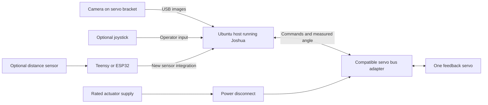
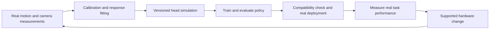

# Camera-head demo: shared setup and R2S2R training

| Field | Value |
| --- | --- |
| Status | Agreed demo direction; implementation and hardware verification gates remain open. |
| Created / last reviewed | 2026-11-01 / 2026-11-05 |
| Implementation baseline | Checkout `31efe9d`; source and documentation review only. |
| Planning horizon | 12 weeks from an agreed kickoff; conference expected in approximately three months. Exact conference and freeze dates are TBD. |
| Delivery owner / engineering capacity | TBD at checkpoint C0. |
| Scope | Shared camera-head setup and comparison protocol; R2S2R-specific learning and transfer work. |

This plan owns the camera-head task, A/B hardware, calibration, and controller
comparison protocol. Section 3 onward specifies the R2S2R learning variant.
The [Decisions API plan](OPENAI_DECISIONS_CAMERA_HEAD_DEMO.md) adds its adapter
and D gates to the same head; it can use the C0/C1 head preparation without
waiting for R2S2R model fitting, training, or transfer gates.

Both variants inherit the nervous-system plan's
[runtime contract](ROBOT_NERVOUS_SYSTEM_DEMO.md#4-shared-interfaces-and-simulator-behavior),
[measurement rules](ROBOT_NERVOUS_SYSTEM_DEMO.md#5-reliability-and-integration-evidence),
and [evidence record](ROBOT_NERVOUS_SYSTEM_DEMO.md#evidence-record).
All implementation and physical qualification gates remain open.

## 1. Audience and product promise

The first audience is robot engineers who have invested in actuators,
electronics, mechanisms, and sensors but have not reached a usable learning
workflow.

> Joshua helps your learning workflow keep up with your changing hardware.
>
> Connect supported components, measure the real device, learn in a calibrated
> simulation, and deploy back through the same interface.

Measure the work and time required to connect and change supported hardware.
Related workflows already cover recording, training, evaluation, and custom
hardware interfaces; see LeRobot's
[learning workflow](https://huggingface.co/docs/lerobot/il_robots) and
[custom hardware interface](https://huggingface.co/docs/lerobot/main/en/integrate_hardware).
Use this head's configuration/artifact diffs and timed workflow as integration
evidence. Report unsupported-device adapter work separately from using a supported
component; joint-count or task changes reopen the observation/action contract.

## 2. Release scope and demo setup

### R2S2R release outcome

- One simple, verified camera head with one rotary joint and measured feedback.
- Two qualified physical configurations, A and B, with the same joint count.
- One complete real-to-sim-to-real loop, including a policy trained in simulation
  and evaluated on real hardware.
- One pinned simulation training environment and small tracking-policy recipe.
  MuJoCo is the provisional baseline; compare it with NVIDIA Isaac Lab and select
  the simulation stack, external trainer, and algorithm at C0. The working
  direction is state-based reinforcement learning. No new learning algorithm is
  required.
- A supported hardware-change workflow that preserves recorder, trainer, and
  inference source code while changing configuration and calibration artifacts.
- A reproducible example, documented extension points, and outside-user evidence.

General-purpose model generation, raw-image policy transfer, arbitrary morphology
transfer, live hot-plugging, and a broad model catalog are deferred. Adding a
second joint is a later milestone.

STS3215 is the actuator for this demo, including both A/B camera configurations.
XL330 integration is deferred to later work and is not a demo dependency.
Distance sensing and distractor/occlusion handling remain conditional additions
after the required loop works. The primary rig connects through a compatible
servo bus adapter. Optional sensors can use a Teensy or ESP32 acquisition path.

A CLI or thin operator UI is sufficient. Reconcile this learning-first sequence
with the separate [AI integration plan](../docs/AI_INTEGRATION.md) at C0.

### Task: a curious camera head

Mount a lightweight USB camera directly on a feedback servo's horn using a
simple bracket. Fix the servo to a stable base. The head rotates horizontally to
keep a recognizable target centered as it moves left/right at camera height.
Use a simple colored target or marker for the first detector. Define the permitted
motion area, lighting, target speed, and camera height at C0.

For state-based variants, a local detector produces target bearing and validity;
controllers combine these with measured joint angle and estimated velocity.
Choose absolute targets or angular increments at C0 and preserve their meaning
through the hardware/simulation adapters. The image-based API variant is defined
below. Keep RGB frames for inspection and outcome review across all variants.

### Controller variants and comparison

This is the single comparison protocol for the head demos. Select one backend
through the shared control contract; keep the rig and application interfaces stable.

| Variant | Input and decision path | Preparation and evidence |
| --- | --- | --- |
| Conventional controller | Local detector-derived bearing/validity and measured joint state feed a fixed controller. | Reference tracking behavior and local latency; no policy training. |
| R2S2R | The same state-based observation contract feeds a simulation-trained checkpoint. | Compare nominal-simulation and calibrated/randomized-simulation policies with equal training budgets. Preserve model, training, and real-transfer provenance. |
| [Decisions API](OPENAI_DECISIONS_CAMERA_HEAD_DEMO.md) | Recent image, target description, and measured state produce a fixed choice, mapped locally to bounded pan movement. | Pin prompt/model/preprocessing and record API delay, usage/cost, accepted/rejected answers, and physical results; no task-specific training run. |

Freeze the target trajectories and speed range, lighting, angular envelope, trial
duration, tracking-error tolerance, target-loss allowance, smoothness limit, and
intervention rules before evaluation. Use identical conditions across compared
variants. If API latency requires a slower target range, use that range for every
variant in that comparison and identify it in the results.

The image-based API path performs target interpretation; the state-based paths
use a separate detector. Record this input/preprocessing difference. An additional
Decisions condition can use the same detector-derived state to compare backends
with identical observations.

Report tracking error, time centered, target loss, motion smoothness, recovery,
and the full trial denominator. Timeouts, missing detections, and human interventions
follow frozen failure rules. Evaluate outcomes independently of training reward.
Use the shared measurement rules for sample completeness and observation-to-command
versus command-to-measured-response delay. API runs additionally report request
latency percentiles/maxima, timeouts, request/token counts, and actual cost.

The R2S2R C4/C6 target is 45/50 held-out successful trials on each A/B configuration;
it remains proposed until qualified. API acceptance bounds are frozen at D0.
Neither approach is required to outperform the conventional controller. The
integration claim is supported by measured setup/change effort and artifacts.

### Physical configurations and hardware changes

| Configuration/change | Physical setup | Required workflow and evidence |
| --- | --- | --- |
| A — Baseline head | Lightweight camera A on a directly mounted bracket | Establish calibration, measured response, simulation, and real policy evaluation. |
| B — Modified head | Replace the camera/bracket with a prequalified heavier assembly using camera B | Update device settings, camera calibration, geometry/payload description, and measured actuator response. Validate or retrain in the updated simulation and evaluate on real hardware. |
| Optional controller substitution | A second verified controller/interface with the same logical actuator and feedback contract | Qualify physical I/O, timing, units, stop/recovery, and policy compatibility separately. |
| Deferred morphology change | Add tilt or change joint count | Requires a revised environment and observation/action contract; do not claim automatic policy reuse. |

At C0/C1 choose A/B parts with a measurable calibration or response difference
within the servo's qualified load and motion range. Do not assume that adding
mass will materially change a closed-loop servo's behavior. If it does not,
report that result and choose a useful supported change before freezing the
experiment. Never deliberately degrade the A policy to manufacture a contrast.

For this release, “easy hardware change” means:

**Stop → replace → configure → calibrate → validate → resume.**

A runtime restart is allowed and included in timing. No energized component
swapping, automatic discovery of arbitrary devices, or zero-calibration claim is
part of this milestone. The existing policy may pass compatibility checks and
remain useful, or the updated simulation may require a newly trained policy.
Both outcomes must be identified explicitly.

### Assembly and connections

1. Fix the servo and base securely. Attach the camera bracket directly to the
   supplied horn. Provide cable slack for the bounded pan range and strain relief.
2. Mark a repeatable bracket orientation and reference angle. Qualify position
   feedback, direction, zero, and limits against an independent angular reference.
3. Connect the camera by USB to the Ubuntu host. Connect the servo through its
   compatible bus adapter and correctly rated external supply. Keep actuator
   power disconnect accessible and qualify stop behavior.
4. Prepare the swappable B camera/bracket assembly and label both configurations.
   Record mass, mounting dimensions, and camera calibration for each.
5. Set up a target, steady lighting, calibration board, and marked motion area.
   Use prescribed target trajectories for evaluation and free visitor movement
   for interaction. Label these as different evidence conditions.
6. Keep simulation/training on the host or a separate compute machine. Bring
   checkpoint and calibration artifacts back to the local conference host.

This is a conceptual connection diagram, not a wiring schematic. The servo
provides integrated position feedback.

### Required hardware

#### Baseline using existing Joshua hardware paths

Use **one Feetech STS3215 servo, one compatible USB servo bus adapter, and one
lightweight USB camera** for the first head. Prefer a spare servo, adapter, and
matched supply from an existing SO-100 kit. Mount the servo independently on the
head base; the complete arm and leader arm are unnecessary. This selects existing
motor, feedback, transport, and camera implementations. Shared runtime integration
and physical qualification remain required under G03/C1; existing drivers alone
do not establish a working head.

| Part | First-trial quantity | Selection and Joshua path |
| --- | --- | --- |
| Feetech STS3215 positional bus servo | 1 | Baseline motor: `MOTOR_STS3215` through `FEETECH_BUS` and `SERVO_BUS_UART`. Reuse the exact model/voltage variant from the available SO-100 kit where possible. Integrated position feedback uses `POSITION` with `sts3215_encoder_config`; no separate encoder is needed. |
| USB half-duplex TTL servo bus adapter | 1 | Prefer the existing SO-100 adapter. A named alternative candidate is Waveshare **Bus Servo Adapter (A), SKU 25514**, in USB mode; qualify it with the exact servo before substitution. This is a vendor servo bus, not a JoshuaWire MCU connection. |
| USB camera A | 1 | Prefer an available lightweight UVC camera that produces three-channel images through Linux V4L2/OpenCV. Use `IMAGE` with `opencv_config`. Start qualification at 640×480 and 30 fps, matching the camera example's requested settings; measure actual rate, buffering, and latency. Freeze the exact camera model and capture format at C0/C1. |
| Servo supply, harness, and power disconnect | 1 set | Match the exact servo's rated voltage and the adapter's connector/polarity/current limits. Size for the selected servo's documented current demand and qualify under load. Record the supply rating and wiring; do not infer voltage from the STS3215 name. |
| Base, supplied horn, and lightweight camera bracket | 1 set | One horizontal pan axis with direct horn mounting, secure fasteners, repeatable zero marks, cable slack, and strain relief. Record camera/bracket mass, center-of-mass offset, and clearance over the full permitted range. |
| Ubuntu host, display, and data cables | 1 set | Existing Ubuntu 22.04/Humble or 24.04/Jazzy Docker environment, with USB camera and servo adapter visible inside the container. Use the CPU Compose override if needed; the API variant performs remote inference and needs no local training GPU. |
| Target and calibration/measurement aids | 1 set | A distinctive target, steady lighting, camera calibration board, independent angular reference, and a scale for payload measurements. |

The baseline follows the checked-in [SO-100 bus/motor configuration](../config/config_preset/so100/teleoperate.pbtxt),
[encoder configuration](../config/config_preset/so100/encoder_publish.pbtxt), and
[camera example](../config/config_preset/example/publish_camera.pbtxt). Reuse their
configuration structure, not their arm-specific limits, speeds, idle positions,
device paths, or node graph. The teleoperation preset reads a separate leader bus;
the head needs commands and feedback from the **same** servo through one owner.
Implementation references are the [Feetech board](../robot/board/feetech_bus/feetech_bus_board.cc),
[STS3215 motor driver](../robot/action/motors/drivers/sts3215_driver.cc),
[position sensor](../robot/perception/position/sts3215_position_sensor.cc), and
[OpenCV camera](../robot/perception/camera/cv_camera.cc).

For the alternative adapter, the manufacturer's [product description](https://docs.waveshare.com/Bus_Servo_Adapter_A)
and [USB wiring instructions](https://docs.waveshare.com/Bus_Servo_Adapter_A/Product-Wiring-Example)
describe its bus connection and USB-mode jumper setting. Follow the exact board
revision's instructions. Its USB connection carries communication; servo power
requires a separate matched input, as documented in the [serial setup guide](https://docs.waveshare.com/ST3215_Servo/Serial-Debugging-Tool-Use).
Manufacturer ST3215 examples do not certify every STS3215 variant against Joshua.

#### Wiring and configuration handoff

Connect camera USB to the host, adapter USB to a separate host port, and the
servo's data/power/ground harness to the adapter's servo connector. Feed the
matched external supply through the accessible actuator disconnect to the
adapter's power input. Verify pin order and polarity from the actual hardware
manuals; an ordinary USB-UART lead is insufficient unless it provides the required
half-duplex bus interface. Keep the camera/host powered when cutting actuator
power so the operator can still inspect observations and logs.

The head preset and calibration artifacts must resolve these fields before C1:

| Mapping | Required values |
| --- | --- |
| Servo board/transport | Logical board `head_bus`; `SERIAL` / `MESSAGE` with `CALLER_SIZED`; actual stable serial path and configured servo baud. The SO-100 reference uses 1000000 baud; verify the device matches. Leave JoshuaWire protocol/firmware selection unset for `FEETECH_BUS`. |
| Servo channel and logical joint | One `SERVO_BUS_UART` channel with the verified `servo_bus.servo_id`; actuator `head_pan` and its position sensor reference the same `board_name` and channel. Channel index and servo ID are distinct configuration fields. |
| Motion calibration | Measured zero, positive direction, native-tick-to-angle mapping, head-frame offset, operational limits, idle target, and native move speed. The driver uses 4096 ticks per revolution for SI position conversion; the mechanical head zero/sign must still be calibrated. Do not treat full register travel as permitted head travel. |
| Feedback | Named measured joint position with declared units/reference, freshness, and sample timing. Velocity is estimated from qualified position samples when needed; do not label a command or default feedback field as measured velocity. |
| Camera | Actual `opencv_config.id`, width, height, fps, and supported `fourcc`; pin intrinsics/distortion, mounting pose, image-to-pan sign, and observed timing. The driver currently selects a numeric camera index, so record physical USB identity and recheck its index after reconnect/reboot. |
| Runtime | One process owns servo commands and feedback under the shared runtime contract; the camera has its own acquisition node. Apply explicit enable, source selection, command expiry, stop/recovery, and local input-freshness policy. Record the implementation revision used. |

Before the API controls the head, qualify low-speed local movements, measured
position, cable clearance, stop and loss-of-link behavior with this exact assembly.
An STS3215 torque-disable request is not a verified communication-loss watchdog;
freeze the permitted operating envelope and measured stop behavior at C1.
Record any vendor-tool servo ID/mode setup separately; no firmware flash is needed
for the baseline vendor-bus path, and this plan authorizes no hardware operation.

#### Full A/B kit and optional extensions

This is a planning BOM, not a confirmed inventory. At C0 record exact model and
revision, manufacturer documentation, availability, price, owner, and lead time.
Prefer existing parts and a simple printed bracket. No total budget is established.

| Item | Quantity | Purpose and qualification |
| --- | --- | --- |
| Feedback serial bus servo | 1 | Baseline STS3215 selected above; verify exact model/protocol, measured angle, load, travel, and supply against Joshua's driver. |
| Compatible servo bus adapter | 1 | Host connection and bus electrical interface; verify simultaneous command/feedback through one runtime bus owner. |
| Rated servo supply, wiring, and accessible disconnect | 1 set | Match selected servo/adapter; qualify electrical setup and physical stop/recovery. |
| Lightweight USB cameras A and B | 2 | Two qualified device configurations; verify OpenCV capture, latency, calibration, and reliable identification after reconnection. |
| Servo horn, fixed base, and swappable camera brackets | 1 base + 2 assemblies | Direct attachment with repeatable reference marks; choose B payload within qualified limits. |
| Target, calibration board, marked area, and steady lighting | 1 set | Repeatable perception calibration and evaluation. |
| Ubuntu host with SSD and display | 1 | Supported Docker environment, local recording, inference, and demonstration. |
| Training compute | Access to 1 resource | Benchmark CPU/GPU requirements for the selected small-policy recipe; a GPU is not assumed mandatory. |
| Cables, fasteners, strain relief, and transport protection | 1 set | Reliable assembly and conference setup. |
| Independent angular reference and basic measurement tools | 1 set | Check angle/zero, mount geometry, payload mass, supplies, and timing as applicable. |

A 3215-family candidate has integrated magnetic feedback; manufacturer naming
alone does not establish compatibility with Joshua's STS3215 driver. See
[servo documentation](https://docs.waveshare.com/ST3215_Servo).

| Optional item | Quantity | Condition |
| --- | --- | --- |
| USB joystick/gamepad | 1 | Manual commissioning, recording, and comparison; demonstrations are not required for the chosen RL recipe. |
| ST VL53L5CX breakout and sensor mount | 1 | Preferred candidate for optional multizone ranging; exact breakout TBD. Requires new acquisition, host integration, and calibration. |
| Teensy or ESP32, harness, and compatible sensor power/interface | 1 set | Optional sensor acquisition or separately qualified controller milestone. |
| Spare camera/servo/adapter and cables | Selected kit | Choose after assembly freeze and failure rehearsal. |

**VL53L5CX integration:** the sensor provides a coarse depth grid: up to 8x8 zones
at 15 Hz, or 4x4 at 60 Hz. Use a breakout with documented supply and I2C logic
compatibility, rather than the bare sensor.
See [ST mode specifications](https://www.st.com/resource/en/flyer/vl53l5cx_flyer.pdf)
and the [datasheet](https://www.st.com/resource/en/datasheet/vl53l5cx.pdf).

Mount it beside the RGB camera. Start with timestamped depth-grid telemetry and
display; implement acquisition through the selected MCU and a Joshua perception
path. Record zone orientation, distances, per-zone validity/status, and camera
alignment. Check bandwidth, startup, latency, and actual performance under booth
lighting. A zone may measure background rather than the target. If the policy
uses depth, add corresponding simulated observations, uncertainty, and timing;
then reopen training and transfer gates. Do not substitute perfect simulated
point distances for qualified multizone behavior. Ranging remains optional.

#### Deferred actuator extension: XL330

Keep the STS3215 motor, Feetech bus adapter, and matched supply for this demo.
DYNAMIXEL XL330-M288-T support is future work requiring a separate bus/motor and
feedback implementation, compatible power/interface kit, and physical
qualification. It is outside the current BOM, implementation milestones, and
acceptance gates. Carry an STS3215 spare matching the qualified primary servo.

## 3. Real-to-sim-to-real workflow

### Real → sim: measure and validate

Record bounded commanded motions and measured joint angles with timestamps.
Estimate an effective response model covering delay, response rate, and limits;
add complexity only when held-out traces justify it. A position-controlled servo
contains its own controller: do not model it as an ideal torque motor or claim
that a response fit uniquely identifies physical inertia/friction.

Calibrate camera intrinsics, distortion, mount pose, and image timing. Record
known geometry and measured payload properties. Generate the head model from a
fixed template and canonical configuration/calibration artifacts. The MVP does
not infer arbitrary robot geometry from a camera scan.

Split identification recordings into fitting and held-out validation sessions.
Compare simulated versus real angle traces under the same commands. Freeze error
and timing tolerances at C0/C1. A visualization that follows measured angles does
not establish predictive model fidelity.

### Learn in simulation

MuJoCo is the provisional baseline because the task has one rotary joint and
uses target bearing and measured joint state rather than raw images. Joshua's
existing MuJoCo engine provides stepping, control, state access, and rendering.
The main transfer work is validating actuator response, timing, and detector
behavior against real measurements.

At C0 compare this baseline with [NVIDIA Isaac Lab](https://developer.nvidia.com/isaac/lab),
a robot-learning framework offering parallel training and simulation integration.
Isaac Sim provides richer scene and sensor rendering when those capabilities are
needed. Joshua's current Isaac integration is a scene viewer, not a training
environment; both candidates require learning-workflow integration. Select one
stack for this release and record the rationale. Validate the choice through the
later real-transfer gates.

Use one parameterized one-axis environment in the selected stack with reset,
action application, observation construction, reward, termination, and
deterministic seeded evaluation. Define a tracking reward and smoothness penalties
with weights recorded in the training recipe. Respect the physical action bounds
and control period.

Train across target trajectories and calibrated uncertainty in actuator response,
sensor noise, and observation/command delay. Derive plausible ranges from bench
measurements and document assumptions. Camera-derived bearing must include the
real detector's visibility, timing, and invalid-detection behavior; do not give
the policy perfect target information unavailable on hardware. Rendered scenes
can check the detector, but raw-image policy learning is outside this release.

MuJoCo supplies configurable actuator and camera models; Joshua still needs the
workflow integration described here. See the upstream
[modeling documentation](https://mujoco.readthedocs.io/en/latest/modeling.html).

### Independent ROS 2 simulator connection

Apply the shared [independent-process mapping and restart procedure](ROBOT_NERVOUS_SYSTEM_DEMO.md#independent-simulator-connection-and-restart-demonstration)
to the head's measured angle and real camera stream. G10/C2 retain the mapping
manifest and before/during/after continuity traces. This live-mirror evidence is
separate from predictive-model validation and synthetic training observations.
A labeled recording may support presentation timing; an unverified gate stays open.

### Sim → real: deploy and compare

Export the trained checkpoint together with config, calibration, environment,
normalization, and dependency identities. Run offline observation/action checks,
then deliberate bounded hardware evaluation through Joshua. No online physical
exploration is required for this training plan.

Evaluate the checkpoint using the shared
[controller comparison protocol](#controller-variants-and-comparison).

After the A→B hardware change, check the A checkpoint's compatibility before
any trial. If compatible, evaluate its performance; if incompatible, record the
rejection. Recalibrate, regenerate the model, and reuse or retrain as appropriate.
A newly trained B policy and an unchanged A policy are distinct claims.

## 4. Implementation gaps

Findings are from the baseline checkout. Code and native tests are foundations,
not evidence of physical qualification or a complete learning workflow. The gaps
below cover the camera-head implementation and verification work.

| Gap | Existing foundation and evidence | Work needed | Gate |
| --- | --- | --- | --- |
| G01 — Qualified actuator and measured state | [STS3215 driver](../robot/action/motors/drivers/sts3215_driver.cc) and [perception factory](../robot/perception/factory/perception_factory.cc) provide servo and encoder paths. | Qualify exact servo/adapter, angle conversion, calibration, limits, timing, and physical behavior for A/B. | C1 |
| G02 — Camera and target observations | OpenCV is a concrete perception driver; arbitrary distance sensors are not supported by the factory. | Add target detection, calibrated bearing, validity, timing, velocity estimation, and A/B camera calibration. Optional range sensing needs its own adapter. | C1, C2 |
| G03 — Runtime bus ownership and run control | Shared I01/I02 work in the [platform backlog](ROBOT_NERVOUS_SYSTEM_DEMO.md#6-implementation-foundations-and-gaps). | Apply and physically qualify that control contract on the head. | C1, C4 |
| G04 — Configuration and calibration | Shared I05/I06 tooling and readiness work in the platform backlog. | Supply the head-specific A/B presets and calibration artifacts from Section 5. | C0, C1, C6 |
| G05 — Measurement data | Shared I04/I09 timing and recording work in the platform backlog. | Produce the aligned head dataset and fitting/training/evaluation splits from Section 5. | C2 |
| G06 — Simulation learning | [AI documentation](../ai/README.md) says BC/RL training is unimplemented. | Integrate one pinned external trainer, task environment, reward, randomization, seed handling, checkpoint export, and smoke run. | C3 |
| G07 — Policy deployment | [Inference host](../ai/inference/host.py) and model plug-ins exist. | Add the selected tracking-policy adapter, named synchronized inputs, action conversions, compatibility checks, and offline parity validation. | C3, C4 |
| G08 — Optional controller portability | Board/transport abstractions exist; they do not prove interchangeable physical behavior. | Qualify a second interface/controller without component-specific edits to shared recording/training/inference code. | C6 optional extension |
| G09 — Outside-user and release evidence | Docker workflows, [documentation](../CONTRIBUTING.md), and monitoring UI exist. | Reproduce fresh-host setup and supported changes, time all assistance, distribute artifacts, and rehearse offline. | C5, C7 |
| G10 — Independent ROS 2 simulator connection | Shared I07 work and restart procedure in the platform plan. | Publish the head mapping manifest and retain the head's restart-continuity result. | C2, C7 |
| G11 — Real-to-sim identification | [MuJoCo engine](../simulation/mujoco/engine.py) can step/read/render a model; [mirror mode](../simulation/mujoco/modes/mirror.py) sends incoming scalars to controls. | Fit an effective servo response and validate predictions on held-out real traces; establish camera calibration and uncertainty. Mirroring alone does not close this gap. | C2 |
| G12 — Canonical head model | [Simulation config](../simulation/proto/simulation.proto) references model files. [PhysicalLayout](../config/proto/physical_layout.proto) describes link geometry/limits but does not establish a config-to-twin pipeline. | Add a fixed head template and schema/artifact references for camera, geometry, response parameters, and provenance; generate reproducibly without manual duplicate edits. | C2 |
| G13 — Hardware-change lifecycle | Config-driven construction exists; hot reload and policy compatibility across changes are not established. | Implement stop/change/reconfigure/calibrate/validate/resume, invalidation rules, A/B evidence, and explicit reuse-versus-retrain decisions. Restart is allowed. | C6 |
| G14 — Optional multizone ranging | The perception factory has no VL53L5CX implementation. | Add and qualify acquisition/telemetry and extend simulated observations if depth enters the learning path. | C1–C4 requalification; C6 optional extension |

## 5. Camera-head artifacts and compatibility

Extend the shared runtime contract with these head-specific artifacts. Store them
under versioned identities referenced by the protobuf config; generators, trainers,
and adapters consume that snapshot.

| Artifact | Required content |
| --- | --- |
| Head calibration | Joint/camera identity; radians and radians/second; native conversion, zero/direction/limits; intrinsics, distortion, mount geometry/payload, and frame conventions. |
| Observation/action contract | Bearing and validity, measured angle, velocity-estimator definition, image identity, preprocessing, timing/alignment bounds, absolute-versus-incremental action semantics, control rate, and target-loss behavior. |
| Dataset | Session/trial boundaries, interventions, interrupted capture, alignment/rejection rules, and separate fitting/training/evaluation splits. Prevent future samples leaking into earlier control inputs. |
| Predictive model | Camera projection, effective actuator response/delay/limits, uncertainty and units, template/generator revision, and held-out validation results. |
| Trained checkpoint | Observation/action schema, normalization/statistics, trainer/simulator versions, config/calibration/model hashes, seed, and supported parameter envelope. Matching array sizes do not establish compatibility. |

Camera changes invalidate associated calibration; payload/mount changes reopen
model validation; timing/action/preprocessing changes reopen compatibility and
transfer evaluation. Joint-count changes require a new contract.

Numeric tolerances and operational limits remain TBD until C0/C1 measurement.
An unspecified acceptance bound cannot pass a gate. JoshuaWire integrations, if
added, must honor the [protocol contract](../docs/JOSHUA_WIRE.md); the primary
vendor servo bus does not become JoshuaWire by configuration alone.

## 6. Twelve-week checkpoint register

Weeks are planning targets, not guarantees. Assign capacity and actual dates at
C0. Work may overlap; downstream evidence must use validated upstream artifacts.

| Gate | Target | Dependency | Owner | Status | Evidence / PR / result |
| --- | --- | --- | --- | --- | --- |
| C0 — Scope, parts, and contract | Week 1 | None | TBD | Open | — |
| C1 — Observable controlled head | Weeks 1–3 | C0 | TBD | Open | — |
| C2 — Predictive calibrated simulation | Weeks 3–5 | C1 measurements | TBD | Open | — |
| C3 — First simulation-trained real execution | Weeks 5–7 | C2 | TBD | Open | — |
| C4 — Repeatable transfer and recovery on A | By end of week 8 | C3 | TBD | Open | — |
| C5 — Outside-user integration | Weeks 9–10 | C4; C6 for change workflow | TBD | Open | — |
| C6 — Supported A→B hardware change | Weeks 8–10 | C4; B preparation starts at C1 | TBD | Open | — |
| C7 — Release and conference readiness | Weeks 11–12 | C4, C5, C6 | TBD | Open | — |

### C0 — Scope, parts, and contract

- [ ] Assign owners, capacity, kickoff/freeze dates, and the exact A/B BOM from
  Section 2, including wiring, host/compute, prices, lead times, and bench access.
- [ ] Freeze the comparison protocol and head artifacts from Sections 2 and 5,
  including held-out splits, model-fit thresholds, and the intended A/B difference.
- [ ] Complete the Section 3 simulator feasibility check, pin one stack and
  trainer/algorithm, and reconcile the learning sequence with the AI roadmap.

**Evidence:** scope decision, BOM, contract, evaluation protocol, owners, and dates.

### C1 — Observable controlled head

- [ ] Apply the shared runtime contract to this head: one bus owner for concurrent
  servo command/feedback, independently checked direction/zero/units/limits,
  operator enable, stop, disconnect/process-failure behavior, and deliberate recovery.
- [ ] Qualify A/B mounting/load, camera capture/calibration, detector, and velocity
  estimation. Measure command/feedback/image timing under recording load; verify
  target-invalid/stale-input behavior and a measurable A/B hardware difference.
- [ ] Separate config-integrity results from device readiness and physical results.

**Evidence:** head configs/calibrations, device identities, and physical angle,
measurement, stop/recovery, and detector traces.

### C2 — Predictive calibrated simulation

- [ ] Produce aligned, replayable command/angle/image/bearing/validity recordings
  with separate fitting and held-out sessions; retain missing/rejected samples.
- [ ] Meet Section 3's predictive error/timing criteria using calibrated response
  and camera models. Record uncertainty and nominal-model prediction errors.
- [ ] Generate the model reproducibly from canonical artifacts and a fixed template;
  validate units, delays, limits, reset, visibility, and observation/action parity.
- [ ] Apply the shared simulator mapping/restart procedure to the head and retain
  continuity traces. Mirroring evidence does not close predictive validation.

**Evidence:** dataset, fit/model identities, repeatable build command, prediction
report, ROS 2 mapping manifest, and restart-continuity result.

### C3 — First simulation-trained real execution

- [ ] Complete a smoke run and one reproducible training run using C2 artifacts.
  Preserve the Section 5 checkpoint contract, recipe/reward, seeds, randomization,
  logs, training budget, and measured compute/time.
- [ ] Pass offline adapter/preprocessing/action/compatibility checks, rejecting
  invalid dimensions, nonfinite actions, and incompatible artifacts.
- [ ] Meet the task criterion in a bounded held-out real trial on A. Preserve all
  attempts/interventions and identify later real-data fine-tuning separately.

**Evidence:** training/checkpoint provenance, offline checks, and a physical trial.
One success closes the first-execution gate only.

### C4 — Repeatable transfer and recovery on A

- [ ] Meet the proposed A acceptance target in the comparison protocol, with
  frozen revisions/conditions and the complete failure/intervention denominator.
- [ ] Publish all required results and metrics under that protocol.
- [ ] Verify stale input, invalid output, disconnect, stop, restart, and repeated
  rehearsal/reset behavior; record every failed attempt.

**Evidence:** full trial ledger, metrics, comparison results, recovery traces, and
artifact revisions. The acceptance target is proposed, not a recorded result.

### C5 — Outside-user integration

- [ ] Publish instructions for the Section 3 workflow, supported A/B changes,
  and troubleshooting. Three engineers outside the implementation team attempt
  the workflow; retain starting state, assistance, failures, and incomplete steps.
- [ ] Measure first valid measurement session, validated model, training launch,
  and deployed policy times. Include downloads/install time and separate hardware
  preparation, firmware work, and preinstalled environments.
- [ ] Evaluate the proposed **60-minute first-session target from software setup
  start**, using an assembled/wired supported rig and host. Report calibration,
  training, and complete adaptation times separately.
- [ ] Users perform the C6 change without shared recorder/generator/trainer/adapter
  source edits; preserve artifact diffs and the full change-to-resumption time.

**Evidence:** per-user timing/assistance ledger, guide revision, diffs, and usability
results. A prepared booth machine does not establish this gate.

### C6 — Supported A→B hardware change (required)

- [ ] Perform the Section 2 stopped change sequence and capture config/calibration/
  model diffs. Regenerate and validate B's simulation without manual model-file edits.
- [ ] Record the Section 5 compatibility decision: checkpoint reuse, rejection,
  or retraining with new provenance. Preserve the logical interface and shared source.
- [ ] Repeat the comparison protocol's proposed trained-policy acceptance target on
  B. Evaluate the A checkpoint only if compatible, and keep that result distinct
  from a newly trained B policy.
- [ ] Publish complete adaptation time, separating calibration, compute, operator
  effort, component integration, and restart time.

**Evidence:** A/B identities/photos, artifact diffs, model-validation and training
records, compatibility decisions, trial ledger, and timing. Optional controller
portability requires its own physical I/O/timing/stop and transfer qualification.

### C7 — Release and conference readiness

- [ ] Pin the A/B artifact set from Section 5 and its firmware/dependencies/guides;
  verify applicable Docker tests, fresh installation, and distributed examples.
- [ ] Rehearse the Section 7 presentation and physical swap with transportable gear,
  cached assets, known lighting, spares, recovery instructions, and labeled fallback.
- [ ] Publish only qualified combinations and link every result to the evidence
  record; identify all precomputed or prerecorded stages.

**Evidence:** pinned manifest, installation/test results, runbook, demo video, and
final gate decisions.

## 7. Conference presentation

Target a five-to-seven-minute walkthrough after rehearsal. Full training and
fresh-host installation are not assumed to fit within this presentation.

| Segment | Audience sees | Evidence/claim |
| --- | --- | --- |
| Connect and inspect | Physical head, selected A config, camera image, measured angle | Supported custom hardware becomes observable through Joshua. |
| Measure reality | Short bounded response capture and existing validation plot | Real measurements inform the model; identify which artifacts are newly captured. |
| Explain learning | Calibrated simulation, training record, held-out evaluation | The deployed checkpoint was trained in simulation. |
| Restart the simulator | Independently launched simulator reconnects to Joshua's published state and camera data while the head and recorder continue | Documented ROS 2 mappings and before/during/after continuity traces; show a labeled recording if required by rehearsal timing. |
| Run A | Visitor target tracking plus benchmark results | Real execution through the shared interface; visitor interaction is separate from controlled trials. |
| Change hardware | Stopped A→B swap, config/calibration differences, model update | Supported changes reuse the workflow with explicit validation. |
| Run B | Compatible reused policy or identified B checkpoint, measured results | Policy reuse or adaptation is demonstrated with the correct provenance. |
| Show engineering effort | Outside-user and adaptation time, source/config diffs | Joshua's ease-of-integration claim is measurable. |

Default to precomputed validated checkpoints. If B's model or policy is prepared
before the talk, say so and show its provenance. A live calibration/recording does
not retroactively train that checkpoint. Promise live retraining only after
rehearsal establishes time and reliability. Label playback/fallback footage.

## 8. Scope decisions when milestones slip

- If C1 slips beyond week 3, remove optional ranging/controller work and simplify
  brackets or target detection. Preserve measured servo feedback.
- If C2 slips beyond week 5, narrow the effective response model and task range.
  A mirrored visualization cannot substitute for predictive validation.
- If C3 slips beyond week 7, reduce the training/task complexity and retain time
  for real evaluation. Do not add a second learning stack as a fallback shortcut.
- If C4 or C6 is incomplete at freeze, present the completed portions as a scoped
  preview. Do not claim verified real-to-sim-to-real transfer or easy changes
  beyond the evidence. Keep incomplete gates open.
- Defer second-axis motion, arbitrary controllers, raw-image policy transfer,
  online physical learning, and live retraining before reducing core evidence.

Changes to task, hardware, calibration, timing, model, or preprocessing can
invalidate downstream evidence. Record the change and reopen affected gates.

## 9. Weekly checkpoint and evidence updates

Use the shared [evidence record](ROBOT_NERVOUS_SYSTEM_DEMO.md#evidence-record)
and gate states. Add the A/B identity; dataset split; model/template and generated
model revisions; trainer/environment/randomization/seed/checkpoint identities;
held-out comparator; and calibration/training/total elapsed time.

At each review update owners, dates, dependencies, blockers, and the next measurable
outcome. Preserve failed results and reopen gates affected by changed artifacts.
Follow [AGENTS.md](../AGENTS.md) and [CONTRIBUTING.md](../CONTRIBUTING.md) for
execution authorization and implementation checks.

| Review date | Gate / decision | Evidence | Next action / owner / due date |
| --- | --- | --- | --- |
| 2026-11-01 | One-axis head, real-to-sim-to-real learning, and required A→B hardware-change demonstration | User-agreed direction; source review of simulation, config, perception, and learning foundations | Complete C0; exact parts, capacity, thresholds, and dates TBD. |
| 2026-11-01 | Recorded VL53L5CX as optional ToF candidate and XL330-M288-T as optional alternate actuator | Manufacturer documentation and factory source review; neither integration is qualified | Select breakout and interface kits; keep core A/B scope and gates unchanged. |
| 2026-11-05 | Use STS3215 for the demo; defer XL330 integration to later work | Operator-selected scope; existing Feetech/STS3215 implementation | Qualify the STS3215 head and camera A/B configurations; XL330 is outside demo gates. |
