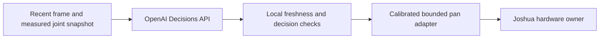

# OpenAI Decisions API camera-head demo

| Field | Value |
| --- | --- |
| Status | Additional demo plan; adapter, measurements, and hardware qualification remain open. |
| Created / last reviewed | 2026-11-04 / 2026-11-05 |
| Task and rig | The same one-axis target-tracking camera head and A/B hardware from the [real-to-sim-to-real plan](CAMERA_HEAD_DEMO.md). |
| Decision backend | OpenAI Decisions API in place of the simulation-trained policy for this variant. |
| Scope | API-specific adapter, failure handling, walkthrough, and D gates. |

## 1. Dependencies and scope

Use the camera-head plan's [task and hardware](CAMERA_HEAD_DEMO.md#2-release-scope-and-demo-setup),
[controller comparison protocol](CAMERA_HEAD_DEMO.md#controller-variants-and-comparison),
and [head artifacts](CAMERA_HEAD_DEMO.md#5-camera-head-artifacts-and-compatibility).
The nervous-system plan owns the shared [runtime and simulator contract](ROBOT_NERVOUS_SYSTEM_DEMO.md#4-shared-interfaces-and-simulator-behavior)
and [evidence record](ROBOT_NERVOUS_SYSTEM_DEMO.md#evidence-record).

Use the C0/C1 hardware, calibration, and local-motion qualification. The local
detector is needed only for a detector-state comparison condition. API-specific
work is tracked by D0–D4; R2S2R model fitting/training remains in the C gates.
Clear pending API work when switching sources, stopping, or restarting a run.

### Hardware for the first API trial

Use the shared plan's [baseline hardware and configuration handoff](CAMERA_HEAD_DEMO.md#baseline-using-existing-joshua-hardware-paths):
**one STS3215 servo + the existing SO-100-compatible USB servo bus adapter + one
USB camera A + matched external servo power + a fixed base/camera bracket + the
Ubuntu Docker host**. Reuse available parts first. The shared hardware table owns
part selection, wiring, power constraints, and configuration details for both demos.

Joshua already implements the STS3215 motor and integrated position-feedback
drivers through `FEETECH_BUS`, and USB camera capture through OpenCV. The head
still needs its composed command/feedback runtime, control lifecycle, preset,
calibration, and physical qualification. Pin the runtime revision supplying those
contracts before D2; this hardware choice does not close the shared runtime gates.

The initial D2 trial uses configuration A only. It needs network/API access and
recording space, but no training compute, simulation-trained policy, second motor,
Teensy/ESP32, lidar, VL53L5CX, or DYNAMIXEL integration. Camera B and its bracket
enter D3 when demonstrating the A→B hardware change; they remain required for the
full R2S2R A/B release. Optional devices stay outside the first API trial.

Use STS3215 throughout this demo, including the camera A→B change. XL330
integration is deferred to later work and is not required for D0–D4.

Before D2, retain a hardware record with exact servo/adapter/camera/supply models
and revisions, servo ID/baud and USB mappings, wiring/polarity, payload measurements,
calibrated direction/zero/limits/speed, actual image and feedback rates/ages, and
local stop/link-loss results. Reference the authoritative protobuf config and
calibration snapshot. Freeze the bounded pan step, freshness limits, and API
cadence at D0 against these measurements rather than copying SO-100 motion values.

## 2. Observation → decision → bounded movement

The [official Decisions guide](https://developers.openai.com/api/docs/guides/decisions)
documents `POST /v1/decisions`, image and JSON evidence, and `choice` questions
that return a supplied option with probabilities and confidence. As reviewed on
2026-11-04, the documented supported model is `gpt-6-luna`; verify availability
and pin the model/SDK when implementing. The application executes selected actions.

1. Select a recent camera frame and measured joint state. Record their sample IDs,
   acquisition/receipt times, clock domains, and alignment quality. Give the local
   request a run/config identity and observation ID for correlation.
2. Send the image, the target description, and the aligned joint state to Decisions.
   Pin the image preprocessing and the centered-image band in the question contract.
3. Ask one named `choice` question with the following mutually exclusive options.
   These are project-defined labels, not built-in API actions:

| Choice | Meaning | Local action |
| --- | --- | --- |
| `target_left` | Target is visible left of the centered band. | Request one bounded pan increment toward that image direction. |
| `target_centered` | Target is visible inside the centered band. | Hold the tracking target; no new pan increment. |
| `target_right` | Target is visible right of the centered band. | Request one bounded pan increment toward that image direction. |
| `target_absent` | Target is not visible in this frame. | Apply the qualified target-loss hold/stop policy; no searching motion. |
| `uncertain` | Visibility or location cannot be determined reliably. | Apply the local hold/stop policy. |

4. Validate the returned question name, answer type, selected option, and finite
   confidence/probabilities. The [create-decision reference](https://developers.openai.com/api/reference/python/resources/decisions/methods/create)
   also permits a refusal instead of an answer; handle that without issuing motion.
5. Use the calibrated camera-to-joint sign to map an accepted left/right choice
   to a bounded angular increment from fresh measured position. Keep step size,
   position/speed limits, command lifetime, and deadband in the protobuf config
   and referenced calibration. The API does not choose raw servo registers,
   enable state, or unrestricted angles.
6. Record the observation, request/response, accepted or rejected decision, applied
   command, measured response, and timing. Show decision, confidence, frame age,
   response delay, and actual joint angle in the audience view.

Implement this as an asynchronous decision source feeding Joshua's local control
path. Camera acquisition, command supervision, recording, and operator stop must
continue while the request is in flight. The API request cadence and the local
control cadence are separate settings, qualified through measurement.

### Freshness, failures, and recovery

Allow at most one API request in flight; keep a bounded latest-snapshot slot for
the next request instead of accumulating frames. Accept an answer only while its
input age, joint-state age/skew, and motion since the input remain within the
D0 bounds, and its run/config/control-source identity still matches. Consume an
accepted observation ID at most once. A newer camera frame alone does not
invalidate an otherwise timely answer; a superseded or expired decision does.

Set a finite request deadline and retry budget, including SDK retries. Timeouts,
network loss, rate limits, refusal, malformed answers, insufficient confidence,
stale observations, or target loss stop new tracking increments and invoke the
qualified local hold/stop policy. A previous decision must not keep generating
movement. Select confidence thresholds from labeled task examples; model
confidence alone does not establish correctness or physical readiness.

Reject late responses after stop, backend switching, or an A→B change. API
recovery follows the shared lifecycle and cannot automatically enable an actuator.

## 3. API audience walkthrough

For the additional presentation segment:

1. Show the same head and target, then select the Decisions backend while stopped.
2. Display a recent frame, returned choice/confidence, and the bounded applied
   movement beside measured angle. Identify the live API dependency.
3. Move the target through the frozen trajectory and demonstrate centering and
   target loss. Show recorded benchmark results alongside the live interaction.
4. Demonstrate a prescribed API outage or delayed reply. The local runtime must
   follow its qualified hold/stop behavior and reject the expired response.
5. Optionally repeat the A→B camera/payload change. Update calibration and prompt
   inputs as needed; qualify behavior again and report those changes separately
   from training effort.

Keep a labeled recorded fallback for unavailable network/API service. Publish
whether a segment used live Decisions, recorded answers, or another controller.

## 4. Implementation and acceptance gates

| Gate | Work and required evidence | Status |
| --- | --- | --- |
| D0 — Freeze the API contract | Select API access/model/SDK, target/preprocessing, choices, bounded step/deadband, request cadence/deadline/retry budget, response freshness/motion/confidence bounds, and request/spend budget. Freeze the baseline hardware record and reference the qualified head calibration, local hold/stop behavior, and shared trial protocol. Keep credentials outside source-controlled configuration. | Open |
| D1 — Adapter and replay | Add config/schema, an asynchronous API adapter, local mapping/gates, source selection, and recording/display integration. Hardware-free fixtures cover malformed/refused/low-confidence answers, stale and duplicate IDs, delayed/out-of-order completion, source changes, rate limits, and outages. | Open |
| D2 — Bounded physical qualification | On the existing qualified head, verify direction/limits, tracking, target loss, operator stop, API failure/deadline behavior, and rejection of late responses. Record all attempts and measured timing. | Open |
| D3 — Comparison and supported change | Apply the shared camera-head comparison protocol and record API-specific provenance/usage. Repeat the shared camera A→B change with the STS3215 actuator when claiming easy hardware changes. XL330 integration is outside these gates. | Open |
| D4 — Conference readiness | Pin config/calibration/prompt/model/SDK artifacts, rehearse live and offline fallback, and publish the runbook and D0–D3 evidence. | Open |

Record prompt/preprocessing revisions, model/SDK identity, request correlation,
responses/rejections, usage/cost, and applied commands in the shared evidence
record. D gates establish this API path; C gates retain the trained-policy claims.
The general-audience read-only inspection walkthrough remains a separate activity.
Follow [AGENTS.md](../AGENTS.md) for execution authorization. No API adapter or
hardware result is established by this plan.
