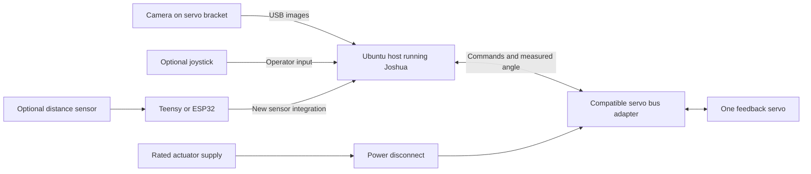
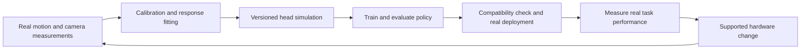

# Real-to-sim-to-real camera-head demo and checkpoints

| Field | Value |
| --- | --- |
| Status | Agreed demo direction; implementation and hardware verification gates remain open. |
| Created / last reviewed | 2026-11-01 / 2026-11-04 |
| Implementation baseline | Checkout `31efe9d`; source and documentation review only. |
| Planning horizon | 12 weeks from an agreed kickoff; conference expected in approximately three months. Exact conference and freeze dates are TBD. |
| Delivery owner / engineering capacity | TBD at checkpoint C0. |
| Primary demo | One-axis camera head: real measurements → calibrated simulation → learning → real execution → supported hardware change. |

This guide defines the release outcome, implementation gaps, and evidence needed
to close them. It does not establish hardware readiness or authorize a hardware
run. Update it as implementation and verification land.

Implementation gates remain open; supporting evidence must be assessed against
the camera-head demo scope.

## 1. Audience and product promise

The first audience is robot engineers who have invested in actuators,
electronics, mechanisms, and sensors but have not reached a usable learning
workflow.

> Joshua helps your learning workflow keep up with your changing hardware.
>
> Connect supported components, measure the real device, learn in a calibrated
> simulation, and deploy back through the same interface.

The product distinction is the work and time required to connect and change
supported hardware. LeRobot already offers recording, training, evaluation, and
custom hardware interfaces; another robot executing a policy is insufficient to
establish Joshua's advantage. See its
[learning workflow](https://huggingface.co/docs/lerobot/il_robots) and
[custom hardware interface](https://huggingface.co/docs/lerobot/main/en/integrate_hardware).

| User situation | Intended Joshua experience |
| --- | --- |
| Compose supported components | Configure, calibrate, record, train, and deploy using the shared workflow. |
| Change a supported camera or payload | Update configuration and calibration, rebuild the simulation, check compatibility, and reuse or retrain the policy. |
| Introduce an unsupported component | Implement a documented adapter, then reuse the workflow. Report this engineering effort separately. |
| Change joint count or task | Revisit observation/action contracts and training; policy reuse is not assumed. |

Measure source edits, configuration edits, calibration work, assistance, and
elapsed time separately. Publish only component combinations actually verified.

## 2. Release scope and demo setup

### Required release outcome

- One simple, verified camera head with one rotary joint and measured feedback.
- Two qualified physical configurations, A and B, with the same joint count.
- One complete real-to-sim-to-real loop, including a policy trained in simulation
  and evaluated on real hardware.
- One pinned simulation training environment and small tracking-policy recipe.
  MuJoCo is the provisional baseline; compare it with NVIDIA Isaac Lab and select
  the simulation stack, external trainer, and algorithm at C0. The working
  direction is state-based reinforcement learning. No new learning algorithm is
  required.
- A supported hardware-change workflow that preserves recorder, trainer, and
  inference source code while changing configuration and calibration artifacts.
- A reproducible example, documented extension points, and outside-user evidence.

General-purpose model generation, raw-image policy transfer, arbitrary morphology
transfer, live hot-plugging, and a broad model catalog are deferred. Adding a
second joint is a later milestone.

A second controller, distance sensing, and distractor/occlusion handling are
conditional additions after the required loop works. The primary rig connects
through a compatible servo bus adapter. Optional sensors can use a Teensy or
ESP32 acquisition path.

A CLI or thin operator UI is sufficient. Reconcile this learning-first sequence
with the separate [AI integration plan](../docs/AI_INTEGRATION.md) at C0.

### Task: a curious camera head

Mount a lightweight USB camera directly on a feedback servo's horn using a
simple bracket. Fix the servo to a stable base. The head rotates horizontally to
keep a recognizable target centered as it moves left/right at camera height.
Use a simple colored target or marker for the first detector. Define the permitted
motion area, lighting, target speed, and camera height at C0.

The tracking policy receives camera-derived target bearing and validity,
measured joint angle, and estimated joint velocity. It outputs a bounded angular
action. Select absolute targets or angular increments at C0 and use the same
meaning in simulation and hardware. The visual detector is a separate component;
this demonstrates learned control using camera observations, not an end-to-end
learned visual detector. Keep RGB frames for inspection and outcome review.

A conventional visual controller is a comparison baseline. The claim is an easier
integration and adaptation workflow, not that this task inherently needs RL or
that the learned controller must outperform conventional control.

### Physical configurations and hardware changes

| Configuration/change | Physical setup | Required workflow and evidence |
| --- | --- | --- |
| A — Baseline head | Lightweight camera A on a directly mounted bracket | Establish calibration, measured response, simulation, and real policy evaluation. |
| B — Modified head | Replace the camera/bracket with a prequalified heavier assembly using camera B | Update device settings, camera calibration, geometry/payload description, and measured actuator response. Validate or retrain in the updated simulation and evaluate on real hardware. |
| Optional controller substitution | A second verified controller/interface with the same logical actuator and feedback contract | Qualify physical I/O, timing, units, stop/recovery, and policy compatibility separately. |
| Deferred morphology change | Add tilt or change joint count | Requires a revised environment and observation/action contract; do not claim automatic policy reuse. |

At C0/C1 choose A/B parts with a measurable calibration or response difference
within the servo's qualified load and motion range. Do not assume that adding
mass will materially change a closed-loop servo's behavior. If it does not,
report that result and choose a useful supported change before freezing the
experiment. Never deliberately degrade the A policy to manufacture a contrast.

For this release, “easy hardware change” means:

**Stop → replace → configure → calibrate → validate → resume.**

A runtime restart is allowed and included in timing. No energized component
swapping, automatic discovery of arbitrary devices, or zero-calibration claim is
part of this milestone. The existing policy may pass compatibility checks and
remain useful, or the updated simulation may require a newly trained policy.
Both outcomes must be identified explicitly.

### Assembly and connections

1. Fix the servo and base securely. Attach the camera bracket directly to the
   supplied horn. Provide cable slack for the bounded pan range and strain relief.
2. Mark a repeatable bracket orientation and reference angle. Qualify position
   feedback, direction, zero, and limits against an independent angular reference.
3. Connect the camera by USB to the Ubuntu host. Connect the servo through its
   compatible bus adapter and correctly rated external supply. Keep actuator
   power disconnect accessible and qualify stop behavior.
4. Prepare the swappable B camera/bracket assembly and label both configurations.
   Record mass, mounting dimensions, and camera calibration for each.
5. Set up a target, steady lighting, calibration board, and marked motion area.
   Use prescribed target trajectories for evaluation and free visitor movement
   for interaction. Label these as different evidence conditions.
6. Keep simulation/training on the host or a separate compute machine. Bring
   checkpoint and calibration artifacts back to the local conference host.



This is a conceptual connection diagram, not a wiring schematic. The servo
provides integrated position feedback.

### Required hardware

This is a planning BOM, not a confirmed inventory. At C0 record exact model and
revision, manufacturer documentation, availability, price, owner, and lead time.
Prefer existing parts and a simple printed bracket. No total budget is established.

| Item | Quantity | Purpose and qualification |
| --- | --- | --- |
| Feedback serial bus servo | 1 | STS3215-compatible candidate; verify exact model/protocol, measured angle, load, travel, and supply against Joshua's driver. |
| Compatible servo bus adapter | 1 | Host connection and bus electrical interface; verify simultaneous command/feedback through one runtime bus owner. |
| Rated servo supply, wiring, and accessible disconnect | 1 set | Match selected servo/adapter; qualify electrical setup and physical stop/recovery. |
| Lightweight USB cameras A and B | 2 | Two qualified device configurations; verify OpenCV capture, latency, calibration, and reliable identification after reconnection. |
| Servo horn, fixed base, and swappable camera brackets | 1 base + 2 assemblies | Direct attachment with repeatable reference marks; choose B payload within qualified limits. |
| Target, calibration board, marked area, and steady lighting | 1 set | Repeatable perception calibration and evaluation. |
| Ubuntu host with SSD and display | 1 | Supported Docker environment, local recording, inference, and demonstration. |
| Training compute | Access to 1 resource | Benchmark CPU/GPU requirements for the selected small-policy recipe; a GPU is not assumed mandatory. |
| Cables, fasteners, strain relief, and transport protection | 1 set | Reliable assembly and conference setup. |
| Independent angular reference and basic measurement tools | 1 set | Check angle/zero, mount geometry, payload mass, supplies, and timing as applicable. |

A 3215-family candidate has integrated magnetic feedback; manufacturer naming
alone does not establish compatibility with Joshua's STS3215 driver. See
[servo documentation](https://docs.waveshare.com/ST3215_Servo).

| Optional item | Quantity | Condition |
| --- | --- | --- |
| USB joystick/gamepad | 1 | Manual commissioning, recording, and comparison; demonstrations are not required for the chosen RL recipe. |
| ST VL53L5CX breakout and sensor mount | 1 | Preferred candidate for optional multizone ranging; exact breakout TBD. Requires new acquisition, host integration, and calibration. |
| Teensy or ESP32, harness, and compatible sensor power/interface | 1 set | Optional sensor acquisition or separately qualified controller milestone. |
| DYNAMIXEL XL330-M288-T alternate servo kit | 1 set | Optional actuator-substitution candidate; requires its own qualified mount, compatible TTL interface, 5 V supply, and new Joshua driver. Not a direct STS3215 spare. |
| Spare camera/servo/adapter and cables | Selected kit | Choose after assembly freeze and failure rehearsal. |

**VL53L5CX integration:** the sensor provides a coarse depth grid: up to 8x8 zones
at 15 Hz, or 4x4 at 60 Hz. Use a breakout with documented supply and I2C logic
compatibility, rather than the bare sensor.
See [ST mode specifications](https://www.st.com/resource/en/flyer/vl53l5cx_flyer.pdf)
and the [datasheet](https://www.st.com/resource/en/datasheet/vl53l5cx.pdf).

Mount it beside the RGB camera. Start with timestamped depth-grid telemetry and
display; implement acquisition through the selected MCU and a Joshua perception
path. Record zone orientation, distances, per-zone validity/status, and camera
alignment. Check bandwidth, startup, latency, and actual performance under booth
lighting. A zone may measure background rather than the target. If the policy
uses depth, add corresponding simulated observations, uncertainty, and timing;
then reopen training and transfer gates. Do not substitute perfect simulated
point distances for qualified multizone behavior. Ranging remains optional.

**XL330 alternate versus spare:** the XL330-M288-T uses DYNAMIXEL Protocol 2.0
over half-duplex TTL and provides position, velocity, and current feedback.
Its supply range is 3.7–6.0 V, with 5 V recommended; do not reuse a higher-voltage
servo supply. See the [ROBOTIS manual](https://emanual.robotis.com/docs/en/dxl/x/xl330-m288/).
A U2D2 is a candidate interface, but needs separate actuator power; see
[U2D2 power requirements](https://emanual.robotis.com/docs/en/parts/interface/u2d2/).

Joshua's current Feetech/STS3215 implementation does not implement DYNAMIXEL.
Add protocol/register handling, motor and feedback bindings, config validation,
and one-owner command/feedback operation before claiming support. Qualify the
XL330-specific horn/bracket, payload, cable drag, limits, and motion profile;
refit its response model and check checkpoint compatibility. This makes a useful
optional actuator-change demonstration after A/B works. For rapid failure
recovery, carry the same model as the qualified primary servo. Promoting XL330
to the primary actuator would move this integration into C1's critical path.

## 3. Real-to-sim-to-real workflow



### Real → sim: measure and validate

Record bounded commanded motions and measured joint angles with timestamps.
Estimate an effective response model covering delay, response rate, and limits;
add complexity only when held-out traces justify it. A position-controlled servo
contains its own controller: do not model it as an ideal torque motor or claim
that a response fit uniquely identifies physical inertia/friction.

Calibrate camera intrinsics, distortion, mount pose, and image timing. Record
known geometry and measured payload properties. Generate the head model from a
fixed template and canonical configuration/calibration artifacts. The MVP does
not infer arbitrary robot geometry from a camera scan.

Split identification recordings into fitting and held-out validation sessions.
Compare simulated versus real angle traces under the same commands. Freeze error
and timing tolerances at C0/C1. A visualization that follows measured angles does
not establish predictive model fidelity.

### Learn in simulation

MuJoCo is the provisional baseline because the task has one rotary joint and
uses target bearing and measured joint state rather than raw images. Joshua's
existing MuJoCo engine provides stepping, control, state access, and rendering.
The main transfer work is validating actuator response, timing, and detector
behavior against real measurements.

At C0 compare this baseline with [NVIDIA Isaac Lab](https://developer.nvidia.com/isaac/lab),
a robot-learning framework offering parallel training and simulation integration.
Isaac Sim provides richer scene and sensor rendering when those capabilities are
needed. Joshua's current Isaac integration is a scene viewer, not a training
environment; both candidates require learning-workflow integration. Select one
stack for this release and record the rationale. Validate the choice through the
later real-transfer gates.

Use one parameterized one-axis environment in the selected stack with reset,
action application, observation construction, reward, termination, and
deterministic seeded evaluation. Define a tracking reward and smoothness penalties
with weights recorded in the training recipe. Respect the physical action bounds
and control period.

Train across target trajectories and calibrated uncertainty in actuator response,
sensor noise, and observation/command delay. Derive plausible ranges from bench
measurements and document assumptions. Camera-derived bearing must include the
real detector's visibility, timing, and invalid-detection behavior; do not give
the policy perfect target information unavailable on hardware. Rendered scenes
can check the detector, but raw-image policy learning is outside this release.

MuJoCo supplies configurable actuator and camera models; Joshua still needs the
workflow integration described here. See the upstream
[modeling documentation](https://mujoco.readthedocs.io/en/latest/modeling.html).

### Independent ROS 2 simulator connection

Include a separate live-mirror demonstration alongside the learning workflow.
Run Joshua and the selected simulator as independently launched processes,
connected through ROS 2 topics. Joshua owns hardware communication, command
execution, recording, and device health. The simulator consumes published measured
state and sensor data; it does not acquire the physical buses or cameras.

Document each mapping from the canonical config/artifact snapshot: topic, message
type and fields, QoS, joint/frame identity, units/conversion, timestamp domain,
maximum age, and destination model or sensor panel. Show measured angle and real
camera data with their source labels. Keep the simulation-training environment's
synthetic observations and predictive-model validation evidence separate from
this live view.

While the qualified hardware controller and recorder continue running, stop and
restart only the simulator. Preserve command/feedback/image traces before, during,
and after the restart. Hardware operation must remain within the frozen timing
and freshness bounds, without restarting Joshua, resetting board sessions, or
changing command ownership. On reconnect, discard stale simulator inputs and
resume from current published state. Record any interruption as a failed restart
trial and retain its diagnostics. Close this requirement with C2 evidence.

This connection is an implementation and qualification task under G10. A labeled
recording is a presentation fallback when live rehearsal cannot fit the conference
schedule; an unverified restart requirement remains open.

### Sim → real: deploy and compare

Export the trained checkpoint together with config, calibration, environment,
normalization, and dependency identities. Run offline observation/action checks,
then deliberate bounded hardware evaluation through Joshua. No online physical
exploration is required for this training plan.

Use a fixed conventional tracking controller as a reference. Also compare a
policy trained with nominal simulation parameters against one using measured
parameters and documented randomization, holding evaluation conditions and
training budget comparable. Report actual differences, including no improvement.
Do not claim that calibration improved transfer without supporting measurements.

After the A→B hardware change, check the A checkpoint's compatibility before
any trial. If compatible, evaluate its performance; if incompatible, record the
rejection. Recalibrate, regenerate the model, and reuse or retrain as appropriate.
A newly trained B policy and an unchanged A policy are distinct claims.

## 4. Implementation gaps

Findings are from the baseline checkout. Code and native tests are foundations,
not evidence of physical qualification or a complete learning workflow. The gaps
below cover the camera-head implementation and verification work.

| Gap | Existing foundation and evidence | Work needed | Gate |
| --- | --- | --- | --- |
| G01 — Qualified actuator and measured state | [STS3215 driver](../robot/action/motors/drivers/sts3215_driver.cc) and [perception factory](../robot/perception/factory/perception_factory.cc) provide servo and encoder paths. | Qualify exact servo/adapter, angle conversion, calibration, limits, timing, and physical behavior for A/B. | C1 |
| G02 — Camera and target observations | OpenCV is a concrete perception driver; arbitrary distance sensors are not supported by the factory. | Add target detection, calibrated bearing, validity, timing, velocity estimation, and A/B camera calibration. Optional range sensing needs its own adapter. | C1, C2 |
| G03 — Runtime bus ownership and run control | [Configuration documentation](../config/README.md) requires one process owner per serial bus; actuator subscribers and position publishers have separate roles. | Support command and measured feedback together through the intended bus owner. Add exclusive control, fresh-input checks, bounded runs, stop, fault, and deliberate recovery. | C1, C4 |
| G04 — Configuration and calibration | Protobuf presets and validation exist; [calibration UI](../ui/src/pages/CalibrationPage.tsx) is a placeholder. | Ship A/B presets, calibration tools, readiness checks, and versioned artifacts. Distinguish integrity checking from hardware readiness. | C0, C1, C6 |
| G05 — Measurement data | [DataStore](../ai/train/data_store.py) records episodes; its [output](../ai/train/README.md) is an interleaved message stream. | Align command, angle, image, bearing, and validity with explicit clock/age rules; preserve fitting/evaluation splits, failures, and replay. | C2 |
| G06 — Simulation learning | [AI documentation](../ai/README.md) says BC/RL training is unimplemented. | Integrate one pinned external trainer, task environment, reward, randomization, seed handling, checkpoint export, and smoke run. | C3 |
| G07 — Policy deployment | [Inference host](../ai/inference/host.py) and model plug-ins exist. | Add the selected tracking-policy adapter, named synchronized inputs, action conversions, compatibility checks, and offline parity validation. | C3, C4 |
| G08 — Optional controller portability | Board/transport abstractions exist; they do not prove interchangeable physical behavior. | Qualify a second interface/controller without component-specific edits to shared recording/training/inference code. | C6 optional extension |
| G09 — Outside-user and release evidence | Docker workflows, [documentation](../CONTRIBUTING.md), and monitoring UI exist. | Reproduce fresh-host setup and supported changes, time all assistance, distribute artifacts, and rehearse offline. | C5, C7 |
| G10 — Independent ROS 2 simulator connection | The existing viewer/mirror paths do not establish the independent launch, complete mapping, or restart-continuity evidence required here. | Launch Joshua and the selected simulator separately, publish state/sensor mappings, and verify simulator restart while hardware control and recording continue. | C2, C7 |
| G11 — Real-to-sim identification | [MuJoCo engine](../simulation/mujoco/engine.py) can step/read/render a model; [mirror mode](../simulation/mujoco/modes/mirror.py) sends incoming scalars to controls. | Fit an effective servo response and validate predictions on held-out real traces; establish camera calibration and uncertainty. Mirroring alone does not close this gap. | C2 |
| G12 — Canonical head model | [Simulation config](../simulation/proto/simulation.proto) references model files. [PhysicalLayout](../config/proto/physical_layout.proto) describes link geometry/limits but does not establish a config-to-twin pipeline. | Add a fixed head template and schema/artifact references for camera, geometry, response parameters, and provenance; generate reproducibly without manual duplicate edits. | C2 |
| G13 — Hardware-change lifecycle | Config-driven construction exists; hot reload and policy compatibility across changes are not established. | Implement stop/change/reconfigure/calibrate/validate/resume, invalidation rules, A/B evidence, and explicit reuse-versus-retrain decisions. Restart is allowed. | C6 |
| G14 — Optional named components | Current actuator/board factories provide Feetech/STS3215 support, not DYNAMIXEL; the perception factory has no VL53L5CX implementation. | Add and qualify VL53L5CX multizone acquisition/telemetry and, separately, XL330 Protocol 2.0 actuation/feedback. Extend the simulated observation or actuator model when each enters the learning path. | C1–C4 requalification; C6 optional extension |

## 5. Shared contract and evidence

Use protobuf configuration as the source of truth. Extend its schema where
necessary. Store measured calibration in versioned artifacts referenced by the
config; generated simulator files and checkpoint metadata must point back to the
same snapshot. Avoid independent hardware constants in the trainer or adapter.

Freeze these items before main identification or training:

- **Identity and units:** stable joint/camera names, radians and radians/second,
  zero, direction, limits, native-unit conversion, camera identity, and frames.
- **Actions:** target semantics, bounds, control rate, delay model, and mapping
  from requested commands to applied commands. Keep measured feedback separate.
- **Observations:** bearing, target validity, angle, velocity-estimator definition,
  image/calibration identity, acquisition/receipt times, clocks, maximum age/skew,
  and explicit behavior when the target leaves view.
- **Data:** session/trial boundaries, operator intervention, interrupted capture,
  alignment rules, rejected samples, and fitting/training/evaluation splits.
  Prevent future observations from leaking into an earlier control sample.
- **Model:** head geometry, camera projection, actuator response, uncertainty,
  parameter units, template/generator revision, and held-out validation results.
- **Checkpoint:** observation/action schema, preprocessing/statistics, trainer and
  simulator versions, config/calibration hashes, seeds, and supported parameter
  envelope. A matching array size does not establish compatibility.
- **Lifecycle:** disabled, commissioning, recording, policy execution, stopped,
  and faulted states; exclusive command source and deliberate recovery.
- **Changes:** camera changes invalidate related calibration; payload/mount
  changes reopen model validation; timing/action changes reopen compatibility
  and transfer evaluation. Joint-count changes require a new contract.

Numeric tolerances and operational limits remain TBD until C0/C1 measurement.
An unspecified acceptance bound cannot pass a gate. JoshuaWire integrations, if
added, must honor the [protocol contract](../docs/JOSHUA_WIRE.md); the primary
vendor servo bus does not become JoshuaWire by configuration alone.

## 6. Twelve-week checkpoint register

Weeks are planning targets, not guarantees. Assign capacity and actual dates at
C0. Work may overlap; downstream evidence must use validated upstream artifacts.

| Gate | Target | Dependency | Owner | Status | Evidence / PR / result |
| --- | --- | --- | --- | --- | --- |
| C0 — Scope, parts, and contract | Week 1 | None | TBD | Open | — |
| C1 — Observable controlled head | Weeks 1–3 | C0 | TBD | Open | — |
| C2 — Predictive calibrated simulation | Weeks 3–5 | C1 measurements | TBD | Open | — |
| C3 — First simulation-trained real execution | Weeks 5–7 | C2 | TBD | Open | — |
| C4 — Repeatable transfer and recovery on A | By end of week 8 | C3 | TBD | Open | — |
| C5 — Outside-user integration | Weeks 9–10 | C4; C6 for change workflow | TBD | Open | — |
| C6 — Supported A→B hardware change | Weeks 8–10 | C4; B preparation starts at C1 | TBD | Open | — |
| C7 — Release and conference readiness | Weeks 11–12 | C4, C5, C6 | TBD | Open | — |

### C0 — Scope, parts, and contract

- [ ] Assign hardware/runtime, simulation/learning, and onboarding owners; record
  capacity, kickoff, conference date, and release freeze.
- [ ] Inventory and select exact A/B parts, wiring, host, compute, prices, lead
  times, and bench access. Record the mechanical change and expected effect.
- [ ] Freeze task distribution, target trajectories, trial length, tracking-error
  tolerance, target-loss allowance, smoothness limit, and intervention rules.
- [ ] Freeze the shared contract, simulator template scope, and supported-change
  boundaries.
- [ ] Compare MuJoCo and Isaac Lab on the same camera-head task in a bounded
  feasibility check: setup effort, calibration support, training throughput,
  compute needs, and checkpoint/deployment integration. Select and pin one
  simulation stack and trainer/algorithm; record versions, results, and rationale.
- [ ] Define nominal-simulation and conventional-controller comparisons, held-out
  splits, model-fit thresholds, and A/B evaluation protocol before testing.
- [ ] Reconcile the learning-first sequence with the existing AI roadmap.

**Evidence:** design decision, BOM, wiring reference, evaluation protocol,
contract, owners, and dates. The direction is agreed; exact parts and bounds are
not yet qualified.

### C1 — Observable controlled head

- [ ] Command and read the same servo concurrently through one bus owner.
  Verify angle direction, zero, units, limits, and restart reference independently.
- [ ] Qualify A/B mounting, load, camera capture, detector, and repeatable camera
  calibration. Record whether the hardware change is measurably different.
- [ ] Measure command/feedback/image timing under recording load, with explicit
  target-invalid and stale-input behavior. Record velocity-estimation behavior.
- [ ] Verify operator enable, exclusive command source, stop, power disconnect,
  limits, host/adapter disconnect, control-process failure, and deliberate recovery.
- [ ] Deliver integrity validation separately from hardware readiness checks;
  identify missing devices and incompatible configurations clearly.

**Evidence:** configurations, wiring, firmware/adapter identities, calibrations,
physical angle/timing/stop traces, target detector results, and limitations.

### C2 — Predictive calibrated simulation

- [ ] Record and replay synchronized commands, measured angles, camera frames,
  bearings, validity, and timestamps; report missing or rejected samples.
- [ ] Split real sessions for response fitting and held-out validation. Preserve
  failures and interrupted recordings with explicit status.
- [ ] Fit the effective actuator model and camera calibration; record uncertainty
  and compare prediction errors with the nominal model under identical commands.
- [ ] Generate the one-axis model for the C0-selected simulation stack from
  canonical config/artifacts and a fixed template. Rebuilding the same inputs
  produces the same model identity.
- [ ] Meet frozen held-out model error/timing thresholds. Verify control units,
  delay, limits, reset, detector visibility, and observation/action parity.
- [ ] Run the independent ROS 2 live-mirror demonstration with documented state
  and sensor mappings. Restart only the simulator and verify hardware control,
  communication ownership, and recording continue within the frozen bounds.

**Evidence:** real dataset, fit/calibration artifacts, generated model, prediction
plots, error report, repeatable build command, ROS 2 mapping manifest, and
simulator-restart continuity traces. Mirroring/playback is supporting
visualization, not model-validation evidence.

### C3 — First simulation-trained real execution

- [ ] Complete a smoke run and one reproducible training run in the pinned
  environment, using C2 model parameters and documented randomization.
- [ ] Save data/model identities, reward/settings, seed, dependencies, statistics,
  checkpoint, logs, training budget, and measured compute/time.
- [ ] Validate adapter preprocessing, actions, units, and compatibility offline.
  Reject invalid dimensions, nonfinite actions, and incompatible artifacts.
- [ ] Execute a bounded real trial on A using the simulation-trained checkpoint
  and meet the task criterion on a held-out trajectory.
- [ ] Preserve all attempts and interventions. Distinguish simulation training,
  real evaluation, conventional control, and any later real-data fine-tuning.

**Evidence:** training recipe and checkpoint provenance, offline checks, and a
recorded physical trial. One success closes only the first-execution gate.

### C4 — Repeatable transfer and recovery on A

- [ ] Meet the proposed target of **45 successful trials out of 50 held-out
  trials** on A. Freeze any revision before evaluation. Trial success requires
  the C0 tracking, target-loss, and smoothness criteria over the prescribed duration.
- [ ] Preserve the denominator: timeouts, dropped tracking, and in-trial human
  interventions follow the frozen failure rules. Do not silently exclude frames
  with missing detections or choose only favorable trajectories.
- [ ] Review task outcomes independently of the training reward using recorded
  image/angle evidence. Compare conventional control, nominal-sim policy, and
  calibrated/randomized-sim policy with comparable test conditions.
- [ ] Verify stale input, invalid output, disconnect, stop, and restart behavior.
  Measure reset/recovery time and complete repeated rehearsal sessions.

**Evidence:** full trial ledger, errors, target-loss rate, motion smoothness,
latency, recovery, comparison results, and artifact revisions. The 45/50 target
is proposed, not a current result or a broad generalization claim.

### C5 — Outside-user integration

- [ ] Publish setup, calibration, identification, simulation generation, training,
  deployment, evaluation, supported-change, and troubleshooting instructions.
- [ ] Have three engineers outside the implementation team attempt the workflow;
  record assistance, failures, incomplete attempts, and host starting state.
- [ ] Measure time to first valid measurement session, validated model, training
  launch, and deployed policy. Include downloads/install time and report hardware
  preparation, firmware work, and preinstalled environments separately.
- [ ] Validate the proposed first-session target of **60 minutes from software
  setup start** with an assembled/wired supported rig and supported host.
  Calibration, training, and complete adaptation times are separate measurements.
- [ ] Users perform a supported A→B change without source edits to the recorder,
  model generator, trainer, or inference adapter. Capture config/artifact diffs
  and the complete change-to-resumption time, including retraining when needed.

**Evidence:** per-user timing/assistance ledger, artifacts and diffs, guide
revision, and usability gaps. A prepared booth machine does not prove onboarding.

### C6 — Supported A→B hardware change (required)

- [ ] Perform the documented stop/replace/configure/calibrate/validate/resume
  sequence on the physical rig. Capture each stage and any restart time.
- [ ] Show exact config/calibration/model differences. Regenerate B's simulation
  without manual simulator-file edits and pass held-out prediction checks.
- [ ] Check checkpoint compatibility; document reuse, rejection, or retraining
  explicitly. Record B training provenance if a new checkpoint is produced.
- [ ] Repeat C4's **45/50 proposed acceptance protocol on B**, with frozen
  conditions. Compare the A policy only when it is compatible for that trial.
- [ ] Preserve logical joint/observation/action contracts and reuse shared
  recording/training/deployment source. Report any component integration work.
- [ ] Publish measured adaptation time with calibration, compute, and operator
  time separated. Do not advertise an unmeasured “instant adaptation” time.

**Evidence:** A/B hardware photos, config and artifact diffs, model-validation
reports, compatibility decisions, training records, real trial ledger, and timing.
This gate is mandatory for the easy-hardware-change claim.

**Optional extension:** qualify a second controller's physical I/O, feedback,
timing, stop/recovery, and workflow reuse. Repeat transfer evaluation before
claiming checkpoint portability. The camera/payload swap alone does not prove
Teensy/ESP32 or arbitrary controller interchangeability.

### C7 — Release and conference readiness

- [ ] Freeze firmware, dependencies, configs, calibration, real measurements,
  model/template, training recipe, checkpoints, and guide revisions for A/B.
- [ ] Verify applicable Docker test services and fresh installation for the
  implementation changes. Confirm all distributed example artifacts work.
- [ ] Prepare offline operation, cached dependencies/assets, known lighting,
  spares, recovery instructions, and a clearly labeled recorded fallback.
- [ ] Rehearse the physical swap and full presentation with transportable gear.
  Verify provenance and timing of every prerecorded or precomputed stage.
- [ ] Publish verified combinations, evidence, limitations, and release scope.
  Include optional controller/range-sensor claims only after qualification.

**Evidence:** release manifest, installation/test results, complete demo video,
runbook, and final register decision.

## 7. Conference presentation

Target a five-to-seven-minute walkthrough after rehearsal. Full training and
fresh-host installation are not assumed to fit within this presentation.

| Segment | Audience sees | Evidence/claim |
| --- | --- | --- |
| Connect and inspect | Physical head, selected A config, camera image, measured angle | Supported custom hardware becomes observable through Joshua. |
| Measure reality | Short bounded response capture and existing validation plot | Real measurements inform the model; identify which artifacts are newly captured. |
| Explain learning | Calibrated simulation, training record, held-out evaluation | The deployed checkpoint was trained in simulation. |
| Restart the simulator | Independently launched simulator reconnects to Joshua's published state and camera data while the head and recorder continue | Documented ROS 2 mappings and before/during/after continuity traces; show a labeled recording if required by rehearsal timing. |
| Run A | Visitor target tracking plus benchmark results | Real execution through the shared interface; visitor interaction is separate from controlled trials. |
| Change hardware | Stopped A→B swap, config/calibration differences, model update | Supported changes reuse the workflow with explicit validation. |
| Run B | Compatible reused policy or identified B checkpoint, measured results | Policy reuse or adaptation is demonstrated with the correct provenance. |
| Show engineering effort | Outside-user and adaptation time, source/config diffs | Joshua's ease-of-integration claim is measurable. |

Default to precomputed validated checkpoints. If B's model or policy is prepared
before the talk, say so and show its provenance. A live calibration/recording does
not retroactively train that checkpoint. Promise live retraining only after
rehearsal establishes time and reliability. Label playback/fallback footage.

## 8. Scope decisions when milestones slip

- If C1 slips beyond week 3, remove optional ranging/controller work and simplify
  brackets or target detection. Preserve measured servo feedback.
- If C2 slips beyond week 5, narrow the effective response model and task range.
  A mirrored visualization cannot substitute for predictive validation.
- If C3 slips beyond week 7, reduce the training/task complexity and retain time
  for real evaluation. Do not add a second learning stack as a fallback shortcut.
- If C4 or C6 is incomplete at freeze, present the completed portions as a scoped
  preview. Do not claim verified real-to-sim-to-real transfer or easy changes
  beyond the evidence. Keep incomplete gates open.
- Defer second-axis motion, arbitrary controllers, raw-image policy transfer,
  online physical learning, and live retraining before reducing core evidence.

Changes to task, hardware, calibration, timing, model, or preprocessing can
invalidate downstream evidence. Record the change and reopen affected gates.

## 9. Weekly checkpoint and evidence updates

Use **Open**, **In progress**, **Blocked**, **Verified**, or **Deferred** in the
register. Check an item only when its condition and evidence are recorded.
A merged PR does not prove physical performance or outside-user usability.

At each review update owners, dates, dependencies, blockers, the next measurable
outcome, and any scope decision. Preserve failed results.

```text
Date / gate / owner:
Status and acceptance items completed:
Code commit / PR:
Firmware / servo / adapter / camera / host / A-or-B identity:
Config / calibration / real-data / model-template / generated-model revisions:
Trainer / environment / randomization / seed / checkpoint revisions:
Evidence type: source review | software test | replay | simulation | hardware | user study
Procedure, starting conditions, held-out split, and comparator:
Expected result / measured result / tolerance / complete trial denominator:
Operator time / calibration time / training time / total elapsed time:
Source edits / configuration edits / artifact changes / assistance:
Failures, interventions, and unresolved limitations:
Evidence location:
Decision / affected downstream gates / next owner and due date:
```

Verification follows [AGENTS.md](../AGENTS.md) and
[CONTRIBUTING.md](../CONTRIBUTING.md). Use documented Docker services for
CI-representative implementation checks. Hardware runs and firmware flashing
require the applicable current operator authorization and setup confirmation.
Inspect simulation presets for real devices before launching; a simulation label
does not establish hardware-free execution.

| Review date | Gate / decision | Evidence | Next action / owner / due date |
| --- | --- | --- | --- |
| 2026-11-01 | One-axis head, real-to-sim-to-real learning, and required A→B hardware-change demonstration | User-agreed direction; source review of simulation, config, perception, and learning foundations | Complete C0; exact parts, capacity, thresholds, and dates TBD. |
| 2026-11-01 | Recorded VL53L5CX as optional ToF candidate and XL330-M288-T as optional alternate actuator | Manufacturer documentation and factory source review; neither integration is qualified | Select breakout and interface kits; keep core A/B scope and gates unchanged. |
