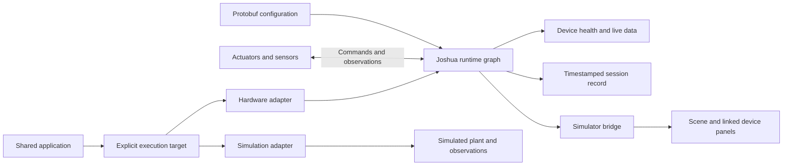

# Robot nervous system: hardware integration demo

| Field | Value |
| --- | --- |
| Status | Agreed demo direction; implementation and physical qualification gates open. |
| Created / last reviewed | 2026-11-03 |
| Implementation review | Checkout `9993548`; source review only. No hardware qualification established by this document. |
| Primary outcome | Configure diverse supported hardware quickly, observe and control it dependably, and connect the same interfaces to a simulator. |
| Delivery owner, parts, capacity, and dates | TBD at N0. |
| Planning horizon | Target twelve weeks from an agreed kickoff; confirm conference and freeze dates at N0. |

This plan defines a hardware-integration demonstration and its acceptance evidence.
The separate [real-to-sim-to-real plan](REAL_TO_SIM_TO_REAL_DEMO.md) covers calibrated
modeling, policy training, and physical transfer in greater depth. Each plan has
its own gates; evidence closes only the conditions it actually demonstrates.

## 1. Product promise

> Build your robot's nervous system quickly. Connect supported actuators and
> sensors, see what they are doing, and keep applications working as hardware
> changes.

Joshua's contribution is the path from hardware configuration to useful, reliable
sensing and actuation. Demonstrate that path with working devices, visible config
changes, and measured engineering effort.

The release should establish four outcomes:

- **Fast integration:** a supported component becomes usable through configuration
  and documented calibration, with the required preparation and assistance timed.
- **Hardware diversity:** distinct actuator interfaces and sensor data types work
  together under one configured runtime graph.
- **Reliable operation:** data freshness, command handling, faults, and recovery
  have defined behavior and repeatable evidence under mixed load.
- **Simulation connectivity:** the same named hardware interfaces feed a simulator
  view, and one application can run through hardware or simulation adapters.

Count different drivers, protocols, and data types separately from device count.
Several identical servos demonstrate scale within one interface family. A second
qualified actuator interface demonstrates a different integration capability.

## 2. Required demo scope

Use a compact bench rig with independently mounted components. A complete robot
mechanism is unnecessary for demonstrating the integration interfaces.

| Component class | Proposed path | Required demonstration |
| --- | --- | --- |
| Feedback actuator | STS3215-compatible servo through a compatible Feetech bus adapter | Bounded command, measured position, direction/zero/limits, and command/feedback operation through one bus owner. |
| Second actuator interface | NEMA17-compatible stepper and rated external driver, through one selected Teensy 4.1 or ESP32 JoshuaWire board | Qualified physical motion, bounded commands, channel identity, and explicit feedback limitations. Select one board for the required rig. |
| Image sensor | USB camera through OpenCV | Live frames, device identity, acquisition/receipt timing where available, stream rate, and stale status. |
| Position sensor | Integrated feedback from the selected servo | Named measured angle with defined units and freshness; distinguish it from commanded position. |
| Range sensor | LDS01 lidar candidate through its serial driver | Live range visualization, frame/orientation, timing, and invalid/missing-data behavior. |
| Simulator | One selected Isaac Sim or MuJoCo integration | Every selected device has a scene representation or linked data panel with identity, source, units, and freshness. |

Exact models, inventory, electrical requirements, physical fixtures, and permitted
motion remain TBD. Select parts already available where possible. Qualify all
combinations before inclusion in the conference rig.

Stepper pulse counts or commanded positions are not measured shaft position.
Without independent physical feedback, label the stepper display as commanded or
estimated. A moving simulator model does not verify physical stepper motion.

The planned hardware kit also needs compatible adapters, correctly rated supplies,
accessible actuator power disconnects, protected moving parts, fixtures, cable
strain relief, a supported Ubuntu host, and a display. Record model/revision,
manufacturer instructions, wiring, power requirements, owner, price, and lead time
in the N0 BOM. Pin the firmware artifact for each Joshua-owned controller.

### Supported component changes

Require both of these changes:

1. Replace camera A with a qualified camera B. Update device settings and any
   required calibration; keep the shared display, recorder, and application code.
2. Add or remove the prequalified second actuator branch through configuration.
   Preserve existing device names and shared consumer code. Launch the expanded
   graph, verify both branches, and show the config diff.

Use a deliberate **stop → change → configure → validate → restart → inspect**
sequence. Include restart and calibration time in the measurement. New hardware
drivers and component-specific adapters are separate engineering work and must
be reported separately from configuring an already supported device.

Cross-family actuator substitution is an optional extension. Reuse requires a
compatible action/feedback contract, units, limits, and physical qualification;
matching a message shape alone is insufficient.

### Optional breadth

Add a second JoshuaWire board, audio telemetry, or a new sensor adapter only
after the required mixed rig and reliability gates pass. Current source includes
an ALSA audio construction path in the
[perception factory](../robot/perception/factory/perception_factory.cc); its full
runtime, display, and recording path still needs qualification. A VL53L5CX ranging
adapter or DYNAMIXEL actuator adapter would be separate development milestones.

Automatic discovery, energized component swapping, arbitrary hardware support,
complete sensor-physics reproduction, and a trained real-transfer policy are
outside this demo's required scope.

## 3. Audience walkthrough

Target a six-to-eight-minute presentation after rehearsal. Carry out long
qualification and endurance runs beforehand and show their recorded results.

| Step | Audience sees | Evidence |
| --- | --- | --- |
| Inspect the setup | Physical components beside the config and named device graph | Exact supported parts and the config that selects them. |
| Launch | Live camera, measured servo angle, range display, and device status | Measured launch-to-valid-data time and clear readiness conditions. |
| Command | Bounded servo and stepper motions with separate command/feedback views | Actual physical operation and truthful feedback labels. |
| Change hardware | Stopped camera replacement or actuator-branch addition; config diff | Measured change-to-usable time, including validation and restart. |
| Exercise a fault | A prescribed sensor interruption becomes visibly stale, followed by deliberate recovery | Detection time, application response, recovery time, and event log. |
| Connect simulation | Model motion and linked sensor views track the configured hardware | Named mappings, units, timestamps, data origin, and bridge delay. |
| Show application reuse | The same small application runs through the selected hardware or simulation adapter | Application source identity, adapter/config differences, and recorded outcomes. |

Choose the camera swap or branch addition for the live presentation; publish
evidence for both. Rehearse any physical fault demonstration and provide a labeled
recording for conditions unsuitable for the conference setting.

## 4. Shared interfaces and simulator behavior

The protobuf configuration remains the source of truth for device identities,
boards, channels, transports, limits, and artifact references. Generated models,
display mappings, and adapter metadata must reference that configuration snapshot.



Hardware execution, live mirroring, recorded replay, and simulated execution must
have explicit labels. Route application commands to one selected execution target
at a time; define control ownership and deliberate enable behavior.

### What appears in the simulator

| Data | Live hardware view | Simulated execution |
| --- | --- | --- |
| Feedback joint | Display measured position with its age; show command separately. | Display simulated state from the selected plant model. |
| Open-loop actuator | Display commanded/estimated position with that label. | Display simulated state without presenting it as physical feedback. |
| Camera | Show real frames in a linked panel and the calibrated camera pose when available. | Render synthetic frames only if implemented and qualified for the application. |
| Range sensor | Display acquired points/ranges with their frame and validity. | Generate synthetic ranges only for the selected implemented model. |
| Device health | Show actual stream freshness, connection/error state, and recovery events. | Show simulator/adapter health with a distinct source label. |

Every demo device should be observable through this view. Not every real sensor
needs a synthetic equivalent for the live-visualization gate. Mark synthetic
outputs as unavailable when absent, rather than silently substituting real data
into a supposedly standalone simulation.

Select one simulator at N0 using a bounded bridge feasibility check: time to
integrate measured state and sensor panels, dependency/setup effort, mixed-load
performance, and application-adapter support. Isaac Sim's ROS 2 ecosystem is a
candidate integration route; Joshua's MuJoCo backend offers an existing stepping
and control interface. Freeze versions and ship one qualified path.

### Executable foundation for learning workflows

Use a small conventional target-bearing controller as the application example.
Give it a fixed observation contract containing target bearing/validity, measured
or simulated joint angle, and timing information. Produce a bounded angular
command through an explicit adapter.

Run the same application source with the physical servo and with a minimal
simulated plant. In simulation, generate the selected observations independently
of live hardware and mark any simplified detector/servo assumptions. Record
preprocessing, units, action semantics, update rate, and adapter differences.
The stepper branch can use a separate prescribed motion sequence; it need not
share the servo controller's semantics.

This demonstrates reusable interfaces and executable simulator connectivity.
Predictive model validation, environment/reward design, policy training,
checkpoint compatibility, and physical transfer evaluation remain additional
work for a real-to-sim-to-real claim. Use the
[learning-workflow plan](REAL_TO_SIM_TO_REAL_DEMO.md) for those acceptance conditions.

## 5. Reliability and integration evidence

Define workload and numeric acceptance bounds at N0 before qualification.
Document the host, device rates, camera resolution, number of channels, recorder
settings, and simulator mode. Evaluate the combined workload as well as each
device independently.

| Measure | Required definition and evidence |
| --- | --- |
| Launch to usable data | Start at the documented launch action; finish when every required stream is valid and the actuator path is ready. Report download/setup separately. |
| Supported change time | Stop-to-validated-resumption time, with wiring, config, calibration, restart, and assistance separated. Preserve failed attempts. |
| Engineering effort | Source edits, config edits, generated/artifact changes, driver development, and operator assistance. |
| Latency and jitter | Record measurement endpoints, p50/p95/p99 and maximum delay, and interval variation under the frozen workload. Distinguish command receipt from observed physical response. |
| Stream completeness | Expected/received samples, gaps, invalid values, and rejected data using explicit counters or sequence rules. Avoid inferring loss from display frame rate. |
| Freshness and fault response | Prescribed interruption, detection deadline, visible stale/fault state, dependent application behavior, and deliberate recovery result. |
| Endurance and lifecycle | Frozen soak duration and repeated start/run/stop/change cycles, including crashes, resource growth, timeouts, interventions, and denominator. |
| Outside-user reproduction | An engineer outside the implementation team follows the guide; record starting state, timing, help, and incomplete steps. |

Record acquisition and receipt timestamps separately where available. Follow the
[robot-time contract](../docs/ROBOT_TIME.md): a shared time accessor does not
establish synchronization across devices or processes. Use measured clock
relationships for cross-domain latency; otherwise report only defensible local
intervals. Preserve time-domain identity in recordings and the bridge.

For a lost sensor, freeze the rule for invalidating observations and stopping
dependent application commands. For an actuator, qualify stop, communication loss,
power interruption, and recovery against the selected firmware and electrical
setup before promising a physical response. The current
[firmware guide](../firmware/README.md) records no communication-loss watchdog for
JoshuaWire serial; a host timeout cannot guarantee a stop after that link fails.
Close that gap or constrain the declared operating envelope before qualification.

Keep health monitoring independent of the simulator display. Simulator or display
failure must produce the documented behavior without losing the evidence record
or silently changing command ownership.

## 6. Implementation foundations and gaps

The basic device paths exist in the [action factory](../robot/action/factory/action_factory.h),
[board factory](../robot/board/factory/board_factory.cc), and
[perception factory](../robot/perception/factory/perception_factory.cc). The main
implementation gaps are shared runtime ownership, control lifecycle, observability,
and simulator/application integration. A factory path or passing software test
does not establish a qualified physical configuration.

The backlog below records source-review findings, with all items open. **P0**
items establish the runtime contracts needed by downstream work. **P1** items
complete the visible demo workflow. **P2** packages the measurements and release
evidence; instrumentation should start with P0. Simulator integration is required
only for the backend selected at N0; the other backend is optional.

| Priority | Gap | Current evidence | Required change | Acceptance evidence |
| --- | --- | --- | --- | --- |
| P0 | I01 — Shared command/feedback bus runtime | [Actuation](../ros2/actuator_subscriber.cc) and [position publishing](../ros2/position_publisher.cc) use separate executables. [Validation](../config/validation.cc) requires one process per bus and one node type per node ID, blocking their composition on one servo bus. | Provide a bus-owning process that handles commands and feedback together. Extend node/config integration while retaining exclusive bus ownership and existing driver abstractions. | Software integration checks demonstrate one board/transport owner, concurrent command and feedback paths, named state with defined units, and rejection of conflicting ownership. Physical behavior is qualified under Q01. |
| P0 | I02 — Explicit control lifecycle and fault policy | [Actuator startup](../ros2/actuator_subscriber.cc) sends `PRESET_ENABLE_TORQUE` during construction. The subscription path has no shared command-source arbitration or stale-command policy. [JoshuaWire serial](../firmware/README.md) has no communication-loss watchdog. | Start disabled; implement deliberate enable, exclusive command ownership, command freshness, stop/fault states, and explicit recovery. Define per-device link-loss behavior; implement device-side enforcement where a stop guarantee depends on it, or constrain the declared operating envelope. | Software checks cover disabled startup, rejected commands from inactive sources, expired input, fault latching, stop, and recovery without automatic re-enable. Link-loss limits are documented; physical response requires Q02. |
| P0 | I03 — Device readiness and health | [Camera](../ros2/camera_publisher.cc), [position](../ros2/position_publisher.cc), and [lidar](../ros2/lidar_publisher.cc) publishers primarily log acquisition failures. UI node/topic discovery does not establish valid device data. | Publish consistent per-device readiness, last-valid-sample age, validity, error state, and recovery events. Define dependent application behavior for stale or invalid input independently of the display. | Controlled-clock and injected-failure checks cover startup without data, invalid samples, stalled streams, disconnect, and recovery. A discovered node cannot satisfy readiness without valid required data. |
| P0 | I04 — Sample identity and timing preservation | [Position publishing](../ros2/position_publisher.cc) passes the position payload without packet timing; camera and lidar publishers stamp outgoing messages at publication. The [robot-time service](../docs/ROBOT_TIME.md) does not synchronize sources or migrate those paths automatically. | Preserve acquisition/receipt times where available, time-domain identity, sample identity, and restart/discontinuity markers through publishing, recording, and bridging. Represent unavailable source timing explicitly. | Known-timestamp samples retain their meaning through the selected data path. Replay checks cover delayed, missing, repeated, and restarted streams; latency reports identify endpoints and clock assumptions. |
| P1 | I05 — Mixed-rig presets and supported changes | [Config validation](../config/README.md) and individual presets exist; the validator explicitly excludes hardware readiness. There is no complete preset package for this mixed rig and its two required changes. | Ship baseline/expanded rig presets, camera A/B settings, stable names, calibration references, and a readiness inspection command. Document the stop/change/configure/validate/restart sequence. | Config checks accept the intended variants and reject ownership/type conflicts. A documented rehearsal produces config/artifact diffs for both changes; readiness distinguishes missing devices from invalid config. Physical and timing evidence comes from Q01/Q03. |
| P1 | I06 — Live device views | [MonitorPage](../ui/src/pages/MonitorPage.tsx) shows topology and logs; [TopicsList](../ui/src/components/TopicsList.tsx) shows endpoint metadata. [CalibrationPage](../ui/src/pages/CalibrationPage.tsx) is a placeholder. | Add camera, measured-versus-commanded joint, range, and health views with units, data origin, rates, and sample age. Supply the calibration procedure/tools needed for the selected rig; a CLI plus simple panels is acceptable. | Recorded or synthetic fixtures verify data display, stale/fault transitions, units, and source labels. Stepper command/estimate is visibly distinct from measured feedback. Qualify the live view under Q01. |
| P1 | I07 — One complete simulator bridge | [MuJoCo mirror mode](../simulation/mujoco/modes/mirror.py) maps scalar topics into actuator controls. The [Isaac viewer](../simulation/isaac/viewer.py) loads a scene and steps physics. Neither supplies the complete required device view and application routing. | For the N0-selected backend only, implement named state mappings, sensor panels, freshness/source labels, a minimal rig model, and explicit execution-target routing. Derive mappings from canonical config/artifact references. | Every demo device is observable; fixtures verify names, units, state mappings, stale behavior, and restart. Live, replayed, and simulated sources are labeled, and commands reach only the selected target. Model motion alone does not count as measured-state evidence. |
| P1 | I08 — Shared application and adapters | The target-bearing controller and paired hardware/simulation adapters specified in Section 4 are not implemented as a demo example. | Implement the small controller, observation/action contract, preprocessing, and explicit hardware/simulation adapters. Supply a minimal independent simulated plant and document its assumptions. | The same application source runs against both adapters with compatible units, update rate, and bounded actions. Simulation completes without live hardware observations; physical execution uses Q01/Q02-qualified hardware. |
| P2 | I09 — Recording, metrics, and release evidence | [DataStore](../ai/train/data_store.py) records interleaved messages and counts; the subscriber uses receipt-time recording by default. It does not assemble the full demo provenance and qualification report. | Add session manifests for code/config/firmware/calibration/simulator identities, fault events, integration effort, and measurement endpoints. Provide repeatable latency, completeness, lifecycle, and soak reports plus inspection/replay instructions. | A sample session regenerates its report from preserved records. Missing data, failed attempts, interventions, and clock limitations remain visible. The release manifest resolves the artifacts used by N4–N6. |

Physical qualification and user evidence are required workstreams alongside the
implementation backlog. They cannot be closed by mocks, native firmware tests,
or simulator motion.

| Priority | Gap | Current evidence | Required change | Acceptance evidence |
| --- | --- | --- | --- | --- |
| Required for N1/N3 | Q01 — Qualified mixed hardware | Driver paths exist, but the exact demo kit is unselected. The current [Teensy record](../firmware/teensy/41/README.md) establishes protocol/backpressure behavior with motor power disconnected; physical GPIO timing and motor stopping remain unverified. The [ESP32 record](../firmware/esp32/README.md) does not establish physical motion qualification for the current revision. | Select and pin the exact devices, firmware, supplies, wiring, fixtures, calibration, rates, and load. Qualify both actuator branches and all required sensors together, including the two supported changes. | Authorized bench records establish actual motion, direction/limits, servo command/feedback concurrency, sensor data, units/frames, and mixed-rig operation. Open-loop stepper values retain command/estimate labels. |
| Required for N1/N4 | Q02 — Physical fault response and endurance | Software stop/teardown paths and protocol coverage do not establish physical stop deadlines or communication-loss behavior. | Qualify the I02 policy on the exact rig: stop, sensor loss, actuator-link loss, power interruption, deliberate recovery, mixed-load soak, and repeated lifecycle operations. Freeze the workload, durations, bounds, and trial counts at N0. | Measured detection/recovery and physical response satisfy the frozen operating envelope. Preserve every trial, timeout, intervention, and failure. Unsupported stop guarantees remain excluded from claims. |
| Required for N2/N5/N6 | Q03 — Reproducible fast integration and release | The plan defines the workflow, but no timed outside-user demonstration or complete release evidence is recorded here. | Rehearse camera replacement and actuator-branch addition/removal, time every stage, and have an engineer outside the implementation team reproduce them. Freeze and rehearse the release package. | Complete timing/assistance ledgers, source/config/artifact diffs, starting conditions, dependency identities, relevant Docker check results, and conference runbook. |

Start with **I01 and I02: one servo bus owner that accepts bounded commands,
publishes named measured feedback, starts disabled, and requires deliberate
enable/stop/recovery**. Add the I03/I04 health and timing contracts to that path,
then extend it to camera, lidar, and stepper. Build the selected simulator and
shared application on those interfaces. Begin physical qualification as each
branch becomes ready; retain separate software and physical evidence.

## 7. Checkpoint register

Weeks are planning targets from kickoff. Assign owners, actual dates, capacity,
numeric bounds, and the supported hardware matrix at N0. All gates start open.

| Gate | Target | Required result and evidence | Owner / status |
| --- | --- | --- | --- |
| N0 — Contract, parts, and simulator | Week 1 | BOM and inventory; config/observation/action contracts; one simulator feasibility result; workload and frozen acceptance bounds; conference/freeze dates. | TBD / Open |
| N1 — Qualified mixed hardware | Weeks 2–4 | Both actuator branches physically qualified; all selected sensor types observable together; one-owner bus operation; units, feedback labels, stop/recovery evidence. | TBD / Open |
| N2 — Fast supported changes | Weeks 4–6 | Camera A→B and actuator-branch addition/removal reproduced from documentation; config/artifact diffs and complete timing ledger. | TBD / Open |
| N3 — Simulator and application reuse | Weeks 5–7 | All demo devices visible in one selected simulator view; independent simulated application run; explicit mappings, data origin, and adapter/source identities. | TBD / Open |
| N4 — Reliability | Weeks 7–9 | Frozen mixed-load, soak, repeated lifecycle, sensor-loss, and qualified actuator-fault protocols pass; complete metrics, failures, and recovery records. | TBD / Open |
| N5 — Outside-user reproduction | Weeks 9–10 | At least one engineer outside the implementation team reproduces setup and both supported changes; timing and assistance recorded. | TBD / Open |
| N6 — Release and conference | Weeks 11–12 | Pinned artifacts, verified combinations, fresh-host guide, relevant Docker checks, offline rehearsal, spares, and labeled fallback recording. | TBD / Open |

Downstream gates use the frozen upstream artifacts. A changed driver, firmware,
device, calibration, rate, or mapping reopens the affected qualification. N3 may
use a minimal scene while N1/N2 progress, but final evidence must use the actual
qualified hardware and configuration.

## 8. Release package and scope control

Ship the qualified hardware matrix, wiring/assembly guide, presets, calibration
artifacts, firmware identities, selected simulator asset/mappings, shared example
application and adapters, recording/inspection tools, and evidence manifest.
Include a support-status distinction between source implementation, software
validation, and physical qualification for every advertised combination.

The operator guide must cover first data, bounded command, supported change,
stale/fault inspection, deliberate recovery, recording, simulation/replay modes,
and troubleshooting. Distribute measured setup and change times with their
starting conditions, including prepared hardware and cached dependencies.

If milestones slip, remove optional device families and presentation polish
first. Preserve two distinct actuator interfaces, three required sensor data
types, both supported changes, and the reliability evidence for the full claim.
If those conditions cannot be met, publish a narrower verified support matrix
and identify the incomplete gates. Freeze one simulator; a second backend is
an optional extension after qualification.

Follow [AGENTS.md](../AGENTS.md) for physical runs and firmware operations, and
[CONTRIBUTING.md](../CONTRIBUTING.md) for Docker-based implementation checks.
This plan does not authorize hardware execution or firmware flashing. Inspect
every preset's devices and operation mode before any authorized run.

At each review record:

```text
Date / gate / owner / status:
Code / config / firmware / simulator / application / adapter identities:
Physical hardware, wiring, calibration, host, and workload:
Procedure, starting conditions, acceptance bounds, and trial denominator:
Measured timing, completeness, fault response, and recovery:
Source edits / config edits / artifact changes / assistance:
Failures, interventions, limitations, and evidence location:
Decision / affected gates / next owner and due date:
```
