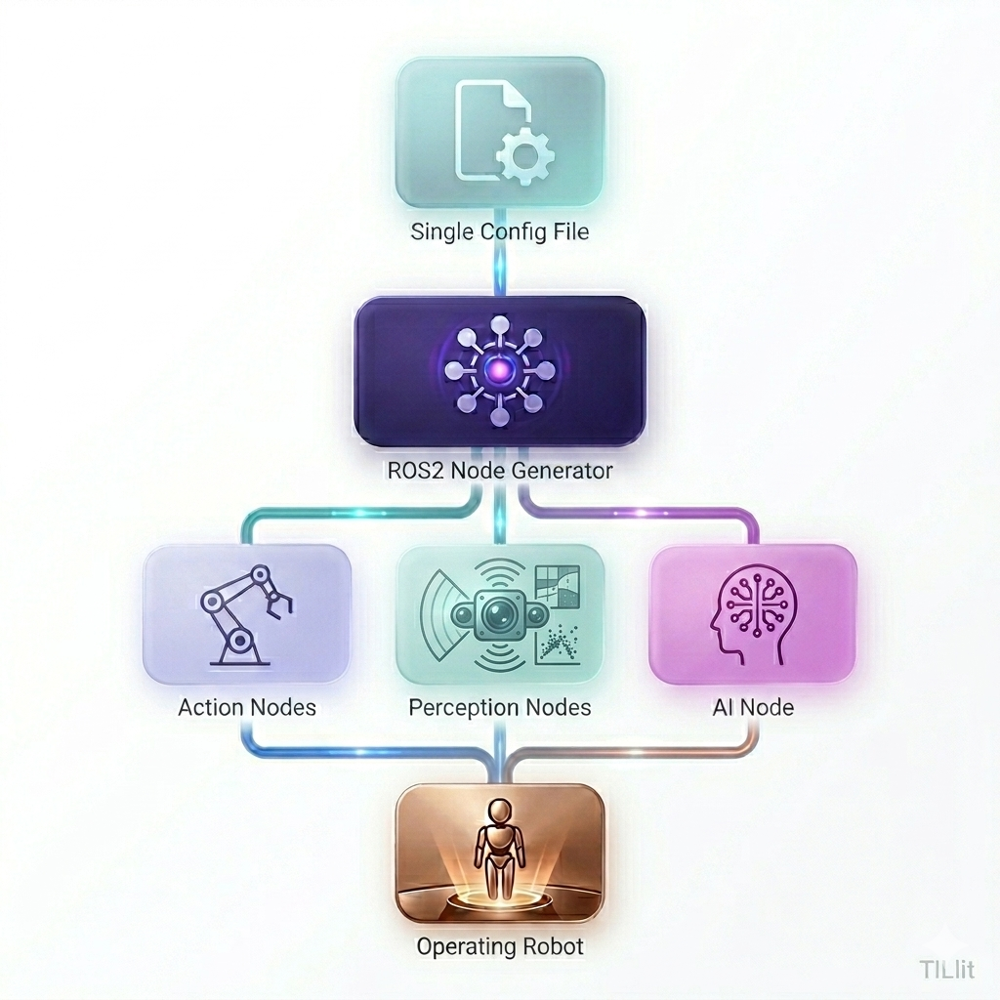

# Architecture

Joshua is a config-driven robotics stack: one protobuf text config defines hardware, AI policy, and operation mode; the launcher builds and runs the matching ROS 2 nodes. Monitoring and control are available through the React web control panel.



A representative preset: [`config/config_preset/so100/teleoperate.pbtxt`](../config/config_preset/so100/teleoperate.pbtxt).

## Directory contracts

Each linked `AGENTS.md` is the authoritative local rule and architecture contract.
This page maps owners; it does not maintain a second copy of their dependency,
initialization, or lifecycle rules. Shared design principles live in
[root coding guidelines](../AGENTS.md#coding-guidelines).

| Area | Authoritative contract |
| --- | --- |
| Protobuf schemas, presets, and validation | [config/AGENTS.md](../config/AGENTS.md) |
| Shared robot-layer invariants | [robot/AGENTS.md](../robot/AGENTS.md) |
| Motor semantics and command conversion | [robot/action/AGENTS.md](../robot/action/AGENTS.md) |
| Sensor I/O and backend cancellation | [robot/perception/AGENTS.md](../robot/perception/AGENTS.md) |
| Board protocols, channels, and coordinators | [robot/board/AGENTS.md](../robot/board/AGENTS.md) |
| Transport capabilities and physical connection ownership | [robot/comm/AGENTS.md](../robot/comm/AGENTS.md) |
| Component nodes, acquisition scheduling, callbacks, and real-node tests | [ros2/AGENTS.md](../ros2/AGENTS.md) |
| Graph processes, readiness, rollback, and shutdown | [launcher/AGENTS.md](../launcher/AGENTS.md) |
| Shared clocks and process failure boundaries | [utils/AGENTS.md](../utils/AGENTS.md) |
| Model adapters and data pipelines | [ai/AGENTS.md](../ai/AGENTS.md) |
| Simulators and backend environments | [simulation/AGENTS.md](../simulation/AGENTS.md) |
| Firmware adapters and portable protocol code | [firmware/AGENTS.md](../firmware/AGENTS.md) |
| Developer tools and recording | [tools/AGENTS.md](../tools/AGENTS.md) |
| Read-only MCP adapters and observation boundaries | [tools/mcp/AGENTS.md](../tools/mcp/AGENTS.md) |
| Container tasks, setup, and artifact preparation | [scripts/AGENTS.md](../scripts/AGENTS.md) |
| Hardware catalog data, validation specifications and evidence | [docs/hardware_catalog/AGENTS.md](hardware_catalog/AGENTS.md) |
| Documentation ownership | [docs/AGENTS.md](AGENTS.md) |

## Configuration layer (Protobuf)

All static configuration uses Protocol Buffers:

| Proto | Role |
|-------|------|
| `config.proto` | Top-level structure: `General`, `Robot`, `Ai` |
| `robot.proto` | Hardware: actions and perceptions |
| `ai.proto` | AI policies and model parameters |
| `action.proto` | Actuators, interfaces, operational parameters |
| `perception.proto` | Cameras, encoders, and other sensors |

Presets live under `config/config_preset/`. The launcher reads a `.pbtxt` file and instantiates the corresponding node graph.

## Runtime data layer (Protobuf + ROS 2)

At runtime Joshua uses protobuf packets internally and standard ROS 2 messages at the graph boundary.

### Internal packets

**`action_packet.proto`** — action commands:

- `joint`: named motion command with optional position, velocity, effort, explicit position encoding, independent velocity/effort units, and source metadata
- `preset`: middle position, idle, teardown, and torque enable/disable

**`perception_packet.proto`** — unified perception:

- Images (dimensions, encoding, raw bytes)
- Position (position, velocity)
- Generic sensor arrays with labels
- Point clouds (reserved for LiDAR/radar)

### Data flow

```
Hardware Interface → Protobuf Packets → ROS 2 Publishers → ROS 2 Messages
      → ROS 2 Subscribers → Protobuf Packets → Hardware Interface
```

### Design goals

- **Type safety** — protobuf at hardware boundaries
- **Performance** — efficient serialize/deserialize on hot paths
- **Compatibility** — ROS 2 types for ecosystem tools
- **Extensibility** — new sensors and action types without breaking the core
- **Modularity** — clear split between config, runtime packets, and ROS 2 topics

## Process runtime

The C++ `JOSHUA_MAIN` entrypoint macro delegates to a shared exception guard.
`JoshuaInit(config)` installs process services, starting with RobotTime; it does
not install a catch that survives an ordinary function return. ROS adapters own
their executor and node lifetime, and worker/destructor boundaries report
failures through the ROS-independent runtime utility.

The launcher owns one `NodeManager` in `launcher/node_manager/node_manager.h/.cc`.
It loads the config, resolves executables, and owns each job's guardian,
application PID, process group, readiness channels, exit history, and shutdown
sequence. ROS nodes and simulation share that manager and one registry of plain
node records. Robot drivers and ROS objects remain inside their application
process. See the [node manager guide](../launcher/node_manager/AGENTS.md) for the
Linux ownership contract and [ROS runtime guide](../ros2/AGENTS.md#process-runtime-and-failure-handling)
for startup, cancellation, and cleanup.

## Perception ownership

The camera, lidar, position and composed bus nodes own their per-sensor state and
optional acquisition workers in their complete `.cc` implementations. Factories
select drivers and resolve shared board/transport handles. Blocking sensors use
one guarded worker per sensor with latest-sample fan-out; scalar streams read the
existing coordinator cache without another worker. Audio preserves chunk streaming.
Shared helpers validate and convert caller-owned samples without a generic node
or an additional acquisition owner. See [ROS observation lifecycle and tests](../ros2/AGENTS.md#observation-readiness)
for cancellation, rollback, clocks and the uninterruptible-camera process fallback.

## Hardware topology and latency budgets

The normative topology and qualification rules live in
[robot/AGENTS.md](../robot/AGENTS.md#hardware-topology-and-latency-budgets).

## Related documentation

- [Getting started](GETTING_STARTED.md) — install and first run
- [ai/AGENTS.md](../ai/AGENTS.md) — inference engine, model plug-ins, per-model venvs
- [ai/train/AGENTS.md](../ai/train/AGENTS.md) — data collection (DataStore)
- [simulation/AGENTS.md](../simulation/AGENTS.md) — MuJoCo and Isaac Sim backends
- [ros2/AGENTS.md](../ros2/AGENTS.md) — ROS 2 type resolver utilities
- [launcher/node_manager/AGENTS.md](../launcher/node_manager/AGENTS.md) — node lifecycle and process ownership
