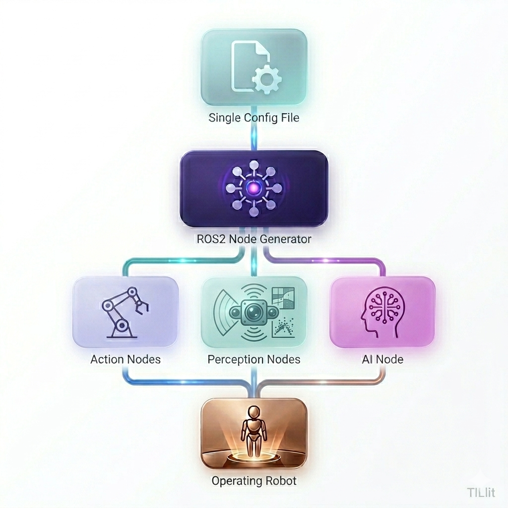

# Architecture

Joshua is a config-driven robotics stack: one protobuf text config defines hardware, AI policy, and operation mode; the launcher builds and runs the matching ROS 2 nodes. Monitoring and control are available through the React web control panel.



A representative preset: [`config/config_preset/so100/teleoperate.pbtxt`](../config/config_preset/so100/teleoperate.pbtxt).

## Configuration layer (Protobuf)

All static configuration uses Protocol Buffers:

| Proto | Role |
|-------|------|
| `config.proto` | Top-level structure: `General`, `Robot`, `Ai` |
| `robot.proto` | Hardware: actions and perceptions |
| `ai.proto` | AI policies and model parameters |
| `action.proto` | Actuators, interfaces, operational parameters |
| `perception.proto` | Cameras, encoders, and other sensors |

Presets live under `config/config_preset/`. The launcher reads a `.pbtxt` file and instantiates the corresponding node graph.

## Runtime data layer (Protobuf + ROS 2)

At runtime Joshua uses protobuf packets internally and standard ROS 2 messages at the graph boundary.

### Internal packets

**`action_packet.proto`** — action commands:

- `joint`: named motion command with optional position, velocity, effort, explicit position encoding, independent velocity/effort units, and source metadata
- `preset`: middle position, idle, teardown, and torque enable/disable

**`perception_packet.proto`** — unified perception:

- Images (dimensions, encoding, raw bytes)
- Position (position, velocity)
- Generic sensor arrays with labels
- Point clouds (reserved for LiDAR/radar)

### Data flow

```
Hardware Interface → Protobuf Packets → ROS 2 Publishers → ROS 2 Messages
      → ROS 2 Subscribers → Protobuf Packets → Hardware Interface
```

### Design goals

- **Type safety** — protobuf at hardware boundaries
- **Performance** — efficient serialize/deserialize on hot paths
- **Compatibility** — ROS 2 types for ecosystem tools
- **Extensibility** — new sensors and action types without breaking the core
- **Modularity** — clear split between config, runtime packets, and ROS 2 topics

## Process runtime

The C++ `JOSHUA_MAIN` entrypoint macro delegates to a shared exception guard.
`JoshuaInit(config)` installs process services, starting with RobotTime; it does
not install a catch that survives an ordinary function return. ROS adapters own
their executor and node lifetime, and worker/destructor boundaries report
failures through the ROS-independent runtime utility.

The launcher owns a `NodeGenerator`, which converts the config into process
specs. `ProcessSupervisor` owns each job's guardian, application PID, process
group, readiness channel, exit history, and shutdown/reaping sequence. Robot
drivers and ROS objects remain inside their application process. See the
[node generator guide](../node_generator/README.md) for the Linux ownership
contract and [ROS runtime guide](../ros2/README.md#process-runtime-and-failure-handling)
for startup, cancellation, and cleanup.

## Related documentation

- [Getting started](GETTING_STARTED.md) — install and first run
- [ai/README.md](../ai/README.md) — inference engine, model plug-ins, per-model venvs
- [ai/train/README.md](../ai/train/README.md) — data collection (DataStore)
- [simulation/README.md](../simulation/README.md) — MuJoCo and Isaac Sim backends
- [ros2/README.md](../ros2/README.md) — ROS 2 type resolver utilities
- [node_generator/README.md](../node_generator/README.md) — node generation from config
