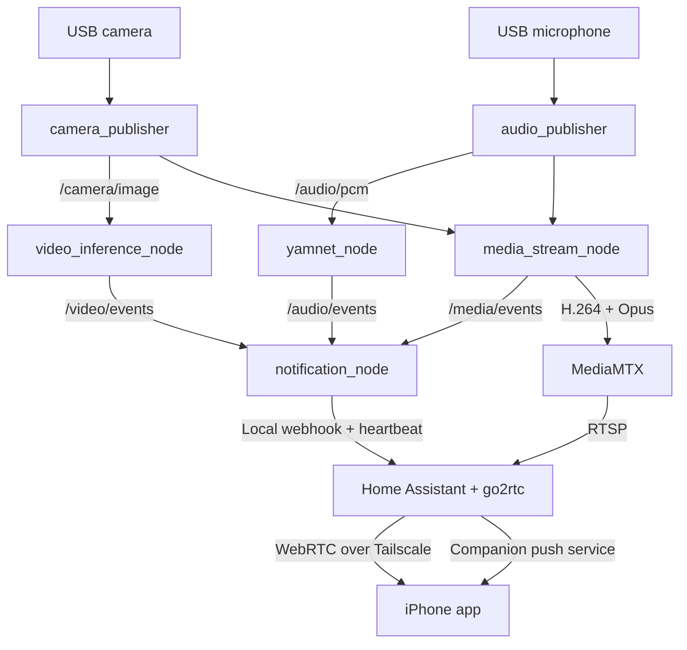

# Joshua baby monitor: implementation, deployment, and iPhone setup

This is the operating guide for the complete baby-monitor stack on
`experimental/baby-monitor`: USB camera and microphone capture, independent
audio/video inference, live streaming and recording, Home Assistant notifications, and automatic
startup on the Raspberry Pi 5.

The reusable audio pipeline is proposed for `develop` in
[PR #122](https://github.com/Joshua-AI-Robotics/Joshua/pull/122). The other stack
PRs (#123–127) are closed. The complete stack now lives on
`experimental/baby-monitor`; earlier stages are included here. Build this branch
to get the complete implementation. The audio PR alone does not contain the full
monitor.

## Contents

- [Deployment placeholders](#deployment-placeholders)
- [What is implemented](#what-is-implemented)
- [How the pipeline works](#how-the-pipeline-works)
- [Build and transfer the package](#build-and-transfer-the-package)
- [Deploy an update to the existing Pi](#deploy-an-update-to-the-existing-pi)
- [First installation on a new Pi](#first-installation-on-a-new-pi)
- [Connect the iPhone and add the camera](#connect-the-iphone-and-add-the-camera)
- [Configure and test notifications](#configure-and-test-notifications)
- [Continuous recording and storage](#continuous-recording-and-storage)
- [Operate and troubleshoot](#operate-and-troubleshoot)
- [Where to change the implementation](#where-to-change-the-implementation)

## Deployment placeholders

This public guide uses placeholders for deployment-specific values. Keep actual
addresses, usernames, phone actions, package checksums, and deployment notes in
private documentation. Replace angle-bracket placeholders before running commands.
The `~/joshua-*` paths below are suggested defaults, not a personal inventory.

| Item | Placeholder or default |
| --- | --- |
| Supported platform | Pi 5, Ubuntu 24.04 ARM64, ROS 2 Jazzy, Python 3.12 |
| SSH on the LAN | `<SSH_USER>@<PI_LAN_IP>` |
| Hostname / Tailscale IP | `<PI_HOSTNAME>` / `<PI_TAILSCALE_IP>` |
| Home Assistant address | `https://<PI_TAILSCALE_HOSTNAME>` |
| Direct browser stream | `http://<PI_TAILSCALE_IP>:8889/baby/` |
| Camera source inside Home Assistant | `rtsp://127.0.0.1:8554/baby` |
| Existing camera entity | `camera.<YOUR_CAMERA_ENTITY>` |
| iPhone action | `notify.mobile_app_<YOUR_PHONE>` |
| Active package symlink | `~/joshua-current` |
| Active release | `~/joshua-releases/<RELEASE_ID>/joshua_main` |
| Editable runtime config | `~/joshua-config/pi5_usb.pbtxt` |
| Home Assistant data and Compose deployment | `~/joshua-home-assistant` |
| Saved diagnostic recording | `~/joshua-data/<DIAGNOSTIC_RUN>/` |
| Continuous audio/video recordings | `~/joshua-data/recordings/` |
| Uploaded package | `<PACKAGE_ARCHIVE>.tar.gz` |
| Package SHA-256 | `<PACKAGE_SHA256>` |

Use the stable `~/joshua-current` symlink for operations. Fresh-install dashboard
templates expect `camera.baby_monitor`; an existing installation must retain
its actual entity ID or update the dashboard to match it.

## What is implemented

| Capability | Implementation |
| --- | --- |
| Microphone capture | ALSA C++ driver and independent ROS audio publisher |
| Audio inference | YAMNet running in its own Python process |
| Video inference | EfficientDet Lite0 plus frame-difference motion detection in a separate Python process |
| Live video and audio | H.264/Opus through MediaMTX, with WebRTC playback |
| Continuous recording | Approximately two-minute MP4 clips with audio, oldest-first cleanup, 20% filesystem reserve |
| iPhone interface | Home Assistant Companion app and Baby Monitor dashboard |
| Remote access | Private Tailscale access over Wi-Fi or cellular |
| Phone alerts | Cry, optional movement, outage, and recovery notifications |
| Reboot recovery | systemd starts Home Assistant and the full Joshua graph |
| Process failure recovery | Launcher exits on a child failure; systemd restarts the graph |

Continuous recording now retains as much history as the storage budget allows,
superseding the original two-minute total buffer request. Event-specific saved
clips and a recording timeline inside Home Assistant are not implemented.
`av_check` remains a separate manual diagnostic tool. Home Assistant's recorder
stores entity history; Joshua saves the actual camera footage.

YAMNet is a general sound classifier. Playback of a crying recording can be
classified as an animal or another sound; the score is not a calibrated
probability that a baby needs attention. Video motion covers the whole frame,
including adults, lighting changes, and camera movement. Object detection does
not implement infant pose, breathing, suffocation, or other danger detection.
Those capabilities and real-world detection accuracy have not been validated.

## How the pipeline works

The [Pi preset](../config/config_preset/baby_monitor/pi5_usb.pbtxt) is the source
of runtime configuration. `joshua_monitor_main` uses Joshua's node generator to
launch six independent ROS 2 processes. There is no monolithic baby-monitor node.



### Capture and inference

| Node | Input / output | Default behavior |
| --- | --- | --- |
| `camera_publisher` | Webcam → `/camera/image` (`sensor_msgs/msg/Image`) | Raw RGB, 640×480, 15 Hz publication, best-effort QoS, depth 1 |
| `audio_publisher` | USB mic → `/audio/pcm` (`std_msgs/msg/UInt8MultiArray`) | Serialized `PerceptionPacket`, signed 16-bit little-endian PCM, 16 kHz mono, 320 frames per chunk |
| `yamnet_node` | PCM → `/audio/events` | Approximately 0.975-second windows with half-window overlap; cry threshold 0.5, two positive windows |
| `video_inference_node` | Images → `/video/events` | EfficientDet Lite0 at 2 Hz, object score threshold 0.5; movement when changed-pixel fraction exceeds 0.03 |
| `media_stream_node` | Images + PCM → stream and `/media/events` | 640×480 at 15 fps, 1,500 kbps H.264, Opus audio |
| `notification_node` | All three event topics → HA and `/notification/events` | Persistent movement for two seconds, 60-second alert cooldown, input timeout 15 seconds |

All event topics use `std_msgs/msg/String` containing JSON. Audio events include
classification scores, top labels, `cry_started`, and `cry_ended`. Video events
include object labels, bounding boxes, motion fraction, and movement state.
Input failures and restoration are also reported.

The webcam's `MJPG` capture setting describes the USB capture format. The ROS
image topic is still decoded, raw RGB. Compression for phone viewing happens in
the media node, once, using GStreamer. Latest-frame/bounded audio queues and stale
input checks prevent a slow consumer from accumulating an old live feed. Home
Assistant/go2rtc relays the resulting H.264/Opus stream without another video
encode.

### Remote viewing and ports

| Endpoint | Binding / purpose |
| --- | --- |
| HTTPS 443 | Tailscale Serve → Home Assistant HTTP on `127.0.0.1:8123` |
| TCP/UDP 18555 | go2rtc WebRTC media on the Pi's Tailscale address |
| TCP 8554 | MediaMTX RTSP on loopback, stream `/baby` |
| TCP 8889 + TCP/UDP 8189 | Optional direct MediaMTX browser player and WebRTC media on Tailscale |
| TCP 1984 / 18554 | Loopback go2rtc management API / RTSP relay |

The normal app path needs Tailscale access to **443/TCP and 18555/TCP+UDP**.
If using restricted tailnet access rules, allow both for each viewer. The direct
browser player additionally needs 8889 and 8189. There is no public router port
forwarding or Tailscale Funnel in this setup.

Home Assistant and go2rtc run in host-network Docker containers. They do not open
the webcam or microphone: Joshua owns capture. Docker images are pinned in
[`compose.yaml`](../deploy/home_assistant/compose.yaml), currently Home Assistant
2026.10.2 and go2rtc 1.9.14.

### Notifications and health

The notification node posts events and a periodic status heartbeat to a local
Home Assistant webhook. The private credential is stored in
`~/joshua-home-assistant/webhook.secret`, with its matching value in
`config/secrets.yaml`. The service supplies its path through
`JOSHUA_HA_WEBHOOK_FILE`; keep both secret files out of Git.

Home Assistant owns phone recipients, notification switches, and an independent
availability watchdog. This is why it can alert when the entire Joshua launcher,
including the notification node, stops.

| Dashboard status | Meaning |
| --- | --- |
| `starting` | Inputs have not become ready yet |
| `online` | Every configured input is healthy |
| `degraded` | Some inputs are healthy and others have failed |
| `offline` | No healthy inputs, or no bridge heartbeat for 30 seconds |

Cry/movement entities become unavailable if their own source is stale or the
bridge disappears. Healthy audio remains valid during a video-only failure.
Media startup cannot keep the whole monitor marked online when inference is
offline.

With notifications enabled and recipients configured, the HA watchdog checks
every 15 seconds and alerts when offline/degraded status has lasted 15 seconds.
Full heartbeat loss normally produces one outage notification after roughly
45–70 seconds; exact timing depends on the heartbeat and watchdog schedules. Ten
seconds of healthy operation triggers a recovery notification and resets outage
suppression. Brief
failures repaired before these windows may not alert.

The bridge queues bounded, expiring events and retries failed HTTP requests.
HTTP acceptance only means Home Assistant accepted the request, not that a phone
displayed it. A single Pi power or network failure also disables its local HA
watchdog; detecting that remotely needs an external uptime monitor.

## Build and transfer the package

Run these commands **on the development machine**, from this branch's checkout.
Commit intended source changes first so the release name identifies the build.

```bash
cd ~/Joshua
git branch --show-current
TARGET=//launcher:joshua_pkg docker compose run --rm build-u24-arm64
```

Use **`//launcher:joshua_pkg`** for this monitor. It contains the monitor launcher,
six nodes, model files, Python runfiles, MediaMTX, and HA deployment templates and
scripts. Preserve the entire extracted directory. Copying only the launcher or
one Python executable loses its runtime dependencies.

Compose writes `dist/u24/arm64/joshua_pkg-<VERSION>-u24-arm64.tar.gz`. The build
needs an ARM64 Ubuntu 24/Jazzy environment; an x86 host needs ARM64 container
emulation configured. Architecture flags alone do not supply a cross-compilation
sysroot. See [development setup](GETTING_STARTED.md).

Inside an already prepared ARM64/Jazzy build environment, Bazel can also run
directly from the repo root:

```bash
source /opt/ros/jazzy/setup.bash
bazel build --config=u24 --config=arm64-base \
  --@rules_python//python/config_settings:python_version=3.12 \
  //launcher:joshua_pkg
```

That produces `bazel-bin/launcher/joshua_pkg.tar.gz`; copy it into the versioned
`dist/u24/arm64/` filename before using the following transfer commands. With the
Compose build, that copy is already done.

```bash
monitor_version=$(cat VERSION)
monitor_release=$(git rev-parse --short HEAD)
monitor_archive="joshua_pkg-${monitor_version}-u24-arm64-${monitor_release}.tar.gz"
cp "dist/u24/arm64/joshua_pkg-${monitor_version}-u24-arm64.tar.gz" \
  "dist/u24/arm64/$monitor_archive"
(
  cd dist/u24/arm64
  sha256sum "$monitor_archive" > "$monitor_archive.sha256"
)
scp "dist/u24/arm64/$monitor_archive" \
  "dist/u24/arm64/$monitor_archive.sha256" "<SSH_USER>@<PI_LAN_IP>:~/"
printf 'Release: %s\nArchive: %s\n' "$monitor_release" "$monitor_archive"
```

The archive is an application package, not an OS image. ROS, shared libraries,
GStreamer, Docker, and Tailscale remain host dependencies. HA/go2rtc container
images are downloaded separately by Docker.

## Deploy an update to the existing Pi

Run **on the Pi**. Substitute the release and archive printed by the build.
Do not run the fresh-install renderer over the existing HA deployment.

```bash
cd ~
monitor_release=REPLACE_WITH_COMMIT
monitor_archive=REPLACE_WITH_ARCHIVE_NAME.tar.gz
sha256sum -c "$monitor_archive.sha256"
mkdir -p "$HOME/joshua-releases"
mkdir "$HOME/joshua-releases/$monitor_release"
tar -xzf "$monitor_archive" -C "$HOME/joshua-releases/$monitor_release"
test -x "$HOME/joshua-releases/$monitor_release/joshua_main/joshua_monitor_main"
```

Proceed only if the checksum and extraction succeed. `mkdir` deliberately fails
if that release directory already exists; do not unpack over a running release.
Review any preset/schema changes before switching. The active config remains
`~/joshua-config/pi5_usb.pbtxt`; new packaged defaults do not overwrite it.

Switch releases during a planned interruption:

```bash
monitor_previous=$(readlink -f "$HOME/joshua-current")
printf 'Previous package: %s\n' "$monitor_previous"
sudo systemctl stop joshua-monitor
ln -s "$HOME/joshua-releases/$monitor_release/joshua_main" "$HOME/joshua-current.next"
mv -Tf "$HOME/joshua-current.next" "$HOME/joshua-current"
monitor_scripts="$HOME/joshua-current/joshua_monitor_main.runfiles/_main/deploy/home_assistant"
sudo bash "$monitor_scripts/install_services.sh" "$HOME/joshua-current" \
  "$HOME/joshua-config/pi5_usb.pbtxt" "$HOME/joshua-home-assistant" "$USER"
sudo systemctl start joshua-monitor
sudo journalctl -u joshua-monitor -n 80 --no-pager
```

The installer refreshes service scripts and enables boot startup; it preserves
HA accounts, credentials, and configuration. Verify live audio/video, all input
statuses, and a dashboard notification before removing the previous release.
Keep its printed path for rollback. A sufficiently long maintenance interruption
can trigger the normal outage alert.

**HA template changes require a separate update.** Replacing the Joshua archive
does not overwrite active HA YAML. For changes to `deploy/home_assistant/joshua.yaml`:

```bash
monitor_backup="$HOME/joshua-backups/$(date +%Y%m%dT%H%M%S)"
mkdir -p -m 700 "$monitor_backup"
sudo cp -a "$HOME/joshua-home-assistant/config/packages/joshua.yaml" "$monitor_backup/"
sudo cp "$monitor_scripts/joshua.yaml" \
  "$HOME/joshua-home-assistant/config/packages/joshua.yaml"
sudo docker exec joshua-home-assistant \
  python -m homeassistant --script check_config --config /config
```

Restart only after the config check passes:

```bash
cd ~/joshua-home-assistant
sudo docker compose restart homeassistant
```

Merge dashboard changes into `config/baby-monitor.yaml`, retaining the actual
camera entity ID. Merge changes to `configuration.yaml`, `compose.yaml`, and
`go2rtc.yaml` deliberately, preserving local URLs and settings. Do not replace
`.storage`, `webhook.secret`, or `secrets.yaml` with fresh-install output. Back up
the entire HA deployment privately before a broader HA upgrade.

To roll back the application in the same shell, stop the monitor, point the
symlink at the saved release, rerun that release's installer, and start:

```bash
test -x "$monitor_previous/joshua_monitor_main"
sudo systemctl stop joshua-monitor
ln -s "$monitor_previous" "$HOME/joshua-current.next"
mv -Tf "$HOME/joshua-current.next" "$HOME/joshua-current"
monitor_scripts="$HOME/joshua-current/joshua_monitor_main.runfiles/_main/deploy/home_assistant"
sudo bash "$monitor_scripts/install_services.sh" "$HOME/joshua-current" \
  "$HOME/joshua-config/pi5_usb.pbtxt" "$HOME/joshua-home-assistant" "$USER"
sudo systemctl start joshua-monitor
```

Also restore any incompatible config/HA YAML changes from the corresponding
backup. If the previous release was removed, transfer and extract its archive again
before rolling back.

## First installation on a new Pi

Skip this section if your Pi is already configured.

### 1. Prepare the runtime and devices

Use Ubuntu 24.04 ARM64 with ROS 2 Jazzy and the matching OpenCV runtime installed.
Install the additional runtime tools:

```bash
sudo apt-get update
sudo apt-get install -y libasound2t64 alsa-utils v4l-utils \
  python3-gi gir1.2-gstreamer-1.0 gir1.2-gst-plugins-base-1.0 \
  gstreamer1.0-tools gstreamer1.0-plugins-base gstreamer1.0-plugins-good \
  gstreamer1.0-plugins-bad gstreamer1.0-plugins-ugly gstreamer1.0-rtsp \
  docker.io docker-compose-v2 curl
```

**`libasound2t64` is required on Ubuntu 24.04.** Missing it caused both capture
executables to fail with `libasound.so.2: cannot open shared object file`.

Install and authenticate Tailscale on the Pi and iPhone. Confirm `tailscale ip -4`
returns the Pi's address. Connect the USB webcam/microphone and ensure the service
user can access `/dev/video*` and `/dev/snd/*` (normally the `video` and `audio`
groups). Inspect devices with:

```bash
arecord -l
arecord -L
v4l2-ctl --list-devices
```

The supplied config opens camera index 0 and
`plughw:CARD=Camera,DEV=0`. Change those to match the actual devices. ALSA's
`default` device can point at an HDMI playback device with no capture input.

### 2. Extract and configure Joshua

Build, transfer, verify, and extract the package using the preceding sections.
For a fresh installation, create the stable symlink and editable preset:

```bash
ln -s "$HOME/joshua-releases/$monitor_release/joshua_main" "$HOME/joshua-current"
mkdir -p "$HOME/joshua-config" "$HOME/joshua-data"
cp "$HOME/joshua-current/joshua_monitor_main.runfiles/_main/config/config_preset/baby_monitor/pi5_usb.pbtxt" \
  "$HOME/joshua-config/pi5_usb.pbtxt"
```

Review the preset before starting it: this configuration opens real camera and
microphone devices even though its operation mode is `MODE_TEST`.

### 3. Create Home Assistant and private HTTPS

The renderer creates a **new** deployment directory and refuses an existing one
to preserve accounts and secrets:

```bash
cd ~/joshua-current
source /opt/ros/jazzy/setup.bash
./ros2_node_wrapper.sh home_assistant_setup \
  --config "$HOME/joshua-config/pi5_usb.pbtxt" \
  --output "$HOME/joshua-home-assistant" \
  --tailscale-ip "$(tailscale ip -4)"
cd ~/joshua-home-assistant
sudo docker compose up -d
sudo tailscale serve --bg --https=443 http://127.0.0.1:8123
```

If Tailscale requests that Serve be enabled, follow the admin URL it prints,
enable Serve, and rerun the command. Use the resulting private HTTPS hostname in
the phone app. The renderer seeds loopback HTTP settings for the pinned HA
version; routine setup does not require editing HA's `.storage` files.

### 4. Install automatic startup

Stop any older manually launched Joshua graph or standalone media/notification
services before starting the new graph. Do not run two capture pipelines against
the same webcam and microphone.

```bash
monitor_scripts="$HOME/joshua-current/joshua_monitor_main.runfiles/_main/deploy/home_assistant"
sudo bash "$monitor_scripts/install_services.sh" "$HOME/joshua-current" \
  "$HOME/joshua-config/pi5_usb.pbtxt" "$HOME/joshua-home-assistant" "$USER"
sudo systemctl start joshua-monitor
sudo journalctl -u joshua-monitor -f
```

The installer enables services but does not start capture until the explicit
`systemctl start`. It enables user lingering so logind preserves Fast DDS shared
memory after the last SSH session closes. Keep lingering enabled: without it,
processes can remain alive while their ROS data flow stops after logout.

## Connect the iPhone and add the camera

1. Enable Tailscale on the iPhone. Open the Pi's HTTPS address,
   **`https://<PI_TAILSCALE_HOSTNAME>`**. Complete HA onboarding if this is a
   new installation and create your owner account.
2. Install **Home Assistant**, published by **Nabu Casa, Inc.** Add a server
   manually using that same HTTPS address, sign in, allow notifications, and
   give the phone a recognizable device name.
3. In HA, check **Settings → System → Network**. Both the Home Assistant URL and
   local network URL should use the Tailscale HTTPS address. Disable automatic
   local URL selection if shown. If the URLs are managed by YAML, update the
   corresponding settings there. Existing installations may already have the
   correct URLs.
4. For a new installation, open **Settings → Devices & services → Add
   integration → Generic Camera**. Set stream source to
   **`rtsp://127.0.0.1:8554/baby`**, transport to **TCP**, still-image URL blank,
   and credentials blank. This loopback address is used by HA on the Pi, not by
   the phone directly.
5. Name the device **Baby Monitor**. For a fresh dashboard, set its entity ID to
   **`camera.baby_monitor`** in entity settings. A display name and an entity ID
   are different fields. If your existing entity has a different ID, use that ID
   in the dashboard rather than creating a duplicate camera.
6. Open **Baby Monitor** in the sidebar. Tap the camera for playback controls and
   unmute. iOS can require a tap before audio plays; continuous playback while
   the app is backgrounded or the phone is locked is not guaranteed.
7. Test with Wi-Fi disabled and Tailscale connected over cellular. Optionally set
   Baby Monitor as your default dashboard in your HA profile.

For another person, grant their Tailscale identity access to the Pi, create a
separate HA user, and connect their app to the same HTTPS address. Each phone
registers its own notification action. A Home Assistant Cloud subscription is
not required for this deployment.

If Generic Camera preview spins forever, confirm the stream is running and the
HA network URLs are HTTPS/Tailscale URLs. The preview uses an absolute HLS URL;
an automatically chosen HTTP/LAN address can break it. Close and reopen the
camera setup dialog after fixing URLs. A stale preview can expire after 60
seconds with `Stream is not configured for format 'hls'`.

## Configure and test notifications

1. Open **Settings → Tools → Actions** in this HA version. Search for
   `notify.mobile_app_` and find the action registered by the iPhone. These tools
   are not a separate Developer Tools sidebar item in this installation.
2. On the **Baby Monitor** dashboard, save that exact action in **Phone
   notification actions**. Use **`notify.mobile_app_<YOUR_PHONE>`**, replacing the
   placeholder with the action registered by your app. For multiple phones, enter their
   actual action names separated by commas.
3. Check that **Joshua notification configured** is on. This checks recipient
   configuration, not delivery; a misspelled or obsolete action still needs to
   be caught by a real test.
4. Press the dashboard's **Send test notification** button. Confirm the push
   appears on the locked phone and tapping it opens `/baby-monitor/live`.
5. Enable **Notifications**. Enable **Movement notifications** separately if
   desired. On a fresh installation these need explicit setup.

Calling an action directly in Tools does **not** populate the dashboard's phone
recipient field. An empty field was the cause of a previously missing automatic
alert even though the manual action test worked.

Notification text uses Home Assistant's push service and Apple/Google push
infrastructure. Tailscale is required to open the private dashboard and stream;
ordinary push text delivery does not require the VPN. This configuration does
not upload camera snapshots with notifications. Cry-start notifications request
the default iPhone critical sound at full volume; enable Critical Alerts for
Home Assistant in iOS notification settings. Movement, outage, recovery, and
the dashboard test remain ordinary notifications. After the initial alert,
Home Assistant sends another critical alert approximately every minute while
crying stays detected. Reminders stop when crying clears, audio becomes
unavailable, Notifications is disabled, or no phone recipient is configured.
They go to all configured phones. A new crying period or re-enabling alerts
starts a fresh minute; HA restart or automation reload resets the reminder wait.
Detection persistence and the 60-second cooldown for new cry-start events remain
unchanged; the cooldown does not suppress these reminders.

### Test detection separately from delivery

With the running graph, inspect the actual classifier outputs on the Pi:

```bash
source /opt/ros/jazzy/setup.bash
ros2 topic echo /audio/events std_msgs/msg/String
# In another terminal:
ros2 topic echo /video/events std_msgs/msg/String
```

For audio, look for the `Baby cry, infant cry` score and `cry_started`, not just
the top label. Two positive windows at the configured threshold are needed.
A phone test push proves the delivery path, not cry recognition. Test recordings
and actual microphone placement/background noise separately before changing
thresholds. Lowering a threshold can increase false alerts.

For video, move within the camera view and inspect `movement` and
`motion_fraction`. The bridge requires persistent movement for two seconds;
movement notifications must also be enabled in HA. COCO object labels alone do
not trigger a danger alert.

### Test outage and recovery

During a planned test, stop the graph while leaving HA running:

```bash
sudo systemctl stop joshua-monitor
```

Expect unavailable detection entities, offline status after heartbeat expiry,
and an outage push in roughly 45–70 seconds. Then restart:

```bash
sudo systemctl start joshua-monitor
```

Confirm online status, restored audio/video, and a recovery push. Verify this on
your deployment after setup. Monitoring is paused during the stop interval.

## Continuous recording and storage

Recording starts automatically with `joshua-monitor.service`, including after a
reboot. The media node encodes the camera and microphone once. A separate,
listener-free MediaMTX process reads the local RTSP stream and saves those encoded
tracks as fragmented MP4 files; no second camera capture or encode is needed.

The media-stream block in the editable runtime protobuf config controls it:

```protobuf
recording_directory: "~/joshua-data/recordings"
recording_segment_sec: 120
recording_reserve_percent: 20
```

An empty `recording_directory` disables recording. Use an empty, dedicated
writable directory; relative paths other than `~/...`, percent signs, and
newlines are rejected. The default duration is 120 seconds; keyframe alignment
may make clips slightly longer, and shutdown or a lost input makes shorter clips.
Each process session has a `run-<ID>/` directory containing timestamped `.mp4`
files and `.complete` markers for finalized clips. Leave the markers in place.
H.264 video and Opus audio can be viewed with a player that supports both, such
as VLC. A recording timeline/download UI in Home Assistant is separate future work.

The reserve is **20% of the entire filesystem containing the recordings**, not
20% of whatever happens to be free. Existing OS, Docker, logs, packages, and other
files count against the 80% used-space ceiling. A two-second check deletes the
oldest completed managed clips until 20% plus a safety margin is available. The
margin is at least 512 MiB, or twice an estimated full clip size, whichever is
larger. Retention therefore adjusts as other applications consume storage. It
never deletes unrelated files or the clip currently being written. Save clips
you want to keep outside the managed directory.

If it cannot reclaim enough space, it closes the recording process, makes its
last clip eligible for cleanup, and waits for space before resuming. Live viewing,
inference, and notifications continue. The directory is locked against concurrent
recorders. After a restart, interrupted clips from previous sessions can expire;
an abrupt power loss can leave the final fragment incomplete. This policy is not
a filesystem partition or quota: unrelated applications can still consume the
reserve between checks. Recording errors and pauses are reported in the journal,
`status.json`, and the `recording` field of `/media/events`; they do not currently
send a dedicated phone alert.

Check recordings on the Pi:

```bash
cat "$HOME/joshua-data/recordings/status.json"
find "$HOME/joshua-data/recordings" -name '*.complete' -type f | sort | tail
du -sh "$HOME/joshua-data/recordings"
df -h "$HOME/joshua-data/recordings"
journalctl -u joshua-monitor.service -n 100 --no-pager
```

`status.json` includes state, available bytes, reserved bytes, and the number of
clips deleted by the current recorder process. Check `observed_at_ns` as well;
a stopped service leaves its last status file on disk. Files remain local and
private; no footage is uploaded to Home Assistant cloud storage. Package updates
keep recordings outside versioned releases. Edit the runtime config and restart
`joshua-monitor.service` to change recording settings.

## Operate and troubleshoot

### Startup and service control

`joshua-home-assistant.service` starts the Docker deployment after network and
Tailscale readiness. `joshua-monitor.service` sources ROS Jazzy, reads
`/etc/joshua-monitor.env`, waits for HA/Tailscale, and runs:

```text
./joshua_monitor_main --config=/home/<SSH_USER>/joshua-config/pi5_usb.pbtxt --exit_on_node_failure
```

That flag makes a child exit fail the entire graph; systemd restarts it after
five seconds. A direct SIGINT to the service's launcher also causes a restart.
Use `systemctl stop` for an intentional stop. Stopping the monitor leaves HA
running so the watchdog can alert. A stopped but enabled monitor starts again
after reboot.

```bash
sudo systemctl status joshua-monitor joshua-home-assistant
sudo journalctl -u joshua-monitor -f
sudo systemctl restart joshua-monitor
loginctl show-user "$USER" -p Linger
```

Check containers separately; the HA systemd unit is a oneshot startup unit, not
continuous proof of application health:

```bash
cd ~/joshua-home-assistant
sudo docker compose ps
sudo docker compose logs --tail=80 homeassistant go2rtc
```

After a planned reboot, verify both services, online input states, live audio
and video, and phone access without a manual launcher command. Also verify that
streaming continues after closing SSH sessions.

### Record a short diagnostic sample

Run **on the Pi while the service is running**. This subscribes to existing
publishers and writes a WAV, image, summary, and events:

```bash
mkdir -p ~/joshua-data
cd ~/joshua-current
source /opt/ros/jazzy/setup.bash
./ros2_node_wrapper.sh av_check \
  --config "$HOME/joshua-config/pi5_usb.pbtxt" \
  --seconds 10 --output "$HOME/joshua-data/av-check-$(date +%Y%m%d-%H%M%S)"
```

### Common symptoms

| Symptom | Check / fix |
| --- | --- |
| `libasound.so.2` missing | Install `libasound2t64` on the Pi. |
| ALSA `capture slave is not defined` / `open audio: Invalid argument` | Use the capture card from `arecord -l`; update `alsa_audio_config.device` instead of relying on `default`. |
| `media_stream_node: No such file or directory` | Old/incomplete package; deploy the complete `joshua_pkg` from this branch and preserve runfiles. |
| ROS image subscriber reports incompatible reliability | Publisher uses best-effort QoS; subscriber must accept best-effort, e.g. SensorDataQoS. |
| Raw remote ROS image viewer has long delay | Use the encoded WebRTC feed for phone viewing; raw images consume substantial bandwidth. |
| Dashboard says entity not found | Match its camera entity to the actual integration entity, using `camera.<YOUR_CAMERA_ENTITY>` for an existing installation. |
| App connects but WebRTC does not | Check Tailscale access to 18555 TCP/UDP as well as HTTPS 443. |
| Direct player works, HA preview fails | Check HA's network URLs, exact `rtsp://` source, and refresh the setup dialog. |
| Cry playback gets animal labels | Inspect captured audio and scores; the classifier can misclassify. Successful streaming does not establish recognition accuracy. |
| Manual phone action works, automatic alerts do not | Save the action in Phone notification actions, enable Notifications, and test from the dashboard. |
| Processes alive but topics stop after SSH logout | Confirm `Linger=yes`; rerun the current service installer, then restart the monitor. |
| Entities unavailable after launcher stopped | Expected after input/heartbeat expiry; the independent HA watchdog should alert if enabled and configured. |

## Where to change the implementation

| Area | Source | Deployment required |
| --- | --- | --- |
| ALSA driver | [`robot/perception/audio/`](../robot/perception/audio/) | Rebuild package |
| Audio ROS publisher | [`ros2/audio_publisher.cc`](../ros2/audio_publisher.cc) | Rebuild package |
| YAMNet processing | [`processor.py`](../ai/models/yamnet/processor.py), [`yamnet_node.py`](../ros2/yamnet_node.py) | Rebuild package |
| Video processing | [`processor.py`](../ai/models/video_detection/processor.py), [`video_inference_node.py`](../ros2/video_inference_node.py) | Rebuild package |
| Streaming | [`media_stream.py`](../ros2/utils/media_stream.py), [`media_stream_node.py`](../ros2/utils/media_stream_node.py) | Rebuild package |
| Notification policy / transport | [`notification.py`](../ros2/utils/notification.py), [`notification_node.py`](../ros2/utils/notification_node.py) | Rebuild package |
| Thresholds, devices, rates, bitrate | [`pi5_usb.pbtxt`](../config/config_preset/baby_monitor/pi5_usb.pbtxt) | Edit active Pi config and restart monitor; keep source preset in sync |
| HA automation / dashboard | [`joshua.yaml`](../deploy/home_assistant/joshua.yaml), [`baby-monitor.yaml`](../deploy/home_assistant/baby-monitor.yaml) | Merge into active HA deployment; validate/reload or restart HA |
| Recording / retention | [`media_recording.py`](../ros2/utils/media_recording.py), [`util.proto`](../config/proto/util.proto) | Rebuild package; preserve external recordings and runtime config |
| Fresh HA setup | [`home_assistant_setup.py`](../ros2/utils/home_assistant_setup.py) | Rebuild package; renderer applies only to new deployments |
| Boot behavior | [`install_services.sh`](../deploy/home_assistant/install_services.sh), [`run_monitor.sh`](../deploy/home_assistant/run_monitor.sh) | Rebuild package and rerun installer |
| Launcher supervision | [`joshua_main.cc`](../launcher/joshua_main.cc), [`node_generator.cc`](../node_generator/node_generator.cc) | Rebuild package |
| Package contents | [`launcher/BUILD`](../launcher/BUILD) | Rebuild package |

Python changes also require repackaging: the deployed executable uses bundled
runfiles, not the development checkout. Config-only changes require a monitor
restart, but no build. Model replacements must preserve the processor's input,
output, and label contracts or update the processor with them.

For code changes, run relevant tests in the matching development environment.
The repository's full CI-equivalent entrypoints are `docker compose run --rm
test-u22` and `docker compose run --rm test-u24`. Hardware checks remain separate:
live audio/video, real phone delivery, outage/recovery, reboot, and SSH logout.
Passing those integration checks does not establish infant cry/danger detection
accuracy.
