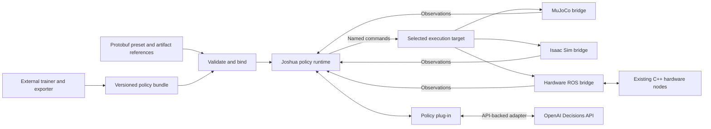

# Policy interface and execution bridges: Decisions API first

Status: **Proposed implementation plan; no runtime changes in this document.**

Prepared 2026-11-09 against `develop` at `68605e76`. The separate
`kangjin/spider-joshua-integration` branch at `9ab34b7a` is a design reference,
not an implemented dependency on this branch.

Priority updated 2026-11-10: implement a reusable OpenAI Decisions API interface
first, then build the camera-head demo on top of it. The demo's physical execution
depends on the shared head-runtime foundation in
[milestone #153](https://github.com/Joshua-AI-Robotics/Joshua/issues/153);
the reusable interface and hardware-free replay can be developed independently.
R2S2R training/transfer and broader policy/simulator integration follow later.

## 1. Outcome and scope

First, build a reusable OpenAI Decisions API interface on the shared asynchronous
inference runtime. It accepts application-supplied image, text, and JSON evidence
and question definitions, constructs API requests, and returns validated decisions.
Camera-head questions, joint requirements, and motor-control logic belong to the
application using this interface.

Then build the [OpenAI Decisions API camera-head demo](demo-plan/OPENAI_DECISIONS_CAMERA_HEAD_DEMO.md)
as its first consumer. The demo supplies USB camera images and the current pan
angle read back from the STS3215 servo, defines its questions and acceptance thresholds, and maps
accepted decisions to bounded head movements. It needs no IMU, trained checkpoint,
or simulator execution bridge.

Then run compatible policies through Joshua against MuJoCo, Isaac Sim, or physical
hardware without changing their observation and action meanings. Later, expand
this observation-and-command interface to support locomotion policies, which
control how a robot walks or otherwise moves from place to place, and
vision-language-action (VLA) policies, which use visual observations and language
instructions to produce robot actions. Each policy declares the inputs and
outputs it needs. Training
may happen in mjlab, Isaac Lab, LeRobot, or another external workflow; the runtime contract
must not depend on which trainer produced the policy.

Extend the existing [inference plug-in architecture](../ai/README.md#inference-architecture),
implemented by the ROS-free [InferenceAdapter contract](../ai/inference/adapter.py),
shared [Observation and ActionCommand types](../ai/inference/types.py),
ROS [InferenceHost](../ai/inference/host.py), and
[manifest-driven adapter registry](../ai/models/registry.py).
Under the proposed extension, Joshua owns typed data,
backend bindings, lifecycle, timing enforcement, and command routing. Plug-ins
own model loading, preprocessing, normalization, inference, and postprocessing.
Each backend supplies its own bridge. Each training workflow supplies its own
export integration.

Interface reuse does not imply weight reuse. Policies declare their compatible
robot structure, observations, actions, and operating envelope. Two units of the
same design may share weights after calibration and validation; a different
morphology may require a new policy and simulation model.

This plan does not build a universal trainer, automatically generate accurate
physics from a hardware preset, impose one observation vector on all models,
or qualify physical deployment. It does not introduce MCP into the control loop.
The first delivery is the minimum shared contract and a reusable OpenAI Decisions
API adapter with hardware-free replay. The next delivery builds the camera-head
demo on that interface and connects it to the validated camera-head hardware and
control path. Do not make either delivery depend on locomotion/VLA migration,
MuJoCo/Isaac execution, recurrent
models, action chunks, or training/export tooling. The nervous-system demo's
separate simulator-view/restart requirements remain in its own plan.

### Reusable OpenAI Decisions API interface first

The [official Decisions guide](https://developers.openai.com/api/docs/guides/decisions)
defines typed answers from image, text, and JSON evidence; Joshua executes any
resulting movement. The reusable adapter owns API request construction and response
validation. Applications supply evidence, questions, and acceptance settings;
the shared runtime enforces request identity, deadlines, and lifecycle rules.
The adapter returns decisions without interpreting them as motor commands.
Verify API/model/SDK availability and pin versions when implementing.

Validate this interface with synthetic evidence and captured responses before
building the demo. Include a non-head question fixture to verify that the adapter
does not require joint state, head-specific choices, or a motor command sink.

### Next delivery: camera-head demo on the reusable interface

Follow the camera-head demo's D0 contract for question choices, preprocessing,
confidence thresholds, cadence, request/retry budget, and bounded movement.
Keep these settings and the choice-to-pan converter in the demo integration.

The demo reads the STS3215 servo's built-in position feedback through the servo
bus and converts it to the camera head's pan angle using its calibration. This
is the measured position, which may differ from the commanded target while the
head moves. No separate external encoder is required.

Use this path:

```text
camera image + current pan angle read back from the servo
    -> admissible observation snapshot
    -> asynchronous Decisions adapter -> validated decision
    -> calibrated bounded pan mapping -> named joint position command (e.g., head_pan target = 0.52 radians)
    -> existing C++ control gate and bus owner -> measured feedback
```

- The shared runtime owns sample metadata, image/joint age and skew checks,
  run/config/source identity, request deadlines, result admission, and diagnostics.
  Keep one request in flight and one bounded pending snapshot. Ingestion, recording,
  and local stop handling continue while a request waits. Bound SDK retries inside
  the total request budget.
- The ROS-free Decisions plug-in owns request construction and response validation:
  question/type/choice, finite confidence/probabilities, refusal, and API errors.
  Keep SDK dependencies in its model environment. No API-specific branches belong
  in the shared scheduler or device driver.
- An explicit head converter maps an accepted left/right choice to one bounded
  increment from fresh measured position, then an absolute SI target. Calibration,
  deadband, step size, speed/position limits, and target-loss behavior come from the
  preset and referenced artifacts. Centered/absent/uncertain/refused results do not
  create new pan increments; invoke the selected local hold/stop behavior as defined
  by the demo. No result may enable hardware.
- Before dispatch, recheck input age, feedback age/skew, motion since the request,
  and run/config/source identity. Consume each accepted observation ID at most once.
  Reject expired, superseded, duplicate, or prior-generation results, including
  replies arriving after stop, reset, source switch, or a hardware/config change.
  A newer frame alone does not invalidate an otherwise admissible answer.
- Reuse the hardware owner's enable/stop/recovery lifecycle. Reset invalidates
  pending work before any new commands are admitted; API recovery never re-enables
  the head. Credentials stay outside source-controlled configuration and recordings.

The current host calls adapters directly inside ROS callbacks and publishes only
scalar Float32 commands. Adding a blocking SDK call there is insufficient. Extend
the versioned path with bounded asynchronous execution and named SI output while
preserving legacy adapters. Preserve request identity and expiry through admission;
if the final ROS message cannot carry them, specify the admission wrapper and its
stop/source-change ordering rather than dropping that metadata silently.

After the foundation PRs merge, reconcile [#145](https://github.com/Joshua-AI-Robotics/Joshua/pull/145),
[#149](https://github.com/Joshua-AI-Robotics/Joshua/pull/149),
[#143](https://github.com/Joshua-AI-Robotics/Joshua/pull/143), and
[#133](https://github.com/Joshua-AI-Robotics/Joshua/pull/133) when taking up this work.
Software adapter/replay work can proceed with fixtures; physical execution depends
on #153's qualified configuration-A head. These tasks contribute to D1/D2, not to
R2S2R C2-C4 or the full mixed-rig qualification.

### User benefit: faster integration and iteration

The intended benefit is less repeated integration work after the first working
setup. Users can change a policy or execution backend while reusing state
assembly, command routing, lifecycle handling, and diagnostics. This is a
development-speed hypothesis to verify, not a measured speedup today.

| User task | Reusable work | Work the user still does |
| --- | --- | --- |
| Try a new policy on an existing robot | Sensor acquisition, command routing, reset, timing checks, and diagnostics | Load the model, declare requirements, and implement model-specific input/output conversion |
| Add the Decisions backend to the qualified head | Camera/feedback streams, control ownership, limits, stop/recovery, and recording | Configure the API adapter, calibrate choice-to-pan mapping, and validate latency/failure behavior |
| Evaluate in another simulator | Policy adapter, semantic contract, and evaluation/reporting mechanisms | Supply a compatible robot model, configure the bridge, and validate engine-specific behavior |
| Move from simulation to hardware | Policy adapter and named observation/action meanings | Bind real streams, calibrate, validate timing and dynamics, and qualify physical behavior |
| Compare policies | Recorded inputs, execution path, and evaluation procedure | Select compatible candidates and task-specific success criteria |
| Diagnose a failure | Independent policy replay and bridge tests | Identify whether the problem is the model, mapping, timing, or physical response |
| Add another unit of the same robot design | Compatible policy bundle and integration code | Configure endpoints and calibrate and validate the new unit |

As a later example, the intended spider workflow is to configure joint identities,
sensors, calibration, limits, and model references; train in mjlab and export
the complete controller; select the bundle in a Joshua preset; validate its
requirements and evaluate through the MuJoCo bridge; then bind the qualified
hardware path using the same policy adapter. Compatibility checks should expose
missing measurements or mismatched units before execution. This workflow
depends on the planned bridges and hardware prerequisites being implemented.

Later learned-policy integrations still require robot modeling, reward design,
training, new drivers where needed, and hardware qualification. The first integration also pays the cost of developing the
shared contract. Savings should come from subsequent integrations reusing that
work, rather than from skipping validation or treating a new morphology as a
configuration-only change.

## 2. Existing foundations and gaps

| Area | Present on the baseline | Work still required |
| --- | --- | --- |
| Policy loading | [InferenceAdapter](../ai/inference/adapter.py), manifest registry, per-model environments | Versioned semantic requirements and compatibility validation |
| Runtime inputs/outputs | [Observation and ActionCommand](../ai/inference/types.py); images and scalars; scalar output indexed by publisher | Named structured observations, named commands, source timing, command identity and validity |
| Scheduling | [InferenceHost](../ai/inference/host.py) supports EVENT and TICK | Bounded inference, explicit reset, missed deadlines, and action lifetime; a timer alone is not a real-time guarantee |
| OpenAI Decisions API | [Demo contract](demo-plan/OPENAI_DECISIONS_CAMERA_HEAD_DEMO.md) specifies the camera-head path; no adapter is implemented on this baseline | First: reusable asynchronous adapter and hardware-free replay. Then: camera-head observations, bounded pan mapping, recording, and D1/D2 evidence |
| VLA | [SmolVLA adapter](../ai/models/smolvla/adapter.py) processes images, scalar state history, and configured task text | Explicit joint identity and input freshness; optional shared action-chunk execution |
| MuJoCo | [Simulation modes](../simulation/README.md) provide viewing, playback, mirroring, and rendering | Reusable policy execution bridge |
| Isaac Sim | [Subprocess launcher](../simulation/isaac/launcher.py) and viewer | Bidirectional policy execution, capability handshake, and reset/restart handling |
| Hardware | [C++ robot layer](../robot/README.md), named SI joint commands, motor and sensor drivers | Policy state assembly and command mapping, plus qualification of each selected hardware path |
| IMU | Interface/type placeholders; [factory](../robot/perception/factory/perception_factory.cc) still reports no IMU driver | Driver, timestamped acquisition, calibrated frame transform, and orientation/gravity estimate where required |
| Time | [RobotTime](ROBOT_TIME.md), packet timestamps, separate device/receipt metadata for scalar streams | Explicit inference clock domains, simulation time, and verified acquisition alignment |
| Training | [Data collection](../ai/train/README.md) on this baseline | External training/export recipes and deployment bundles |

The spider branch demonstrates useful requirements: complete state frames,
episode/step correlation, a frozen hybrid controller, and replay comparisons.
Its 33-value state, 47 actor inputs, twelve outputs, and 20 ms period remain
policy-specific. Do not turn them into Joshua-wide constants or require its
Float32MultiArray protocol for other policies.

The [shared runtime demo plan](demo-plan/ROBOT_NERVOUS_SYSTEM_DEMO.md#4-shared-interfaces-and-simulator-behavior)
owns execution-target selection, source ownership, and hardware lifecycle
requirements. The [camera-head plan](demo-plan/CAMERA_HEAD_DEMO.md) owns its
real-to-sim-to-real experiment. The [Decisions demo plan](demo-plan/OPENAI_DECISIONS_CAMERA_HEAD_DEMO.md)
owns the first consumer's API-specific D gates and comparison protocol. This plan
supplies its minimum reusable mechanisms first and expands for other consumers
later; it does not create competing enable/stop state machines or replace #153.
Reconcile implementation status with source when taking up each milestone:
older plan backlogs are not an inventory of current merged support.

## 3. Architecture and responsibility boundaries



Only the selected execution bridge receives commands. A separate read-only
mirror may observe hardware while it runs; restarting that mirror must not
take command ownership or reset hardware. Failure of the selected execution
bridge instead invalidates its policy session and invokes the configured fault
behavior. Replay, mirroring, simulated execution, and hardware execution have
distinct source labels and configurations.

| Component | Owns | Does not own |
| --- | --- | --- |
| Policy plug-in | Tensor layout, normalization, image preparation, task encoding, recurrent state, gait/controller logic, action decoding | ROS endpoints, physics stepping, physical device access |
| OpenAI Decisions API plug-in | API request construction and response validation for application-supplied evidence and questions | Head-specific questions, motor-command conversion, shared scheduling, hardware ownership |
| Camera-head demo integration | Head observations, questions and acceptance settings; calibrated choice-to-target conversion | API transport internals, hardware ownership, enable/stop authority |
| Shared policy runtime | Binding validation, bounded state assembly, scheduling, inference request identity, output validation, lifecycle and diagnostics | Robot-specific gait or reward functions |
| Simulation bridge | Engine names/indices, frame/unit conversion, simulated observations, action application, stepping/reset | Learned weights or model-specific normalization |
| Hardware ROS bridge | Bind configured streams and named commands; integrate with existing control ownership and fault handling | Opening serial/NIC devices or replacing C++ drivers |
| Estimator/preprocessor | Declared derived measurements such as body gravity direction or joint velocity, with validity and timing | Pretending estimated state is direct sensor feedback |
| Exporter | Freeze the complete controller and its dependencies, provenance, and reference input/output fixtures | Changing live wiring or silently overriding calibration |

Keep pure contract and scheduling helpers under `ai/inference/`; keep model
logic under `ai/models/<model>/`. Engine-specific code belongs under
`simulation/mujoco/` and `simulation/isaac/`. ROS codecs and hardware routing
integrate with `ros2/`; no Python hardware drivers are added under `robot/`.
Concrete filenames and proto field numbers are chosen in the implementing PRs.

## 4. Proposed contract

The names below describe proposed records, not an API already available.
Use protobuf for static configuration and serialized metadata. Use ROS-free
Python records for decoded runtime values, following the existing architecture.

### Minimum interface and optional capabilities

The mandatory interface for a versioned adapter is limited to declaring its
requirements, accepting named typed inputs, returning named commands, and
participating in initialize/reset/close lifecycle. Shared envelopes preserve
identity, units/frames, validity, and timing; command admission validates those
semantics and rejects incompatible or expired outputs. These checks apply even
when an adapter uses no optional execution helpers.

Compose additional behavior only when a consumer needs it:

| Capability | When to add or select it |
| --- | --- |
| Multi-source state assembly | A policy needs inputs from separate streams with declared age/skew rules; an already complete frame needs no extra assembler. |
| Periodic scheduling | A policy requires a control cadence; event-driven policies do not implement a periodic hook. |
| Bounded asynchronous inference | Model execution must be isolated from ingestion and control callbacks; direct lockstep evaluation can use synchronous calls with a defined timeout boundary. |
| Action-chunk execution | A concrete policy produces timed sequences; single-action policies use the ordinary command path. |
| Estimation and resampling | A required measurement needs a declared, validated transformation; select the component explicitly. |
| Temporal history helper | Two concrete policies demonstrate the same buffering semantics; otherwise history stays in the plug-in. |

Requirements describe only the capabilities an adapter uses. Unsupported
capabilities are rejected at binding rather than replaced with no-op hooks.
Do not require every plug-in to implement all scheduling modes or allocate
queues for capabilities it does not use. Extraction into shared helpers follows
working examples; the records and modes below are a staged design, not a
requirement to implement the entire framework in P1.

### Policy requirements and backend capabilities

Extend `AdapterSpec` with an explicitly versioned, opt-in semantic contract.
Unversioned adapters retain their existing behavior. A new adapter declares:

- Required and optional logical input names, payload schemas, units, coordinate
  frames, shapes or bounded dimensions, and measured/estimated/simulated status.
- Joint identities and supported output modes: initially absolute joint position;
  velocity, effort, Cartesian goals, and other modes require separate consumers.
- Scheduling mode, nominal control period where applicable, inference deadline,
  input age/skew limits, and allowed missing-input behavior.
- Supported reset behavior, temporal history, and whether outputs are single
  actions or bounded chunks.
- Robot/model compatibility requirements and required estimator definitions.

A bridge advertises what it can actually provide and consume. Resolve logical
names to configured endpoints and simulator joints once at binding time.
Reject missing inputs, duplicate names, unsupported modes, unit/frame mismatch,
or incompatible artifacts before admitting commands. Shape equality alone is
insufficient. Do not silently replace missing measurements with zero or ground
truth. Validate bounds and dynamic availability again while running.

### Observation samples and assembled input

Extend the current input representation with typed, named payloads and an
envelope containing source identity, sequence, runtime/session identity,
source time and clock domain when available, receipt time and clock domain,
validity, and frame/unit metadata. Preserve the origin of derived values and
their input sample identities. Own or copy payload memory so a later sensor
update cannot mutate an input already submitted for inference.

Start with joint state, image, and task-text schemas. Add IMU and derived
orientation/gravity schemas alongside the corresponding bridge/estimator work.
Unknown acquisition time remains unknown. Receipt freshness cannot establish
acquisition freshness. Do not subtract unrelated device, host, or simulation
timestamps; reuse [RobotTime's limitations](ROBOT_TIME.md) explicitly.

`ObservationBatch` groups the samples used for one inference request and records
their individual timestamps. It does not imply simultaneous acquisition. The
runtime applies the adapter's declared maximum age, skew, missing-data, and
resampling rules. History remains plug-in-owned unless two concrete policies
demonstrate a reusable history helper. Optional inputs have explicit availability;
their absence must not change tensor layout implicitly.

Share metadata semantics with the [observation reader design](MCP_OBSERVATION_DESIGN.md),
but do not use its read-latest MCP interface as the high-rate control scheduler
or make inference depend on `tools/mcp`.

### Commands and action chunks

Introduce a named `JointCommandBatch` carrying session/generation, command ID,
originating observation/request ID, target joint names, explicit command mode
and units, and a bounded validity interval with a defined clock domain. Require
finite values, unique names, correct dimensions, supported modes, and configured
limits before accepting the complete batch. Start with absolute SI position
targets; revolute joints use radians. Other joint types need explicit units and
verified driver support.

Keep model normalization and relative-to-absolute conversion inside the plug-in
or an explicitly selected converter. Driver calibration remains authoritative
for physical native-unit conversion. Apply each conversion exactly once. Reuse
the existing `JointCommand`/`POSITION_SI` path; never publish radians to legacy
scalar native-unit topics by assuming they mean the same thing.

Acceptance of a complete command does not guarantee simultaneous physical
application across boards. Report validation, transport acceptance, application
acknowledgment where available, and measured response separately. Unknown
application status stays unknown. A communication heartbeat must not refresh an
expired policy target.

`ActionChunk` is a later extension containing a bounded sequence of named
commands and relative execution offsets. Define maximum horizon, queue capacity,
replacement/preemption, and interpolation explicitly. Discard expired or
superseded chunks; clear the queue on reset, stop, task change, and session loss.
A single-step controller must not be forced to implement chunking.

### Adapter lifecycle and scheduling

Preserve registry loading and per-model environments. Add an opt-in lifecycle
extension for versioned adapters: pre-load requirements inspection, binding,
initialization, reset with a new generation, inference, and close. Retain
`on_observation`/`on_tick` for legacy adapters through a compatibility path;
do not reinterpret their timestamp or normalization semantics in place.

| Execution mode | Required behavior |
| --- | --- |
| Simulation lockstep | Bridge produces state for one source step; applies one matching complete command before advancing physics. Sim time controls policy phase; monotonic wall time bounds transport waits. |
| Live periodic control | Runtime samples an admissible input batch and requests an action on the configured cadence. Reject late results; do not issue a burst of missed ticks to catch up. |
| Event-driven inference | A declared input event triggers inference only when its required input set is admissible. Bound queued work and define supersession. |
| Chunked execution | Inference may run slower than action execution. A separate bounded executor validates each action's lifetime and the selected replacement rule. |

Give one scheduler authority per execution session. Keep expensive inference
off the ROS callbacks responsible for stop, health, and input ingestion. Start
with one in-flight request per policy session and a bounded pending-input slot.
A timed-out worker may finish later; request/generation checks prevent that
result from reaching the command sink. Worker cancellation and shutdown must be
bounded, using process isolation if the model cannot cooperate.

Reset must clear model history, gait phase, queued inputs/actions, and request
identity before the new generation can emit commands. Readiness requires valid
binding and required observations, not merely successful weight loading.
For hardware, stop/enable/recovery is delegated to the existing or planned
shared runtime control lifecycle. No automatic re-enable follows reconnect.

## 5. Bridge implementations

### MuJoCo

Build a policy execution mode around the existing engine. Map joints by name,
explicitly distinguish link and inertial frames, reconstruct only declared
observations, and apply targets through the matching actuators. Physics timestep
and controller timestep are separate; validate their stepping relationship.
Expose reset and simulation epoch/step identity. Optional wall-clock pacing
must not change the meaning of simulation time.

Support direct in-process calls first, then ROS transport with identical
semantic records. Both paths run the same compatibility and output validators.
Use an explicit, versioned wire envelope with integer sequence/generation IDs;
the spider prototype's float-array IDs are not the general protocol.

### Isaac Sim

Keep the existing subprocess/dependency boundary. Add a bridge inside the
selected Isaac environment that publishes observations and accepts named
commands through the shared ROS transport contract. If ROS dependencies require
another relay process, document ownership and test that additional boundary.

Implement startup capability exchange, joint/frame/unit mapping, physics/control
cadence, simulation clock, reset, timeout, and process-loss behavior. Pin the
tested engine version in the integration recipe. A restarted simulator creates
a new session; old replies and commands cannot apply to it.

Validate semantic equivalence on controlled fixtures. Do not require identical
MuJoCo and Isaac trajectories: their physics and actuator models may differ.
Camera observations are supported only after rendering, encoding, calibration,
and timestamps have been implemented and tested on that bridge.

### Physical hardware

Consume the configured ROS feedback streams and send named SI commands through
the existing C++ action path. Preserve a single owner for each physical bus.
Confirm command/feedback concurrency for the selected servo path; existing
mixed-MCU support does not prove every motor bus already supports that topology.

The first head bridge consumes camera images and the current pan angle read back
from the STS3215 servo and needs
no IMU. Later policy-specific IMU work must expose calibrated body angular
velocity and, when required, an orientation/gravity estimate with timing and validity. Raw accelerometer
measurements are not interchangeable with the policy's projected gravity input.
Joint velocity must have a defined measured or estimated source. A command
echo or open-loop position estimate is not encoder feedback.

Before hardware rollout, the selected runtime must enforce command-source
ownership, age/expiry, limits, explicit enable, and fault recovery. Select and
qualify the per-robot fault action; neither holding the last target nor disabling
torque is universally appropriate. Do not infer physical stop guarantees from
host-side rejection or software acknowledgments. Hardware runs remain governed
by [AGENTS.md](../AGENTS.md) and the selected device qualification procedure.

## 6. Configuration, artifacts, and training integration

The `.pbtxt` preset remains the source of truth for wiring, backend selection,
calibration references, allowed command sources, operational bounds, policy
selection, and artifact paths. Extend existing schemas where needed; introduce
no parallel robot YAML/JSON configuration system.

A local-model deployment bundle contains weights, normalization, model-specific
controller assets, contract version, expected input/output semantics, required runtime
dependencies, robot-model/calibration provenance, and reference inference
fixtures. Extend existing model manifests or reference a versioned artifact
manifest from them rather than create a second plug-in registry. Frozen training
assumptions are evidence to validate against the preset, not live wiring overrides.

For Decisions, record the provider/model and SDK identity, prompt/question and
preprocessing revisions, contract version, head config/calibration hashes, limits,
request/retry budgets, and replay fixtures. There are no local weights or training
export requirements. Preserve responses/rejections and usage separately from
credentials; API variability means replay checks admission/mapping, not identical
answers from repeated live calls.

Record hashes and versions for assets and training provenance. Define separately
which changes require an exact match, revalidation within a declared envelope,
or retraining. Do not use a serial port or robot-unit identifier to require
retraining when only endpoint wiring changed. A changed joint order, observation
meaning, control period, or normalization cannot be accepted just because the
array dimensions match.

| Integration | Export responsibility |
| --- | --- |
| mjlab/PPO | Complete locomotion controller, including gait/feedback outside the neural network; recorded observation/action comparisons |
| Isaac Lab or another RL trainer | Equivalent semantic contract and exporter for its own model/controller; no assumed checkpoint-format compatibility |
| LeRobot/VLA | Model and processor versions, camera/task/state requirements, normalization, and action/chunk interpretation |

Keep GPU training batches and simulator-native tensors inside the trainer. Share
contract definitions and conversion fixtures with Joshua; do not route each PPO
environment step through ROS or import training libraries into the core runtime.
NumPy, PyTorch, or ONNX deployment is a plug-in choice, not a universal format.
Recorded replay establishes export agreement on those inputs; closed-loop
simulation and physical validation remain separate evidence.

## 7. Delivery sequence and acceptance gates

Each row is a focused implementation increment with its own tests and docs.
All are **open**. This planning branch implements none of them.

**P1-P2 deliver the reusable OpenAI Decisions API interface; P3 builds the
camera-head demo on top.** The reusable API interface does not require the
broader policy/simulator framework to be complete. Use a deterministic
decision-provider fixture and captured API
responses to develop without network access, credentials, GPU, or hardware.
Live API checks and physical qualification are separate evidence.

| Step | Deliverable and likely areas | Dependencies | Acceptance gate |
| --- | --- | --- | --- |
| P1 — Reusable evidence/decision contract and replay fixtures | Application-supplied image/text/JSON evidence and question definitions; sample/request/generation identities, validated decision and failure results; deterministic provider fixtures | Review existing inference contracts; physical hardware and the head's D0 settings are not required | Pure checks reject invalid evidence, question/answer mismatches, and incompatible contract versions. A non-head fixture works without joint state or a motor sink. Core imports need no API SDK, simulator, or model weights. Existing adapters retain behavior. |
| P2 — Reusable asynchronous OpenAI Decisions API adapter | API request/response handling, one in-flight request and bounded pending snapshot, configurable freshness/deadlines/retry budget, source/reset invalidation, validated decisions, and request/result recording | P1; selected SDK/API contract; shared asynchronous runtime interfaces | Hardware-free tests cover refusal, malformed/nonfinite answers, application-supplied confidence thresholds, stale/duplicate observations, late/out-of-order completion, wrong run/config/source, source changes, stop/recovery, rate limits, outages, and shutdown. No result is consumed twice or emitted after stop. Slow API work does not block ingestion or stop. Non-head fixtures run without head questions or motor mapping. Live API schema/access checks are separately recorded. |
| P3 — Camera-head demo integration and qualification | Supply camera/joint observations, D0 questions and settings, age/skew/motion checks, bounded head converter, named SI ROS command sink, and recording/display integration; pin configuration A, calibrate mapping, and run authorized API trials and live/offline fallback | P1-P2; production runtime interfaces from #145/#149/#143/#133; D0 contract; #153 qualified head and API access before physical trials | D1 uses hardware-free production-path ROS tests on Humble and Jazzy to verify names/units/frames, calibration, bounded mapping, freshness, expiry, stop/recovery, and failure handling. D2 records tracking, target loss, operator stop, failures/deadlines, and late-response rejection with measured joint response and latency/usage. Preserve all attempts, identities, timing, and interventions. Software acknowledgments do not establish physical stop. API recovery cannot automatically enable. D3/D4 remain in the demo plan. |
| P4 — Broader fixtures and MuJoCo direct path | Add numeric locomotion and image/task VLA fixtures; revise requirements/helpers only for demonstrated needs; generic named mappings and lockstep execution | P1-P2; scheduled after the camera-head demo delivery | Both fixtures use the shared interface without provider/model-specific host branches. Hardware-free preset completes repeatable episodes with reset, joint permutations, rotated frames, limits, and control/physics timestep checks. No spider or trained-model dependency. |
| P5 — Simulator ROS execution transport | Extend the P3 hardware ROS contract to independent simulator/inference processes and lockstep identity | P3-P4 | Actual ROS exchanges on both supported stacks cover matching, duplicates/gaps, timeout, process death, wrong session, QoS mismatch, and shutdown. Direct and ROS replay agree within fixed tolerances; report serialization/copying/transport overhead. |
| P6 — Local-model migration and export proof | Opt-in SmolVLA migration plus a frozen locomotion adapter/exporter if available | P4-P5; selected model artifacts | Actual models validate the broader fixtures. Camera/task inputs and named joints work without locomotion assumptions. No scalar arrival-history indexing for migrated state. Reference outputs/reset tests pass; legacy presets remain until replacements are validated. |
| P7 — Action chunks | Bounded executor and explicit replacement/cancellation rules | P2-P3; concrete P6 need | Controlled-clock checks prove horizon, timing, expiry, task/reset flushing, and stale-result rejection. Integration uses one real chunk-producing adapter. |
| P8 — Isaac bridge | Engine-local adapter and shared ROS contract; isolated dependencies | P4-P5; pinned Isaac environment | Same reference policy source runs against a compatible Isaac fixture. Verify mapping/time/reset/process-loss behavior and record engine-specific results; no cross-engine physics-equality claim. |
| P9 — Additional hardware policies | Extend the P3 head path to selected local-model hardware bindings, adding IMU/estimators only when required | P1-P3; selected policy/export and driver prerequisites; P4-P6 when simulation/export evidence is needed | Replay/fault checks precede separately authorized bench evidence for frames, conversion, freshness, timing, ownership, expiry/stop, and recovery. Qualify each selected physical path independently. |

P4-P9 are deferred expansion, not prerequisites for the Decisions demo. Hardware
preparation and hardware-free P1/P2 work may overlap. P3 software integration
follows P1/P2; its physical trials cannot bypass #153.
Do not require an IMU, PPO run, CAD branch, or simulator installation for P1-P3.
The broader fixtures remain necessary before stabilizing a general-purpose
interface; success on one head does not establish universal policy support.

## 8. Validation and evidence

| Level | Evidence | What it establishes |
| --- | --- | --- |
| Contract/unit | Malformed inputs, incompatible bindings, controllable clocks, restart and lifecycle faults | Software semantics and failure handling |
| Recorded inference | Frozen inputs, outputs, transforms, bundle hashes, and explicit tolerances | Export/preprocessing equivalence for the captured cases |
| Decisions replay and live API | Captured/synthetic answers with IDs and timing; separate live model/SDK/prompt identity and usage | Replay establishes validation, mapping, and failure handling; live calls establish behavior only for those requests |
| Interface overhead | Matched direct, shared in-process, and ROS runs with numeric and image fixtures | Incremental cost of validation, assembly, scheduling, copying, and transport on the tested workload |
| ROS integration | Actual process-separated exchanges, correlation, queue bounds, failure injection, latency distributions | Transport behavior on the tested host and ROS stack |
| Closed-loop simulation | Model/version/seed, duration, controller period, task metrics and failure counts | Task performance in that specific simulated environment |
| Hardware | Config/calibration/firmware identities, measured timing and motion, sensor validity, fault/recovery trials | Qualified behavior only for the recorded physical setup |
| Developer workflow | Timed second-policy integration and compatible-backend switch, with source/config diffs and assistance recorded | Whether reuse reduces user integration effort under the recorded starting conditions |

For implementation PRs, run focused Bazel tests inside the Docker development
environment, then the applicable Compose `test-u22` and `test-u24` tasks before
claiming CI coverage. Build/test core helpers without GPU or simulator SDKs;
mark model-weight and Isaac execution checks as separate integration work and
record unavailable prerequisites instead of calling them passed. Format edited
BUILD files with buildifier and follow the repository lint workflow.

Record policy version, backend, execution mode, input sample identities and
ages, inference latency, command age, missed deadlines, rejected outputs, reset
events, and fault reasons. Separate startup from steady-state measurements.
Freeze task metrics, trial counts, workload, and numerical/latency thresholds
before qualification; no universal 50 Hz or walking-success threshold applies
to all policies. Hash large artifacts and store them through the established
artifact workflow instead of committing checkpoints or recordings here.

### Measure development effort

During P1-P3, record the Decisions integration effort, including API setup,
head mapping, replay, and qualification as separate activities.
During P6, record the work to integrate another actual policy on an existing
robot/backend. During P8 or P9, record switching a compatible policy to the
additional backend. Count bridge implementation separately from subsequent
use of an already supported bridge. Where practical, have an engineer outside
the implementation team follow the documented workflow.

Measure elapsed and hands-on time to the first validated run, policy-adapter
edits, shared-runtime edits, configuration and artifact changes, debugging
iterations, and assistance required. Separate installation/downloads, training,
model preparation, calibration, and physical qualification from integration
time; retain them in the total workflow report. Record failed attempts and
missing prerequisites as well as successful runs.

Freeze starting conditions, supported capabilities, completion criteria, and
comparison tasks before measuring. Compare with an equivalent existing bespoke
integration where evidence is available; otherwise report absolute effort
without claiming a speedup. The reuse target is no policy-source edit for a
compatible backend switch and no model-specific shared-host edit for a policy
using existing capabilities. If either is needed, record why and revise the
boundary or supported scope before claiming the development benefit.

### Measure the cost of the abstraction

Benchmark the same deterministic policy and input sequence through direct
adapter calls, the shared in-process runtime, and the ROS path (P3 for the head,
P5 for simulation).
Keep validation guarantees equivalent for the two supported execution paths;
bare adapter calls are a measurement baseline, not an alternative deployment
path that bypasses admission checks. Separate policy computation from framework
work, and serialization/copying from process and transport costs where measurable.

Cover small numeric state and representative camera resolutions/rates. Record
p50/p95/p99 and maximum latency, CPU use, allocations/copy counts or their
measurement limits, bytes copied, and peak/steady-state memory. Preserve host,
dependency versions, payload sizes, warmup, repetitions, and startup results.
Use owned immutable buffers when they avoid unnecessary image copies; lifetime
and mutation guarantees still apply.

Set acceptable added latency and memory budgets for each workload before
accepting P2/P3/P5 performance results. If the shared path exceeds them, simplify
or optimize the responsible helper before broad migration. Keep noisy wall-time
benchmarks outside ordinary unit-test pass/fail gates; retain reproducible
reports as acceptance evidence. Do not let a slow model hide framework cost or
claim zero-copy behavior without measurement.

## 9. Decisions to resolve in implementation

- **Wire representation:** choose the smallest versioned envelope compatible
  with existing ROS/protobuf conventions; use standard sensor messages where
  their metadata is sufficient. Define how sample identity and command lifetime
  travel across the command boundary before P3; extend for simulator steps in P5. Do not
  hide these in float indices.
- **Initial command sink:** position control is the first supported mode.
  Document whether the selected existing ROS path preserves all batch metadata
  or needs an admission wrapper. Require separate design for synchronized
  multi-board application or Cartesian/effort control.
- **Shared ownership integration:** place policy admission under the runtime
  control owner from the demo plan; reconcile with current MCU/standalone-node
  behavior before P3. The inference host must not acquire a second device owner.
- **First consumer and later generality:** P1/P2 use Decisions response replay
  with application-supplied questions, including a non-head fixture. P3 adds the
  head converter and a bounded local-controller fixture. P4 adds numeric locomotion and image/task
  fixtures; P6 adds actual local-model evidence. Do not make those later consumers
  prerequisites for the API head, or declare the broader interface stable from
  the first consumer alone.
- **API admission:** define configurable request limits, request consumption,
  and source/config invalidation before P2. Freeze the demo's D0
  age/skew/motion/confidence bounds and retry budget before P3.
  Select the local no-motion/hold/stop behavior under the existing control owner;
  no fresh command timestamp may conceal an expired source observation.
- **IMU and estimation:** select the driver and estimator in their own work;
  freeze frames, gravity convention, timestamp provenance, and validity before
  enabling a locomotion policy on hardware.

The reusable OpenAI Decisions API interface delivery is complete when P1-P2 pass,
including non-head replay. The subsequent camera-head demo delivery is complete
when P3 and its D1/D2 evidence pass. Neither delivery requires the broader
stabilization target below.

The abstraction is ready to stabilize when a locomotion-style controller and
an image/task policy use it without model-specific branches in the shared host,
and a compatible policy uses two execution backends without policy-source edits.
Publish the supported combinations and their evidence separately from this
architectural target.
