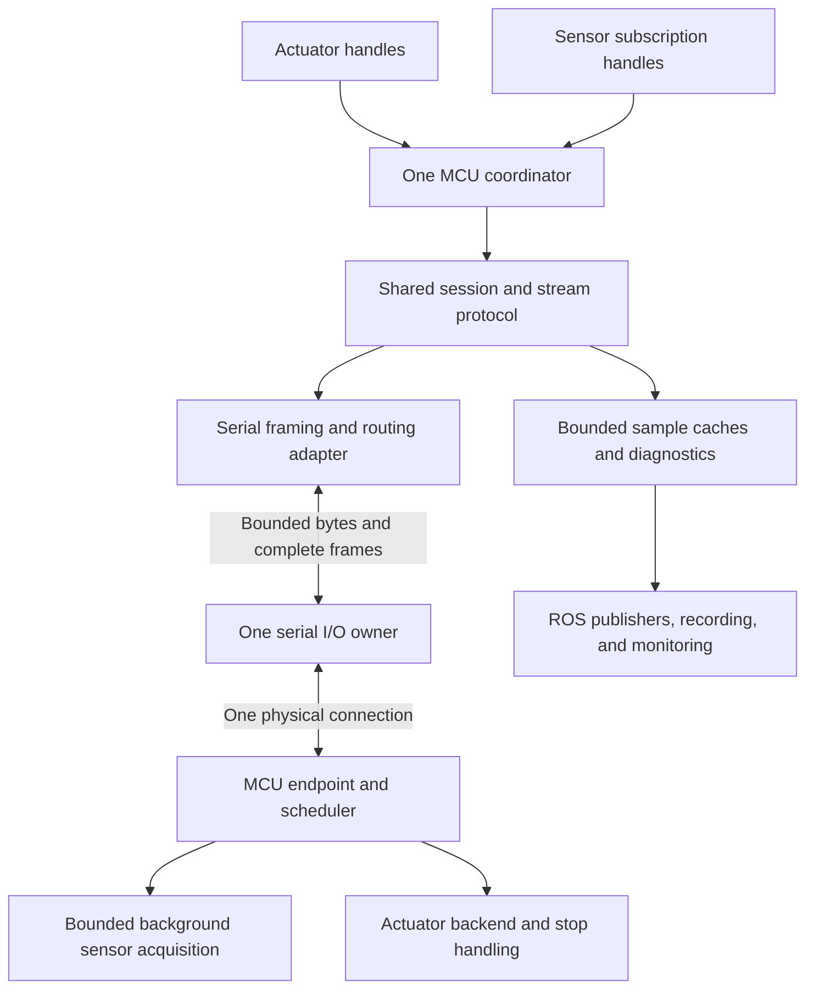

# Serial communication and mixed-device streaming plan

| Field | Value |
| --- | --- |
| Status | Implementation authorized 2026-11-03; P1 protocol foundation implemented and software-tested. Production streaming and hardware qualification remain open. |
| Planning baseline | Committed checkout `258e3e4` on `kangjin/serial-comm-improve`. |
| Scope decision | Include continuous sensor streaming and actuator commands on the same MCU serial connection, plus the demo's Feetech and LDS01 paths. |
| Created / last reviewed | 2026-11-03 |
| Owners, exact hardware, rates, budgets, and dates | Remaining decisions must be recorded before their dependent integration or qualification phase. P1 uses backend-supplied period bounds, with fixture values confined to tests. |
| Related work | [JoshuaWire contract](JOSHUA_WIRE.md), [board/comm separation](BOARD_COMM_SEPARATION_PLAN.md), and [streaming issue #135](https://github.com/Joshua-AI-Robotics/Joshua/issues/135). |

## 1. Required outcome

Joshua must operate mixed sensing and actuation through one MCU connection while
preserving bounded control latency, observable data loss, and deliberate recovery.
The serial work also needs to support the demo's separate vendor servo and lidar
connections dependably.

Completion requires all of the following:

- A selected Teensy or ESP32 fixture streams a typed sensor while accepting
  actuator commands, feedback/status queries, and stop/recovery operations on
  the same connection.
- One receive owner routes replies and samples without competing reads or
  discarding valid telemetry at the start of a command.
- Overload, a slow consumer, a failing sensor, or blocked transmission produces
  bounded, documented behavior. Telemetry cannot consume reserved control/stop
  capacity.
- Subscription teardown, disconnect, reboot, and reconnect cannot revive stale
  samples, replay uncertain actions, or implicitly enable actuators.
- Existing Feetech request/response and LDS01 byte-stream consumers retain their
  protocol semantics and gain dependable timeout, shutdown, and diagnostic behavior.
- The mixed-device integration uses production host and shared firmware paths.
  Physical motion, output timing, and stopping have separate qualification evidence.

The first supported payload is scalar-f32, selected for P1. The physical sensor
must be selected before P4's production backend work. An IMU enum is insufficient:
the current sensor profile implements scalar-f32
samples, so a multiaxis IMU needs a versioned typed schema and backend. A software
sample generator can validate transport behavior but cannot close sensor-hardware
qualification.

New Ethernet/CAN implementations, bulk image/audio transfer over MCU serial,
automatic physical device discovery, and simultaneous serial/EtherCAT ownership
of one MCU are outside this branch's required delivery. The shared stream
semantics must nevertheless be exercised through a second link fixture, as
required by issue #135. Existing EtherCAT behavior remains covered by regression
tests.

## 2. Baseline findings

Findings refer to the committed planning baseline. Source-level support does not
establish completed streaming or physical qualification.

| Area | Existing foundation | Gap |
| --- | --- | --- |
| Serial mechanism | [Serial](../robot/comm/serial/serial.cc) and [CommFactory](../robot/comm/factory/comm_factory.cc) share a connection and bus lock within a process. | Raw/vendor paths combine synchronous I/O with asynchronous cancellation timers; end-to-end bounds are inconsistent. Physical-port aliases, lifecycle, cancellation, and diagnostics need explicit contracts. |
| Request framing | [JoshuaWire serial adapter](../robot/comm/serial/joshua_wire_serial_transport.cc) bounds a framed exchange. | It discards pending input before a request and returns one response. It cannot independently route interleaved samples. |
| Session | [JoshuaWireSession](../robot/board/joshua_wire/joshua_wire_session.cc) supplies IDs, exact retries, response matching, and unknown-outcome handling. | Nested synchronous locks do not supply bounded admission, priority, stop preemption, or subscription ownership. |
| Host device binding | [JoshuaWireBoard](../robot/board/joshua_wire/joshua_wire_board.h) exposes actuator channels. | Generic sensor handles and subscription-backed perception bindings are missing. Actuator/perception handles must share one MCU coordinator. |
| Firmware transport | [Serial frame transport](../firmware/common/serial_frame_transport.c) bounds frames and retains an in-progress TX frame; it has a local TX-fault callback. | Telemetry routing, reserved reply/control capacity, and subscription lifetime are absent. The board main loops pause request admission while an application reply is pending. |
| Firmware profiles | [Shared runtime and codecs](../firmware/common/README.md) define discovery, status, scalar samples, validity, boot identity, and sequence metadata. | Production mixed-device acquisition/scheduling and a negotiated streaming extension remain unimplemented. |
| Recovery | Session reset disables configuration and preserves ESTOP. | Port retirement/reopen, cross-handle invalidation, subscription reconciliation, and no-replay/no-re-enable behavior need end-to-end implementation. |

The existing H/F/T gates in [JoshuaWire](JOSHUA_WIRE.md#stacked-implementation-and-integration-gates)
remain authoritative. This plan scopes their serial and mixed-streaming work;
it does not create a competing protocol or session owner.

## 3. Architecture and responsibility boundaries

| Owner | Responsibilities |
| --- | --- |
| Physical serial owner | Descriptor lifetime, nonblocking reads/writes, wake/cancel/close, port exclusivity, bounded byte buffers, monotonic deadlines, and I/O diagnostics. No motor/sensor payload interpretation. |
| Link framing adapter | Bounded frame assembly/resynchronization and serialization. Distinguish reply and telemetry envelopes using the approved protocol extension. No independent subscription or session policy. |
| MCU coordinator and protocol | One session/ID allocator, one ordinary published request at a time, bounded admission, priority/fairness, exact retries, unknown outcomes, subscriptions, and reconnect reconciliation. |
| Device/profile bindings | Typed values, units, acquisition semantics, desired configuration, and profile compatibility. Motor drivers continue using board abstractions. |
| Firmware runtime/backends | Bounded acquisition and dispatch, queues/resource ownership, authoritative status, watchdog policy, and actual actuator operations. |
| ROS/application integration | One bus-owning process, named observations, explicit control ownership, health publication, and deliberate enable/recovery. |

Use one event-driven I/O owner per physical serial connection, with an explicit
wake path for submissions, cancellation, and shutdown. A nonblocking POSIX
poll/wake implementation is the proposed Linux mechanism; review its lifecycle
and test seam at P0. Logical coordinator state can run on that owner for serial,
but protocol semantics must not depend on serial descriptors or a specific event
loop. Do not create a worker, reader, session, or ID allocator per device handle.

Keep consumer callbacks and expensive sensor/image work off the I/O owner. A
synchronous compatibility facade may await a completion outside owner locks;
it must not wait on itself from the I/O thread. Add subscription capability
separately from the existing request/response interface, without forcing every
transport or motor channel to implement streaming.

Port paths come from protobuf configuration. Resolve aliases to one physical
resource for ownership checks and retain the configured stable identity for
diagnostics. Reconnect validates the intended device rather than assuming that
a newly assigned `/dev/ttyUSB*` path is the same controller. Unsupported competing
owners are rejected, not serialized through unrelated sessions.

## 4. Contracts to freeze at P0

### 4.1 Wire extension and compatibility

The current revision-4 contract does not advertise streaming. Define the extension
in the normative contract before adding codecs or sending unsolicited traffic.

- Give telemetry a distinct message kind/correlation namespace. A sample can
  never satisfy a command's pending response, even when numeric IDs coincide.
- Negotiate streaming and its typed schema explicitly. Older hosts receive no
  unsolicited traffic because they never create a subscription. Unsupported
  firmware rejects subscription requests before side effects.
- Specify creation, inspection/reconciliation, cancellation, stream identity,
  requested versus accepted rates, payload bounds, and lifecycle acknowledgments.
- Carry function/sensor identity, stream identity, session/subscription generation,
  acquisition sequence/time, boot/clock identity, validity, and overflow/loss data.
  Reuse existing measurement semantics rather than inventing receipt-time freshness.
- Preserve the 96-byte frame bound for this increment. Choose a sensor schema
  that fits; do not add implicit fragmentation or truncate multiaxis samples.
- Record exact byte layouts, operation/message assignments, compatibility rules,
  and golden examples. Prefer an explicitly negotiated additive extension if the
  existing envelope invariants remain valid; otherwise require a new wire revision
  and reject mixed revisions explicitly. The decision must be resolved at P0.

P1 selects the additive option: SENSOR v1.1 SUBSCRIBE/UNSUBSCRIBE/GET_SUBSCRIPTION
and firmware-to-host STREAM_SAMPLE kind 0x11. The subscription token is the
SUBSCRIBE request's message ID, scoped by session and function. The
[normative layouts and lifecycle](JOSHUA_WIRE.md#opt-in-sensor-profile-11-streaming)
define the implemented codec/helper contract.

Subscription operations follow ordinary session rules. Lost create/cancel replies
are uncertain mutations: retry identical bytes/IDs within the bounded budget,
then reconcile or reset. Never create duplicate subscriptions using a new ID just
because an acknowledgment was lost.

### 4.2 One owner and bounded scheduling

The coordinator owns the queue, assigns IDs at dispatch, and preserves one
ordinary published request across all handles. A stop can retire the pending
request and use the reserved stop path defined in the JoshuaWire contract; the
retired operation remains unknown and is never retried afterward.

Priority is stop/watchdog, deadline-bound control, configuration, then polling or
telemetry service. Bound queue admission, operation count, and bytes separately.
Reserve stop capacity independently of sensor work. Define a polling/telemetry
quota that uses available control slack; reject an infeasible requested workload
instead of promising both rates without a link/dispatch budget.

Scheduling operates at frame boundaries. A frame already accepted by the OS/USB
stack or being transmitted cannot be recalled or interrupted safely. Include
driver/USB buffering and the maximum in-progress frame in the stop latency budget.
Keep outstanding output bounded so a telemetry backlog cannot hide a stop behind
an unbounded byte queue.

### 4.3 Deadline, cancellation, and outcome semantics

Configure finite operation budgets that include admission/queue wait, I/O, and
the permitted retries. Distinguish stream idle timeout, full-operation deadline,
freshness bound, and device watchdog interval. Progress does not renew a total
deadline indefinitely. Use a monotonic clock for these intervals.

UART wire time is a feasibility lower bound, not a complete timeout policy.
For 8N1, `wire_seconds = bytes * 10 / baudrate`; a 2520-byte lidar scan alone
takes approximately 109 ms at 230400 baud. Account separately for device cadence,
response/processing delay, USB buffering, and scheduling margin. Native USB CDC
throughput is not established by its nominal baud setting. Freeze measured and
configured budgets rather than adopting fixed allowances for every device.

| Outcome | Required meaning |
| --- | --- |
| Rejected or canceled before publication | No request bytes submitted to the link; no command side effects from this operation. |
| Partial/full write without a matched reply | Execution may have occurred. Report unknown outcome; do not infer safe retry from the timeout error code. |
| Correlated reply | Apply the protocol's status/execution semantics. ACCEPTED still requires completion reconciliation. |
| Stop acknowledgment | Software/protocol evidence only; physical response is qualified separately. |

Make publication/progress state machine-readable internally; correctness must not
depend on parsing error-message strings. Preserve existing capability facades
where practical and explicitly review necessary API changes. Cancellation wakes
waiters and retires their work; closing cannot leave callbacks referencing destroyed
state. Teardown is idempotent and nonthrowing with a bounded owner shutdown path.

### 4.4 Buffering and subscription lifetime

The proposed default for live observation is one latest sample per stream, with
explicit overwrite/loss counters. A recorder needing a bounded history opts into
a ring with a declared capacity and overflow policy. Neither may block control
or grow without bound. Drop/coalesce only whole, unissued telemetry samples;
never alter an in-progress frame, cached reply, or uncertain command.

Share a firmware subscription across compatible local consumers through owned
handles. Closing one consumer does not stop another's subscription. The last
close retires the subscription with defined cancellation/reconciliation behavior.
Slow callbacks execute outside the serial owner and cannot delay response routing.

Repeated reads preserve sequence and original acquisition/receipt metadata;
they do not manufacture freshness. Reject late samples for closed subscriptions,
old sessions/generations, or previous boots. Validate sensor identity, units,
payload shape, and clock semantics before publishing a usable sample.

### 4.5 Firmware service and fault behavior

Move sensor acquisition outside command dispatch using bounded cooperative work
or an appropriate background task. Slow conversion or a failed sensor bus must
not block command admission, motor service, or watchdog evaluation.

Replace the current reply-pending receive gate with bounded admission and
reserved control/stop resources. Preserve exact response replay while allowing
telemetry emission and incoming control service. Define what happens when reply
capacity itself is exhausted; a full telemetry queue cannot prevent stop handling.

Keep the existing local TX-stall fault behavior until a reviewed policy replaces
it. Define communication-loss and target-freshness watchdogs separately; the TX
timeout is not a watchdog against a stalled firmware loop or a silent host.
Advertise only supported safety semantics. Any required physical stop bound must
be supported by the selected firmware, electrical setup, and bench evidence.

### 4.6 Disconnect and reconnect

Use the lifecycle:

**Closed → opening → identifying/configuring disabled → ready → faulted →
deliberate reconnect/reconciliation → ready disabled.**

On loss, block new mutations, invalidate every affected handle/subscription,
wake pending calls, and preserve unknown outcomes. Retire the old port owner and
queued bytes before opening a replacement. Reconnect performs one coordinated
reset and discovery/status reconciliation, validates identity/profile/schema,
and reapplies desired configuration. Preserve ESTOP/fault requirements. Stream
restoration follows explicit desired configuration; actuator enable always needs
a deliberate action. Never replay old targets or uncertain mutations.

### 4.7 Configuration and diagnostics

Keep wiring and policy in protobuf configuration. Separate physical-port settings
(baud/settle/exclusivity), per-operation timing and admission limits, subscription
rate/schema/queue policy, and firmware watchdog settings. Define compatibility
checks and migration/default behavior for existing presets before schema edits.

Expose bounded diagnostic snapshots/events independently of the UI:

- Port identity and connection generation/state; queue occupancy and admission
  rejections; TX/RX bytes and framing errors; lock/dispatch wait, transaction
  latency, timeouts, cancellation, and reconnect counts.
- Stream schema/identity, negotiated rate, acquisition and receipt clock IDs,
  boot/sequence, last-valid age, invalid/stale state, drops, and discontinuities.
- Operation publication/unknown-outcome state, control/stop dispatch latency,
  firmware fault/recovery state, and watchdog capability.

Diagnostics must not expose arbitrary device access or carry large sample payloads
through control callbacks. Preserve typed metadata through C++ perception and ROS
publishing; future monitoring readers can consume it without becoming owners of
the hardware lifecycle.

## 5. Delivery sequence and review gates

The operator authorized implementation on 2026-11-03. Software protocol choices
for the P1 increment are recorded below. Physical hardware, performance budgets,
and later API/configuration decisions remain gates for their corresponding
integration phases. Each increment must include its own software acceptance
evidence and stay
reviewable; passing an early phase does not imply the complete branch is ready.

| Phase | Deliverable | Dependencies | Completion evidence |
| --- | --- | --- | --- |
| P0 — Increment design agreement | Freeze the decisions needed by each increment: wire/version/schema for P1, public seams and I/O policy for P2/P3, hardware/workload/watchdogs before production integration and qualification. | This plan and existing normative contracts. | Record resolved contracts and remaining dependent gates. P1 protocol choices are selected; later hardware, scheduling, and API/config decisions remain open. |
| P1 — Protocol extension | Implemented: normative streaming contract, capability negotiation helper, codecs, portable subscription lifecycle, and compatibility fixtures. | P0 protocol choices. | Golden frames, request/sample namespace collision, malformed data, unsupported capability/version, exact retries after lost create/cancel replies, reset invalidation, and host query gating. Both Compose services passed all 50 targets on 2026-11-03. |
| P2 — Serial I/O foundation | One nonblocking owner, bounded read/write/wait/cancel/close, port identity/lifetime, raw/vendor compatibility, and port diagnostics. | P0; retain existing request-only behavior. | PTY tests for silence, partial data, backpressure, disconnect, aliases, shutdown, and full-size lidar/vendor traffic. |
| P3 — Host coordinator and streams | Shared scheduling/session owner, frame routing, subscriptions, bounded caches, unknown outcomes, priority/fairness, and reconnect. | P1, P2. | Multiple concurrent consumers; telemetry interleaved before/during/after replies; overload; stop retirement; late traffic; reference lifetimes; one reset across reconnect. |
| P4 — Production mixed firmware | Selected MCU binding, one typed sensor backend, bounded acquisition/dispatch, TX arbitration, subscription state, and watchdog/fault policy. | P1 and frozen host/firmware contracts. | Production firmware service loop with simulated sensor/GPIO/clock faults; no blocking acquisition, control/stop starvation, or implicit enable. |
| P5 — End-to-end runtime integration | Actuator and sensor handles in one bus-owning process; config/perception/ROS integration, firmware artifact, preset, and diagnostic recording. | P3, P4. | Same serial connection runs streaming and actuation through production paths; Feetech/LDS01 regressions pass; second link fixture reuses protocol/stream logic. |
| P6 — Qualification and release evidence | Frozen artifacts, hardware procedures, measured workload/fault results, operator recovery guide, and support matrix. | P5 and deliberate hardware authorization/setup. | Bench metrics plus applicable Docker services; physical and simulated claims recorded separately. |

The ROS bus-owning process and generic sensor binding are required dependencies
for the demo, even though they live above serial. Track them explicitly rather
than claiming that a mutex or a new stream codec completes application integration.

## 6. Workload and acceptance matrix

Record exact values and reference conditions before the dependent integration
and qualification gates. A gate with unspecified bounds cannot pass. Rates and
capacities must fit both the measured link and the selected firmware's
dispatch/acquisition behavior. Protocol fixture values establish codec/state
behavior only and are not physical performance defaults.

| Parameter | Decision required before implementation |
| --- | --- |
| Supported physical configurations | Selected MCU/transport, sensor, motor/driver, host, firmware/toolchain, wiring, and device identities. |
| Traffic | Sensor payload/size, acquisition and stream rates, actuator command and feedback rates, configuration/status load, burst allowance, and number of consumers. |
| Link capacity | UART baud/framing or measured native-USB service rate; worst-case frame overhead; TX/RX utilization and reserved control headroom. |
| Timing | Total operation and retry budgets, stream idle/freshness thresholds, handler/acquisition bounds, stop dispatch/completion goals, and firmware watchdog intervals. |
| Memory/admission | Host and firmware byte/frame/request capacities, reserved stop slots, per-stream latest/ring limits, and explicit overflow policy. |
| Reliability | Soak duration, lifecycle/reconnect repetition counts, acceptable loss under nominal load, and required detection/recovery bounds. |

| Condition | Required result |
| --- | --- |
| Nominal streaming plus actuation | Correct source, units, sequence/time semantics, matched replies, and frozen rate/latency bounds. |
| Sensor flood or slow subscriber | Bounded memory and explicit drops/admission failures; control/stop retain their reserved capacity. |
| Partial, malformed, duplicate, stale, or reordered frames | Bounded resynchronization; no sample is mistaken for a reply; no duplicate mutation. |
| Lost command reply | Exact same-ID retry within the original budget, then unknown-outcome gating and reconciliation. |
| Stop during an outstanding slow command | Retire the old request; bounded stop dispatch; late reply cannot complete a new operation or cause the retired action to be retried. |
| Firmware response/TX backpressure | Defined fault/stop behavior and preserved reply ownership; telemetry cannot block independent fault evaluation. |
| Slow/failing sensor acquisition | Invalid/stale or NOT_READY data while command service and acquisition watchdog bounds remain satisfied. |
| Consumer close or unsubscribe acknowledgment loss | Other consumers remain valid; closed handles reject late samples; uncertain subscription state is reconciled. |
| Link loss, MCU reboot, or device replacement | All affected users see discontinuity/unavailability; old state is invalidated; one reset/reconciliation; no automatic target replay or actuator enable. |
| Raw lidar and vendor servo paths | Realistic-sized fragmented transfers succeed within configured budgets; silent devices, blocked writes, and shutdown are bounded. |
| Second link fixture | The same subscription, ordering, identity, and scheduling rules operate without serial-specific logic in the shared coordinator. |

Use controlled-clock/state-machine tests for scheduling and freshness, PTYs for
real host byte I/O, and production firmware code with simulated sensor/GPIO hooks
for integration. Use broad execution guards for deadlock regressions without
treating wall-clock CI timing as hardware performance evidence. Finish with
`docker compose run --rm test-u22` and `test-u24`; investigate and report timing
failures rather than silently retrying them away.

Physical procedures require the current operator authorization and setup
confirmation under [AGENTS.md](../AGENTS.md). Build/test coverage does not authorize
firmware flashing or physical actuation.

## 7. Decision register

| Decision | Proposed direction / status |
| --- | --- |
| Mixed streaming and control scope | Agreed: required on the same MCU connection. |
| Protocol ownership | Reuse one transport-independent MCU coordinator/session; extend the existing JoshuaWire contract. |
| Receive ownership | One event-driven owner per physical serial link; no competing synchronous receive path in streaming mode. |
| Live data overflow | Proposed: bounded latest-per-stream cache with explicit loss counters; bounded recording rings only when requested. |
| Recovery | Proposed: deliberate reconnect/reconciliation; never implicit actuator enable or replay of uncertain actions. |
| Wire/version and typed payload | Selected for P1: additive SENSOR v1.1 operations 1–3 and firmware-to-host STREAM_SAMPLE kind 0x11 within revision-4 framing. First payload is scalar-f32 with existing measurement metadata; token is the SUBSCRIBE message ID, scoped by session/function. See [normative contract](JOSHUA_WIRE.md#opt-in-sensor-profile-11-streaming). |
| Hardware and numerical budgets | Open at P0: exact device kit, native USB versus UART, rates, capacities, and acceptance bounds. |
| API/config migration | Open at P0: subscription capability, cancellation/result representation, policy schema, and existing-preset migration. |

Treat remaining P0 items as design work before their dependent implementation.
P1 supplies codecs and a portable subscription lifecycle, not production
streaming. Queue/rate enforcement, host routing/scheduling, physical sensor
selection, runtime integration, and measured qualification remain open.
