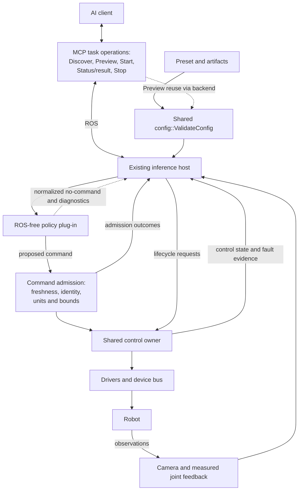

# Pluggable inference and MCP integration

Proposed architecture, 2026-11-15; no runtime capability is implemented here.
The camera-head demo is the first consumer.

## Architecture

Extend the existing [InferenceAdapter](../../ai/inference/adapter.py) and
[manifest registry](../../ai/models/registry.py). Decisions is one ROS-free
plug-in; a compatible API or local policy can replace it through protobuf
configuration and registered artifacts.

| Owner | Purpose | Responsibility |
| --- | --- | --- |
| Inference host | Manage the task lifecycle. | ROS inputs, task/session state, asynchronous scheduling, deadlines and result admission. |
| Policy plug-in | Turn observations into proposed commands. | Preprocessing, model/API calls, response validation and conversion to named SI commands. Keep provider SDKs in its model environment. |
| Existing control owner | Own and constrain robot execution. | Command-source ownership, limits, leases, enable/stop/recovery and device bus. |
| MCP server | Expose robot tasks to AI clients. | Thin ROS adaptation of tested task operations, camera/feedback inspection and results. |

Boxes denote responsibilities, not mandatory new modules or processes. MCP
manages tasks; observation, inference and command cycles run within Joshua.
Accepted results or human approval cannot bypass shared control checks. The host
coordinates lifecycle requests, relays admission outcomes and control state to
MCP, and invalidates pending inference on cancellation; hardware
enable/stop/recovery and command-source authority remain with the shared control
owner. #151 extends existing inference contracts; #168 adds the proposed MCP
task adaptation.

Use versioned inputs/results carrying names, units, sample/request identity,
generation and validity; preserve legacy adapters. Provider-specific parsing and
error handling stay inside the plug-in; normalized command/no-command outcomes
and diagnostics reach the runtime and MCP Status/result. No-command means no new
motor command, not proof of a physical stop. Select compatible policies between
runs with fresh binding and approval; defer hot swapping. Reuse existing owners
and focused helpers, following
[earlier review](https://github.com/Joshua-AI-Robotics/Joshua/pull/145#pullrequestreview-5887228322)
and [native ROS guidance](https://github.com/Joshua-AI-Robotics/Joshua/pull/150#pullrequestreview-5887076039).

## MCP inputs and outputs

These are proposed operations, not tools currently exposed. Codex or another
agent connects through the existing [stdio setup](../MCP_SETUP.md), discovers
capabilities, previews a task, obtains direct human approval, then starts it.

| Operation | Purpose | Input | Output |
| --- | --- | --- | --- |
| Discover | Check what this target can do. | Configured target | Supported tasks/policies, requirements and readiness gaps. |
| Preview | Review task scope before approval. | Target, configured policy, goal/duration and total timeout | Immutable preview ID, resolved limits, deadlines and request/spend budgets. |
| Start | Begin the approved task. | Approved preview ID | Run ID and accepted/blocked state. Retries return the same run. |
| Status/result | Inspect progress and the outcome. | Run ID | State, bounded progress, measured feedback, terminal outcome and reason. |
| Stop | Request an end to the active task. | Run ID | Cancellation state, then terminal result and measured stop status. |

Reuse existing read-only camera/feedback tools. Results distinguish known,
unknown and stale evidence. Model arguments or automatic tool approval cannot
assert human readiness; the backend must verify a single-use, preview-bound
human grant. Unsupported client confirmation leaves motion unavailable.

Preview delegates static configuration validation through its backend to the
shared [`config::ValidateConfig`](../../config/validation.cc) and does not
duplicate its acceptance rules. Tool-argument validation, runtime
capability/readiness/freshness checks and human approval remain separate.

## POC dependencies and validation

These dependencies and checks cover the camera-head tracking POC only. Use the
relevant subset of each PR; other flows require separate validation.

The POC reuses existing configured presets. Configuration authoring,
build/install flows and broader hardware or MHS compatibility belong to the
wider Joshua MCP roadmap. Shared control checks constrain what a task may
execute; they do not prevent prompt injection.

Our integration requires the colleague's inference implementation and minimum
shared extension; identify its implementation PR before coding. Target one
integration PR on our side. Dependencies are described by role; consult the
linked PRs for their current scope and state.

| PR | Core design or implementation | How it enables the POC MCP layer |
| --- | --- | --- |
| [#151](https://github.com/Joshua-AI-Robotics/Joshua/pull/151) | Shared policy contracts and asynchronous inference design. | Gives MCP-started tasks a shared policy/inference contract. |
| [#145](https://github.com/Joshua-AI-Robotics/Joshua/pull/145) | Shared device-bus ownership and enable/stop/recovery controls. | Keeps MCP requests under shared control ownership and stop/recovery rules. |
| [#149](https://github.com/Joshua-AI-Robotics/Joshua/pull/149) | Feetech command acknowledgment and fault handling. | Supplies acknowledgment and fault evidence for MCP status/results. |
| [#150](https://github.com/Joshua-AI-Robotics/Joshua/pull/150) | Native ROS camera images through MCP. | Lets MCP clients inspect the camera through native ROS images. |

Head integration and qualification are tracked in
[#153](https://github.com/Joshua-AI-Robotics/Joshua/issues/153).
The GitHub base branch records the current stack; it does not replace the
inference dependency.

Prove reuse with Decisions replay and a deterministic alternative plug-in.
Check timeout/blocked inference, stale/duplicate replies, stop races and legacy
compatibility; then real ROS/MCP and chosen-client behavior. Physical runs need
separate authorization and the existing
[demo gates](../../doc/OPENAI_DECISIONS_CAMERA_HEAD_DEMO.md).

## External examples

| Reference | Relevant finding or pattern | How it supports our design |
| --- | --- | --- |
| [OpenAI Decisions](https://developers.openai.com/api/docs/guides/decisions) | Typed choices; the application owns execution. | Keep API answers separate from command execution. |
| [LeRobot remote inference](https://huggingface.co/docs/lerobot/remote_inference) | Asynchronous inference with local freshness and deadline checks. | Separate inference from local control; enforce freshness and timeouts. |
| [ROS 2 actions](https://design.ros2.org/articles/actions.html) | Goal, feedback, result and cancellation semantics. | Reuse ROS task semantics for MCP operations. |
| [LEASH](https://arxiv.org/html/2611.14115v1) and [System1-Arena](https://arxiv.org/html/2610.21244v1) (preprints) | Study scoped execution authority and latency-sensitive closed-loop behavior. | Retain execution-scoped authority and qualify actual closed-loop behavior. |

These references inform the design; they do not establish Joshua runtime or
hardware results. Joshua's own validation evidence belongs in the PR.
