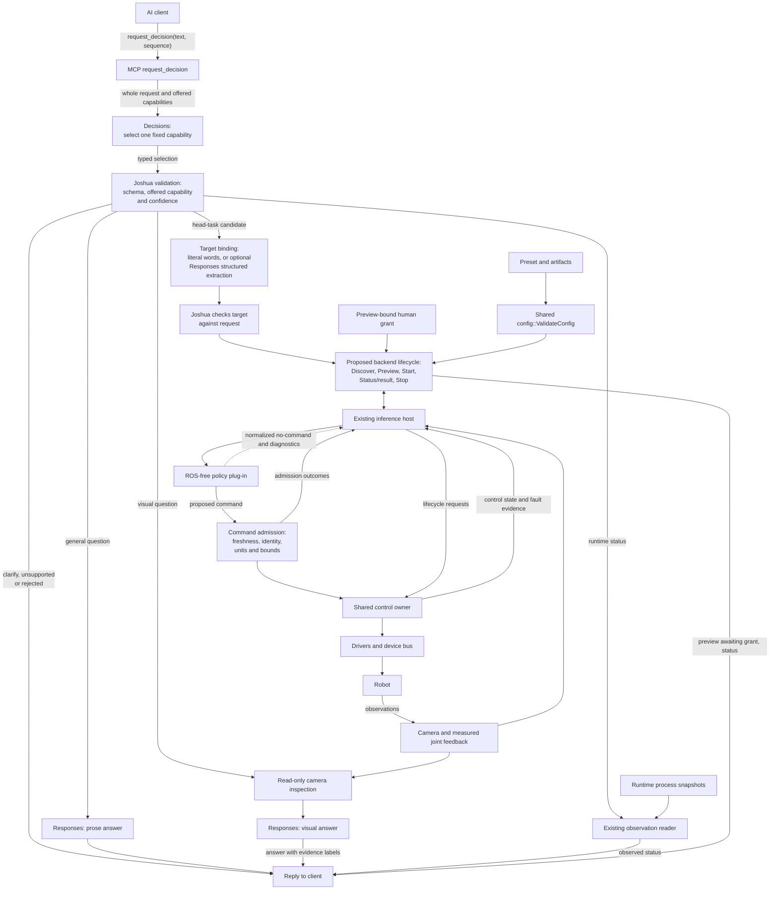

# Pluggable inference and MCP integration

Proposed architecture, 2026-11-15; revised 2026-11-22 around `request_decision`.
This document adds no runtime capability. The camera-head demo is the first
consumer.

## Architecture

Extend the existing [InferenceAdapter](../../ai/inference/adapter.py) and
[manifest registry](../../ai/models/registry.py). Decisions is one ROS-free
plug-in; a compatible API or local policy can replace it through protobuf
configuration and registered artifacts.

| Owner | Purpose | Responsibility |
| --- | --- | --- |
| MCP server | Accept operator requests and expose task state. | `request_decision(text, sequence)` entry, read-only camera/feedback inspection and thin ROS adaptation of backend task operations. |
| Decisions and Responses | Interpret one request. | Decisions selects one fixed, server-offered capability. Responses generates prose answers or, when needed, structured arguments. Neither executes anything. |
| Inference host | Manage the task lifecycle. | Selection/argument validation, proposed Discover/Preview/Start/Status/Stop, task/session state, asynchronous scheduling, deadlines, cancellation and result admission. |
| Policy plug-in | Turn observations into proposed commands. | Preprocessing, model/API calls, response validation and conversion to named SI commands. Keep provider SDKs in its model environment. |
| Existing control owner | Own and constrain robot execution. | Command-source ownership, calibrated limits, leases, enable/stop/recovery and device bus. |

Boxes denote responsibilities, not new required processes or layers. General
answers need no camera. Answer and status paths never reach Preview, the policy
or the control owner.
The conversational Decisions router only selects a capability; it is not the
motor-policy plug-in. Only an admitted head handler enters the configured
motor-policy adapter, which runs a second Decisions evaluation on the image,
target and measured position, reusing the shared decoder and client without
adding a process.
Observation, inference and command cycles run inside Joshua; MCP carries the
request, replies and task state. Accepted results or human approval cannot
bypass shared control checks. Hardware enable/stop/recovery and command-source
authority remain with the shared control owner. #151 extends existing
inference contracts; #168 records this design, and the stack below implements
its replay-only pieces.

Use versioned inputs/results carrying names, units, sample/request identity,
generation and validity; preserve legacy adapters. Provider-specific parsing and
error handling stay inside the plug-in; normalized command/no-command outcomes
and diagnostics reach the runtime and MCP status. No-command means no new motor
command, not evidence of a physical stop. Select compatible policies between
runs with fresh binding and approval; defer hot swapping. Reuse existing owners
and focused helpers, following
[earlier review](https://github.com/Joshua-AI-Robotics/Joshua/pull/145#pullrequestreview-5887228322)
and [native ROS guidance](https://github.com/Joshua-AI-Robotics/Joshua/pull/150#pullrequestreview-5887076039).

## MCP inputs and outputs

Codex or another agent connects through the existing [stdio setup](../MCP_SETUP.md)
and sends the whole operator request. The client does not preselect a policy or
task; the backend offers the fixed capability set from the configured target.
#179 supplies `request_decision`; #180 adds `stop_decision` for replay. The
preview/grant/run lifecycle and physical task Stop are proposed extensions that
neither implements.

| Operation | Purpose | Input | Output |
| --- | --- | --- | --- |
| `request_decision` | Conversational entry for one operator request. | Whole operator text and client sequence. | One outcome: general or visual answer, observed runtime status, clarification, unsupported, or head-task candidate. Resending the last completed sequence with the same text returns its result; conflicting reuse is rejected. History is bounded and internal. |
| `stop_decision` | Cancel a pending replay request. | Client sequence. | Cancellation state; late inference for that sequence is discarded. A future physical task Stop reports a separate measured outcome. |

| Request | Decisions selection | Joshua behavior |
| --- | --- | --- |
| "Where is the red mug?" | Visual answer | Read-only camera inspection; Responses writes the answer with known, unknown or stale evidence labels. No preview or command. |
| "Look at the red mug." | Head-task candidate | Joshua binds target `red mug` from the literal words; other admitted phrasing may use Responses structured extraction. Either target must match the request. A proposed Preview follows; motion starts only after the grant and runtime checks. |

Behind a head-task candidate, the backend would own this proposed lifecycle:

| Operation | Purpose | Input | Output |
| --- | --- | --- | --- |
| Discover | Derive offered capabilities. | Configured target | Supported tasks/policies, requirements and readiness gaps. |
| Preview | Review task scope before approval. | Selected capability, validated arguments, configured policy, duration and total timeout | Immutable preview ID, resolved limits, deadlines and request/spend budgets. |
| Start | Begin the approved task. | Preview ID and its human grant | Run ID and accepted/blocked state. Retries return the same run. |
| Status/result | Inspect progress and the outcome. | Run ID | State, bounded progress, measured feedback, terminal outcome and reason. |
| Stop | Request an end to the active task. | Run ID | Cancellation state, then terminal result and measured stop status. |

Decisions output and Responses arguments are untrusted. Provider errors, schema
violations, selections outside the currently offered capabilities, insufficient
confidence and targets not grounded in the operator request fail without
dispatch. Arguments never name topics, endpoints or
devices; Joshua resolves those from the configuration.

Physical execution requires a single-use, preview-bound human grant verified by
the backend, plus readiness, observation freshness, sample/session identity,
calibrated limits and shared control/source ownership. Model arguments or
automatic tool approval cannot assert human readiness; missing or unsupported
confirmation blocks physical execution. Cancellation invalidates pending and
late inference.

Preview delegates static configuration validation through its backend to the
shared [`config::ValidateConfig`](../../config/validation.cc) and does not
duplicate its acceptance rules. Tool-argument validation, runtime
capability/readiness/freshness checks and human approval remain separate.

## POC dependencies and validation

These dependencies and checks cover the camera-head POC only; other flows
require separate validation. The POC reuses existing configured presets.
Configuration authoring, build/install flows and broader hardware or MHS
compatibility belong to the wider Joshua MCP roadmap. Shared control checks
constrain what a task may execute; they do not prevent prompt injection.

Dependencies are listed by stable role; consult each PR for current state.

| PR | Role | How it enables `request_decision` |
| --- | --- | --- |
| [#151](https://github.com/Joshua-AI-Robotics/Joshua/pull/151) | Shared policy contracts and asynchronous inference design. | Shared policy/inference contract for started tasks. |
| [#175](https://github.com/Joshua-AI-Robotics/Joshua/pull/175) | Typed configuration and named motor-policy contract with deterministic replay. | One named-command contract for Decisions and alternative plug-ins. |
| [#176](https://github.com/Joshua-AI-Robotics/Joshua/pull/176) | Asynchronous Decisions adapter. | Session identity, source, generation, expiry and cancellation; sink admission rejects stale or foreign results. |
| [#179](https://github.com/Joshua-AI-Robotics/Joshua/pull/179) | `request_decision` stdio entry. | Whole text and sequence, last-result deduplication, bounded history, observed runtime status and answer/clarify/unsupported outcomes. No history or task-status query API. |
| [#180](https://github.com/Joshua-AI-Robotics/Joshua/pull/180) | `--head-replay` head-task replay. | Fixed synthetic image and zero-radian feedback, literal target binding with structured extraction for other admitted phrasing, one bounded pan step held in memory and `stop_decision(sequence)` for a pending replay sequence. No device, ROS command publisher or control loop. |
| [#177](https://github.com/Joshua-AI-Robotics/Joshua/pull/177) | Sibling read-only browser chat with its own Decisions/Responses service and read-only Zenoh lookup. | Parallel workflow with no MCP dependency; not a prerequisite for #179. |
| [#145](https://github.com/Joshua-AI-Robotics/Joshua/pull/145) | Shared device-bus ownership and enable/stop/recovery controls. | Keeps future physical tasks under shared control ownership and stop/recovery rules. |
| [#149](https://github.com/Joshua-AI-Robotics/Joshua/pull/149) | Feetech command acknowledgment and fault handling. | Acknowledgment and fault evidence for task status/results. |
| [#150](https://github.com/Joshua-AI-Robotics/Joshua/pull/150) | Native ROS camera images through MCP. | Real camera input for the read-only answer path. |

Replay exercises bounded routing, validation and cancellation; it does not
qualify general routing accuracy or physical execution. Production
integration still needs ROS camera/feedback inputs, the shared control owner
and command admission; head integration and qualification are tracked in
[#153](https://github.com/Joshua-AI-Robotics/Joshua/issues/153).

Prove reuse with Decisions replay and a deterministic alternative plug-in.
Check answer versus head-task routing, ungrounded targets, missing grants,
timeout/blocked inference, stale/duplicate replies, stop races and legacy
compatibility; then real ROS/MCP and chosen-client behavior. Selection or
confidence thresholds require a labeled evaluation set; a live accuracy snapshot
is evidence, not a contract. Physical runs need separate authorization and the
existing [demo gates](../OPENAI_DECISIONS_CAMERA_HEAD_DEMO.md).

## External examples

| Reference | Relevant finding or pattern | How it supports our design |
| --- | --- | --- |
| [OpenAI Decisions](https://developers.openai.com/api/docs/guides/decisions) | Fixed typed choices; Responses handles prose and structured field extraction; the application executes. | Decisions selects, Responses generates, Joshua validates and executes. |
| [Tempo showcase](https://developers.openai.com/showcase/tempo) | Demo source `app/api/coach/route.ts` selects from available actions using the whole learner question and context, then validates schema and membership. | Pass the whole request; validate the selection against the offered set. |
| [Signal showcase](https://developers.openai.com/showcase/signal) | Demo source `applyVehicleDecision` in `app/lib/traffic-engine.ts` rechecks revision, age, action and current lane gaps before applying. | Recheck freshness and current state at admission, not only at selection. |
| [LeRobot remote inference](https://huggingface.co/docs/lerobot/remote_inference) | Asynchronous inference with local freshness and deadline checks. | Separate inference from local control; enforce freshness and timeouts. |
| [ROS 2 actions](https://design.ros2.org/articles/actions.html) | Goal, feedback, result and cancellation semantics. | Reuse ROS task semantics for MCP operations. |
| [LEASH](https://arxiv.org/html/2611.14115v1) and [System1-Arena](https://arxiv.org/html/2610.21244v1) (preprints) | Study scoped execution authority and latency-sensitive closed-loop behavior. | Retain execution-scoped authority and qualify actual closed-loop behavior. |

These references inform the design. The showcases are web demos; they do not
establish Joshua runtime, robot or hardware results. Joshua's own validation
evidence belongs in the PR.
