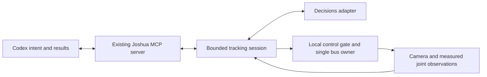

# Codex-driven Decisions camera-head demo

Status: proposed design, 2026-11-14. This document implements no runtime or MCP
control capability and establishes no physical qualification.

## Principles and outcome

Deliver one prompt-driven workflow on one qualified STS3215 camera head:
**"Connect to the head and follow the red target for 20 seconds."**
Reuse Joshua's protobuf configuration, inference plug-ins, ROS interfaces,
launcher, and hardware owner. MCP exposes bounded tasks and measured results;
the local runtime owns timing, limits, enable, stop, and recovery. Decisions
requests run asynchronously outside the conversational LLM/MCP loop.

Keep the first release on one Ubuntu host with local stdio MCP, configuration A,
one camera, and one servo. Defer microphone input, training, simulators, A/B
hardware comparisons, arbitrary ROS publishing, and additional device families.
The shared [Decisions demo](../../../doc/OPENAI_DECISIONS_CAMERA_HEAD_DEMO.md)
still owns D0-D4; this delivery targets D1/D2 and the actual Codex workflow,
not every conference, R2S2R, or mixed-rig gate.

## User experience

1. Prepare and register the existing server once using the
   [local setup](../../MCP_SETUP.md). The operator connects and powers the rig
   and brings its qualified runtime to disabled standby through the existing
   launcher. MCP connection alone never launches or enables hardware. Missing
   setup produces an actionable explanation, not an installation or launch retry.
2. From Codex, select the configured head and inspect its task capabilities,
   camera image, measured angle, health, and sample ages. Distinguish configured
   support, observed connectivity, and physical readiness. Missing evidence stays
   unknown and prevents admission when the task requires it.
3. Preview the resolved target, duration, angular/speed limits, target-loss and
   API-failure behavior, and request/spend limits. Bind this immutable preview to
   the run, config, calibration, and selected command source.
4. Obtain explicit readiness confirmation and approval from the responsible
   human through a verified client/operator channel. The backend validates an
   expiring, single-use grant for that preview and consumes it atomically with
   session admission. A model-supplied readiness flag or automatic tool approval
   is not authorization. Changed plans and restarts require a new preview/grant.
5. Start returns a run ID promptly. Codex reads bounded progress while the turn
   is active and reports the terminal result. The local runtime performs the
   repeated image -> Decisions -> bounded movement -> measured feedback loop.
   No conversational turn is required for each image or movement.
6. Stop remains available locally without Codex or the API. Reconnecting reads
   the existing run by ID; it does not resubmit, replay, or re-enable it. A chat/MCP
   disconnect cannot extend the approved duration: the backend completes or
   faults the bounded run under its local policy and retains its result.

The Codex-only run gate requires testing real human confirmation in the chosen
Codex client. MCP form elicitation is a candidate, not assumed proof of support.
If it cannot establish direct human approval, motion remains unavailable through
that client. Local confirmation can support bench development but does not close
the Codex-only gate. Client trust prompts remain governed by client policy.

## Ownership and execution

The backend owns goal admission, run identity/state, deadlines, cancellation,
results, and recording. MCP adapts that tested contract; it creates no parallel
runtime state machine, process manager, or device owner. Use ROS goal, feedback,
result, and cancellation semantics; select the smallest supported wire binding
in the backend change rather than introducing a generic job platform.

Admission atomically reserves one active motion session per head. Reject
overlapping starts and retain ownership through termination and command-authority
revocation. Retrying the same admitted preview returns its existing run ID, not a
second run. Operator takeover revokes the session's authority before another
source can command the head.

Extend the existing inference host only where necessary for asynchronous work,
identified observation snapshots, and named SI commands. Keep SDK dependencies
and answer validation in a ROS-free Decisions plug-in. Keep target questions,
image preprocessing, calibrated mapping, and operational bounds in protobuf
configuration/referenced artifacts. Preserve existing adapters.

Maintain one request in flight and one latest pending snapshot. Preserve sample
identity, receipt/acquisition times where available, clock domains, and alignment
quality. Check the originating snapshot's age/skew, movement since observation,
session state/deadline, and run/config/source generation before the request,
again when accepting its response, and at command handoff to the control owner.
Stop/invalidation fences both queued work and in-flight responses; the final
admission check and authority revocation must be ordered so an old response
cannot cross that boundary. Consume an observation at most once; invalidate
pending work on stop, source/config change, or restart. A fresh command timestamp
must not conceal stale source evidence.

Each accepted left/right result produces one calibrated increment from fresh
measured position. Centered, absent, uncertain, refused, invalid, or expired
answers produce no new tracking increment. Define bounded hold/stop and command
lease behavior while requests wait; never repeatedly apply an old increment or
renew expired observation authority. API recovery cannot enable an actuator.
Cancellation acceptance and device acknowledgments are distinct from a measured
physical stop. Unknown acquisition timing remains explicit; qualify capture
buffering/timing limits rather than treating an MCP JPEG's receipt age as proof.

## Delivery: two implementation PRs

Finish existing [#145](https://github.com/Joshua-AI-Robotics/Joshua/pull/145)
and [#150](https://github.com/Joshua-AI-Robotics/Joshua/pull/150), then deliver the
two changes below. #149 merged into #145's branch, not `develop`; reconcile the
actual merged tree rather than implementing its fixes again. Use
[milestone #153](https://github.com/Joshua-AI-Robotics/Joshua/issues/153) for shared
head qualification and [#151](https://github.com/Joshua-AI-Robotics/Joshua/pull/151)
for the proposed policy contract. Combine its necessary P1-P3 work in the first
implementation PR; P4-P9 are deferred. Retain a small non-head replay fixture for
the reusable adapter without requiring a general policy/simulator framework.

#153 is an integration/qualification checklist, not another implementation PR.
#145 supplies shared ownership, lifecycle, health, and timing primitives. PR 1
owns the remaining head preset/calibration, integration, session supervision,
recording/operator view, and authorized physical qualification required by #153.
Track these against that issue; qualification cannot be assumed from merging
#145, and physical API trials wait for the applicable head checks.

| Change | Scope and likely areas | Completion evidence |
| --- | --- | --- |
| 1. Bounded Decisions tracking | Head preset/calibration references in `config/`; minimum host/contracts in `ai/inference/`; Decisions plug-in in `ai/models/`; named ROS command binding; session preview/admission/status/cancel/result and recordings. Reuse #145's control owner and existing recorder. | Deterministic replay and production ROS integration work without credentials/hardware. A separately authorized configuration-A run establishes calibrated tracking, target loss, stop/failure behavior, measured response, timing, and usage. |
| 2. Codex/MCP operation | Extend `tools/mcp/` with capability discovery, preview, approved start, run status/results, and stop. Adapt head feedback from the shared bus runtime; the current observer assumes `POSITION_PUBLISHER`. Reuse #150's camera reader and existing setup/skill guidance. Keep inspection read-only by default; enable control only for the configured, qualified task. | Actual MCP SDK and chosen Codex client demonstrate the complete prompt, direct human approval, measured result, cancellation, denial/fault, disconnect, and reconnect sequence. |

Each implementation PR carries its tests and affected usage docs. The design
draft may become the first implementation PR after design approval; no extra
plan-only merge, adapter-only scaffolding PR, new server, or setup framework is
required. Stack this draft on #150's `donegjookim/mcp-camera` branch. After the
parent merges, replay this change onto `develop`, retarget, and rerun checks;
the backend requires reconciled #145 interfaces and completes the head-specific
#153 integration/qualification within PR 1.

## Acceptance and implementation order

1. Reconcile the merged foundation; pin the exact rig, config, calibration, and
   runtime revision. Freeze D0 step/deadband, freshness/skew/motion bounds, cadence,
   API deadline/retry/spend budgets, duration, local lease/fault policy, and trial
   criteria against measured hardware behavior before physical acceptance.
   Probe the chosen Codex client's direct human-confirmation path early with a
   harmless request, as part of PR 2's design validation; do not discover an
   unsupported or automatically accepted flow only at the hardware rehearsal.
2. Use controlled clocks and deterministic/captured answers to cover malformed,
   refused, nonfinite, low-confidence, stale/duplicate, wrong-generation, delayed,
   out-of-order, outage, and shutdown cases. Verify no motion after stop and no
   duplicate execution after a lost response/start retry. Retain a run ID and
   terminal result across MCP reconnect within the documented retention window.
   Include concurrent starts, takeover, stale-on-return answers, deadline expiry
   between acceptance and handoff, and stop-versus-command admission races.
3. Exercise real ROS and MCP SDK boundaries on Humble and Jazzy. Preserve named
   joints/units, independent ingestion/recording/stop under slow inference, source
   changes, missing feedback, and truthful unknown/partial results. Include denied,
   expired, reused, or changed-preview approval grants and actual client refusal.
4. Record authorized hardware trials and an actual Codex rehearsal: the red target
   is tracked within frozen limits for the approved interval; target loss, operator
   stop, API failure, and late replies follow the qualified policy. Preserve all
   attempts and compare requested commands with measured response. Publish a
   reproducible runbook, pinned API/prompt/preprocessing identities, usage, and a
   labeled recorded fallback. Hardware follows [AGENTS.md](../../../AGENTS.md).

A valid preset, green CI, or accepted ROS command does not close physical or
chosen-client acceptance. This document records a plan, not a completed demo.

## Research basis

- [Codex MCP configuration](https://learn.chatgpt.com/docs/extend/mcp?surface=cli):
  configured local stdio servers, discovery, server instructions, and tool policies.
- [Codex client interaction](https://learn.chatgpt.com/docs/app-server) and
  [MCP elicitation](https://modelcontextprotocol.io/specification/2025-11-25/client/elicitation):
  human input is a negotiated client capability that must be verified.
- [MCP tools](https://modelcontextprotocol.io/specification/2025-11-25/server/tools):
  explicit schemas, observable tool use, and human control; annotations are hints.
- [ROS 2 actions](https://design.ros2.org/articles/actions.html): goal, feedback,
  result, and cancellation semantics for bounded asynchronous work.
- [Reviewable changes](https://google.github.io/eng-practices/review/developer/small-cls.html):
  self-contained changes with their actual usage and tests.
