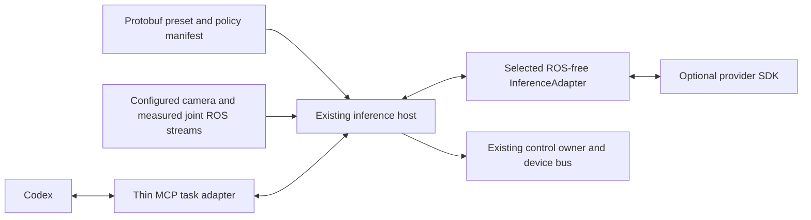

# Pluggable decision inference in Joshua

Status: proposed architecture, 2026-11-15; no new interface is implemented here.
This document defines the reusable boundary. The camera-head demo is its first
consumer; the existing [Decisions demo](../../../doc/OPENAI_DECISIONS_CAMERA_HEAD_DEMO.md)
retains its qualification gates. This narrows the initial delivery of
[#151](https://github.com/Joshua-AI-Robotics/Joshua/pull/151), rather than creating
a competing policy framework or a separate demo specification.

## Principles and decision

Use the existing `InferenceAdapter` and manifest registry as the policy extension
point. OpenAI Decisions is one ROS-free implementation. A compatible local
controller or another API-backed policy can replace it through configuration
without editing MCP, drivers or the shared host for provider-specific behavior.
A new provider or policy still needs its own plug-in, schema/manifest/build
registration and qualification; this is not an arbitrary-model compatibility claim.

Keep one owner for each lifecycle and source of truth. The inference host owns
ROS and scheduling; plug-ins own inference and action decoding; the existing
control owner admits physical commands. Static setup remains protobuf.
Use focused helpers inside those owners. Do not introduce a new decision
service, registry, message bus or generic node hierarchy for this demo.

## Basis in code and earlier feedback

On the pinned camera-parent baseline (`753848ce`):

| Existing component | Established boundary and present gap |
| --- | --- |
| [InferenceAdapter](../../../ai/inference/adapter.py) | ROS-free lifecycle and observation/tick hooks already encapsulate preprocessing, inference and postprocessing. |
| [Runtime types](../../../ai/inference/types.py) and [AdapterSpec](../../../ai/inference/proto/inference.proto) | Inputs carry a channel and host receipt time; outputs are publisher-index/scalar commands. Named semantics, correlation, validity and reset are missing. |
| [InferenceHost](../../../ai/inference/host.py) | Owns ROS decoding and publication; invokes adapters synchronously in callbacks and only publishes FLOAT32. Slow API work, named SI output and command admission require extension. |
| [Registry](../../../ai/models/registry.py), [manifest loader](../../../ai/inference/manifest.py), [model catalog](../../../ai/proto/ai_model.proto) | Select configured implementations without provider branches in the host. Existing per-model environments isolate SDK dependencies. |

Earlier review establishes the direction: [#93](https://github.com/Joshua-AI-Robotics/Joshua/pull/93#discussion_r4112730170)
requires protobuf authority and tested subsystem operations before shared tools;
[#150](https://github.com/Joshua-AI-Robotics/Joshua/pull/150#pullrequestreview-5887076039)
requests native ROS access instead of per-node MCP pipelines;
[#145](https://github.com/Joshua-AI-Robotics/Joshua/pull/145#pullrequestreview-5887228322)
rejects generic wrappers that obscure meaningful component ownership.
Open [#160](https://github.com/Joshua-AI-Robotics/Joshua/pull/160) and
[#164](https://github.com/Joshua-AI-Robotics/Joshua/blob/422a9b067d588ebe6f86416841aaeb2ae1eba074/docs/CODING_GUIDELINES.md)
describe minimal layers, traceable execution and reuse of ROS capabilities.
Those proposals and #151 are design evidence, not claims of merged support.

Three placements were considered: extend the existing plug-in boundary
(recommended; one shared contract), introduce a separate decision service
(adds lifecycle/transport without a demonstrated need), or put provider calls
in MCP (couples tool availability to the control loop and duplicates runtime
semantics). The existing boundary already solves provider encapsulation.

## Data flow and ownership

| Owner | Responsibility |
| --- | --- |
| Inference host under `ai/inference/` | Task/session state, bounded observation assembly, one scheduler, request identity, asynchronous work, deadlines, result admission and ROS binding. Share focused internal helpers rather than adding another runtime owner. |
| Plug-in under `ai/models/<policy>/` | Model/API calls, preprocessing, answer validation, policy state and action decoding. The Decisions plug-in converts accepted choices to calibrated named SI commands using configured mapping. No ROS, device access, enable or stop authority. |
| Existing control owner | Exclusive source, limits, command lifetime, enable/stop/recovery and bus ownership. Retains final authority at command handoff. |
| MCP tooling | Discover and adapt tested backend task operations through ROS interfaces; read camera/feedback/results. Owns no inference scheduler, provider SDK, alternate decoder or device lifecycle. |

The colleague owns the inference implementation and minimum shared extension.
Our integration adds missing task/head/MCP operations around that contract and
reuses upstream operations where present. Agree this division before editing
shared host files. Do not use MCP image polling as the inference input scheduler.
Keep driver and ROS sensor-node behavior in their existing owners.

## Minimum provider-independent contract

Extend the existing adapter/spec/types with an explicitly versioned, opt-in
contract, consistent with #151. Preserve the existing unversioned adapters and
their timestamp/normalization semantics. Agree exact fields with the colleague;
these are semantic requirements, not a new API already exposed.

- **Requirements:** logical input names/types, units/frames, bounded image shape,
  required measured state, joint names, supported output mode and timing bounds.
  Start with named absolute joint positions in SI units.
- **Input snapshot:** immutable decoded samples with individual source/sample
  IDs, available acquisition and receipt times/clock domains, validity, and
  request/session/config/policy/source generation. A group is not assumed
  simultaneous; unknown acquisition timing remains explicit.
- **Result:** originating request/snapshot/generation, explicit no-action/failure
  outcomes or finite named SI commands, and bounded validity. Provider response
  objects, choice labels and vendor errors remain private to the plug-in.
- **Lifecycle:** declare/bind, initialize, infer, reset/invalidate and close;
  optional asynchronous execution only where needed. Keep legacy hooks through
  an explicit compatibility path, without forcing chunking or simulators.

The Decisions plug-in owns question/prompt construction, SDK configuration,
response validation and configured choice-to-pan conversion exactly once.
Its output satisfies the same motor contract as a local controller; do not add
a universal left/right/center interface or another converter framework.
SDK clients can be replaced by test doubles inside the plug-in; a second
provider registry or a second abstract base class is unnecessary for this scope.

Reuse protobuf `SingleModel`/`ModelType`, per-policy config, manifest and dependency
locks. Expose only configured, compatible policy references to MCP. Keep shared
static checks at `config::ValidateConfig` in `config/validation.cc`; runtime
capability, sample and command admission checks remain with their owners.
Declarations must be inspectable without importing an SDK or opening hardware.

## Asynchronous execution and bounded authority

Extend scheduling once in the shared host; every later compatible provider uses
it. Maintain one in-flight request and one latest pending snapshot per session.
Keep ingestion, health and stop schedulable while inference waits. SDK/network
timeouts are configured inside the plug-in, but the shared task deadline and
admission checks remain effective if a call ignores cancellation. Bound worker
shutdown; use process isolation if the implementation cannot bound a blocking
call's lifetime. Do not create unbounded abandoned workers.

Use monotonic task and request deadlines. A request deadline cannot exceed
remaining task time or applicable observation-validity bounds; retries cannot
extend either approved duration or usage budgets. Timeout revokes tracking
authority and applies the qualified local hold/stop policy; it never re-enables
the actuator. Physical stop is measured separately from cancellation acceptance.

Check source age/skew, motion since observation, deadline/state and generations
before dispatch, on response, and at command handoff. Fresh command timestamps
cannot conceal stale evidence. Consume each observation at most once.
Centered/absent/uncertain/refused/invalid/expired answers create no new increment.
Waiting may use only the qualified bounded hold/lease behavior, never repeatedly
apply an old increment or renew expired observation authority.

Atomically admit one active task per head with a single-use human grant; retries
return the admitted run ID. Hold ownership until termination and authority
revocation. Stop/takeover/config or policy change invalidates queued/in-flight
work; order final admission and revocation so old responses cannot cross.
The contract needs identity/lifetime preserved to that boundary; choose the
smallest supported ROS binding instead of assuming bare FLOAT32 or JointState
preserves all metadata. Reuse [ROS goal/feedback/result/cancel semantics](https://design.ros2.org/articles/actions.html)
without requiring a generic job platform.

## First consumer and delivery dependency

For the first consumer, Codex requests a bounded camera-head task, such as
following the red target for 20 seconds. The operator prepares the qualified
runtime in disabled standby using the existing launcher; MCP connects to that
runtime. Preview the configured policy, goal/duration, total timeout, limits and
failure/request budgets before direct human readiness confirmation and approval.
Verify that channel in the actual chosen Codex client; model-supplied readiness
or automatic tool approval cannot establish authorization. Unsupported flows
leave motion unavailable. Start returns a run ID promptly; reconnect reads it
without replay, automatic enable or duration extension. A disconnected run
remains bounded by its original backend policy and deadline.

An unmet goal at the deadline returns `timed_out` with partial results and measured
stop status; retrying cannot pursue it indefinitely. For a duration-based follow
task, finishing the approved interval is normal completion when its criteria
hold, not proof of exact-angle convergence.

The colleague's inference implementation is a required upstream dependency.
#151 describes a plan, not that implementation; identify the actual PR and
agree the common contract before integration. Mocks allow parallel work, not
live-demo acceptance. Our scope is the head/task/MCP integration around that
implementation, not another inference implementation. Target one integration
PR on our side plus the colleague's upstream contribution; the total depends
on its actual scope.

The draft is currently stacked on camera
[#150](https://github.com/Joshua-AI-Robotics/Joshua/pull/150); that Git base does
not satisfy the inference dependency. Once its PR is identified, stack integration
on it while open, or replay/retarget onto `develop` after dependencies merge.
Reconcile shared control [#145](https://github.com/Joshua-AI-Robotics/Joshua/pull/145)
and camera #150; #149 merged into #145's branch, not `develop`.
Track remaining head calibration, shared-bus feedback binding, recording/operator
guidance and authorized qualification in
[#153](https://github.com/Joshua-AI-Robotics/Joshua/issues/153).
Reuse established recording facilities. Neither a merged foundation nor an
accepted command proves physical readiness or measured stop.

## Replacing a policy and proving reuse

Initially select a policy between runs: stop, revoke authority, close/reset,
validate the replacement's declared inputs/outputs and calibration, then obtain
a new preview and approval. In-run hot swapping and automatic failover are
deferred. A compatible replacement changes the preset's registered policy and
its artifacts; a different observation/action meaning requires explicit binding
or contract work and renewed qualification.

Prove the boundary with Decisions replay plus a small deterministic alternative
plug-in/test fixture using the same head contract. Exercise both through the
same host admission and task/MCP operations without provider-specific branches.
No second live API subscription or full local-model migration is required.
Verify legacy adapters, timeout/blocked inference, stale/generation/stop races,
restarts, units and bounds. Run real ROS/MCP integration and separate authorized
hardware/client acceptance against the existing demo gates. A fake proves
contract reuse, not tracking quality.

Keep future local models, new providers, action chunks and simulator bridges
behind demonstrated requirements. Do not delay the first demo for a general
policy framework or declare broader policy/hardware compatibility from one rig.
